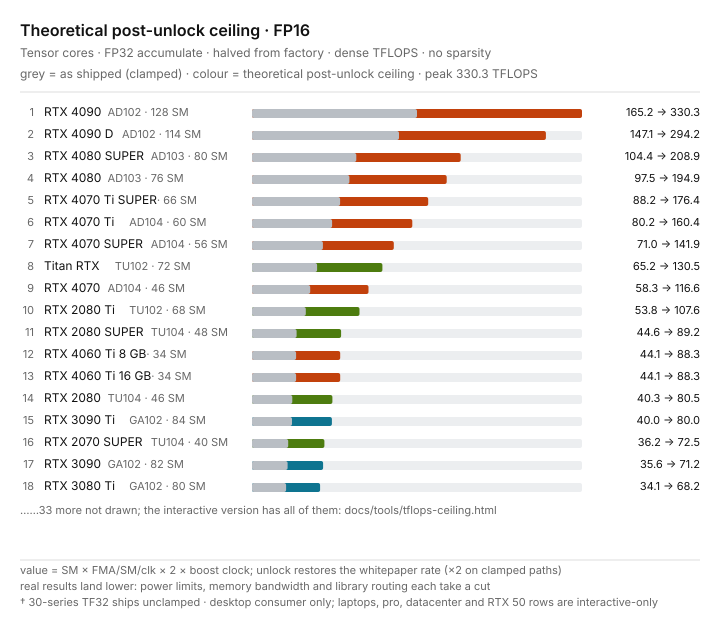
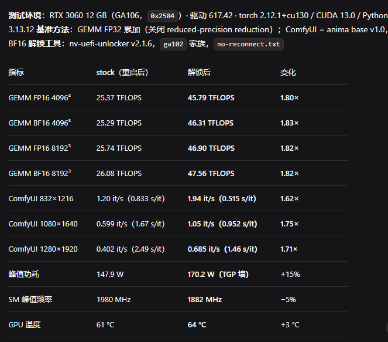
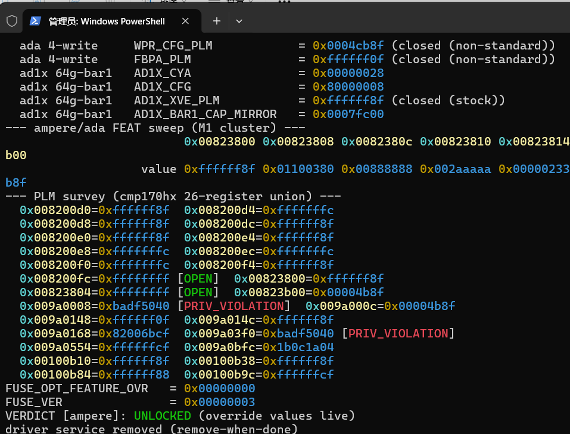
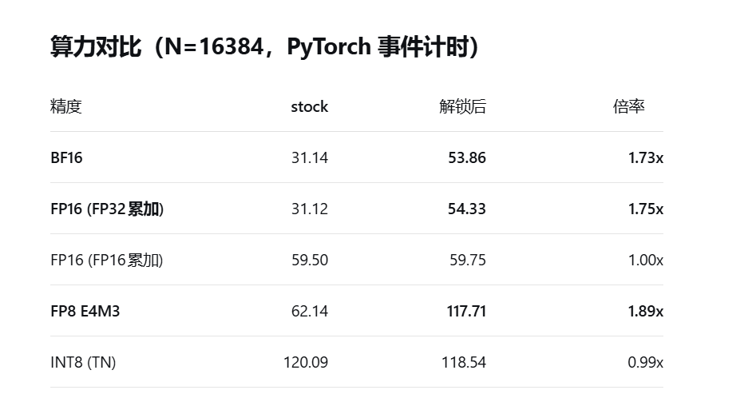
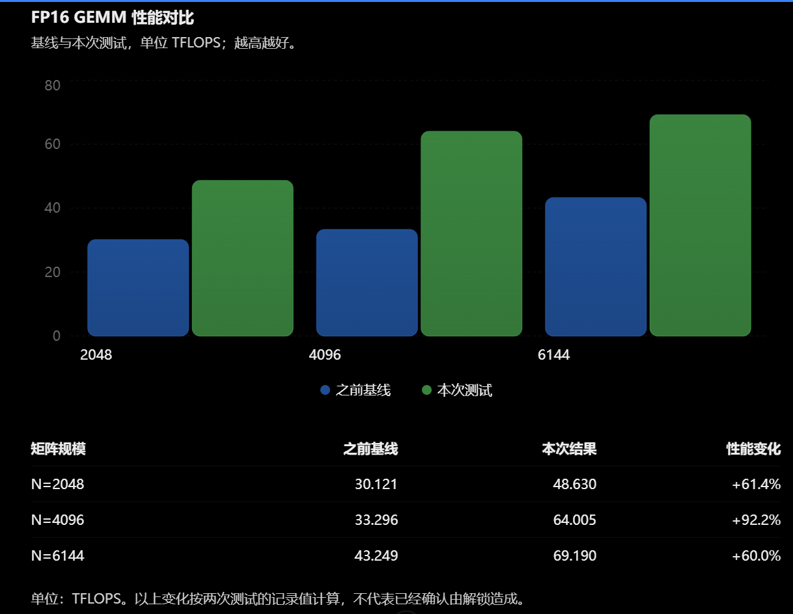

# nv-uefi-unlocker

[中文](README.md) | [English](README.en.md)

**Your GeForce runs AI at half speed — this fixes it before the driver even loads.**

[](https://github.com/physicsdolphin/nv-uefi-unlocker/releases/latest)
[](docs/compatibility.en.md)
[](docs/faq.en.md)
[](LICENSE)
[](https://github.com/physicsdolphin/nv-uefi-unlocker/stargazers)

**Measured up to ~2.6× FP16 / BF16 / TF32 tensor throughput · FP8 up to ~1.9× · +14–75% image / video generation · up to +94% DirectML inference kernels · LLM inference prefill up to +19% (decode +5%) · no VBIOS flashing, cleared by power-off** (per-board data in the [compatibility matrix](docs/compatibility.en.md); gains are bounded by power limits and precision paths — the LLM row is a dual-GPU MoE end-to-end measurement, not a microbenchmark extrapolation)

[](https://physicsdolphin.github.io/nv-uefi-unlocker/tools/tflops-ceiling.html)

*Theoretical post-unlock ceiling chart (FP16 · desktop) — [open the interactive version](https://physicsdolphin.github.io/nv-uefi-unlocker/tools/tflops-ceiling.html): five precision tabs (FP32/TF32/FP16/BF16/FP8), the full RTX 20/30/40 desktop + laptop lineup, a toggle for as-shipped values; [`?k=fp8`](https://physicsdolphin.github.io/nv-uefi-unlocker/tools/tflops-ceiling.html?k=fp8) deep-links a precision. This is a theoretical yardstick and differs from the measured figures above; see [the theoretical uplift analysis](docs/theoretical-uplift.md).*

A UEFI pre-driver NVIDIA GPU unlocker for the GTX 16 and RTX 20, 30, and 40 series.

Unlock your NVIDIA GPU’s Tensor compute performance. Boot from a USB stick, unlock, and continue into Windows or Linux. No VBIOS flashing is needed; powering off clears the unlock.

[Watch the project trailer ↗](https://www.bilibili.com/video/BV1d6xN66ECM/) (Simplified Chinese)
[Official videos: tool overview ↗](https://www.youtube.com/watch?v=y11Pluqoqhg) · [full unedited walkthrough ↗](https://www.youtube.com/watch?v=hrw1KBTM1EQ)

## Compatibility at a glance

| Series | Support |
| --- | --- |
| GTX 16 · Turing | Theoretically compatible; field tests welcome |
| RTX 20 · Turing | Fully compatible; some models have known issues listed in the full matrix |
| RTX 30 · Ampere GA10x | Fully compatible |
| RTX 40 · Ada | Fully compatible on laptops and desktops |
| Pascal and older / GA100 / RTX 50 | Unsupported |

## Community success reports and reproductions

The **hardware/model groups** below let you scan straight for your own card name and see whether a success precedent exists (you may not know the PCI ID or chip codename up front!). Sources are partly the [video comment section](https://www.bilibili.com/video/BV1d6xN66ECM/), partly the [community validation archive](docs/community-reports.md); the comment-section portion consists of viewer reports. Where a model has several reports, the most informative one is kept. Current support and known limitations remain in the full [compatibility matrix](docs/compatibility.en.md).

The table distinguishes before/after measurements, post-unlock-only screenshots and text-only reports. Benchmark gains are not application gains; reports involving overclocking or different power settings are marked accordingly.

| Reported hardware | Community report / conditions | Sources |
| --- | --- | --- |
| RTX 2050 Laptop 4GB | Full EFI chain passes and Windows-side ssdiag reports UNLOCKED (PLM open, SS overrides live); preliminary PyTorch peaks FP16 25.13 / BF16 25.33 TFLOPS, no strict locked-state A/B yet | [#142](https://github.com/physicsdolphin/nv-uefi-unlocker/issues/142) |
| RTX 2060 12GB | Passes after the fix; six single-variable rounds and offline PROM analysis placed staging exactly on the 4 GiB boundary (no performance numbers) | [#89](https://github.com/physicsdolphin/nv-uefi-unlocker/issues/89) |
| RTX 2060 Super 8GB | Full chain passes: FWSEC → WPR2 → BOOT_DIRECT → PLM open → SS0/SS1 readback; signatures restored and Windows handoff normal | [#12](https://github.com/physicsdolphin/nv-uefi-unlocker/issues/12) |
| RTX 2070 Laptop 8GB | Passes on v2.1.3; first Turing laptop success, and its cross-chip signature drove the >4G allocation fix (no performance numbers) | [#16](https://github.com/physicsdolphin/nv-uefi-unlocker/issues/16) |
| RTX 2070 8GB (developer's own test) | Full chain passes (FWSEC → BOOT_DIRECT booter → PLM open → SS0/SS1 readback); FP32-accumulate GEMM 36 → 60–63 TFLOPS (+67–75%), GSP mode required | [final result](docs/evidence/m3-tu106/host-and-final-result.md) |
| RTX 2080 8GB | Passes after the v2.1.8 fix; reporter pinned 0x91 with eight single-variable rounds and a bitwise diff against a working machine (no performance numbers) | [#62](https://github.com/physicsdolphin/nv-uefi-unlocker/issues/62) |
| RTX 2080 Super 8GB | Retest passes after the 0x91 fix: 46 → 68 TFLOPS (+47.8%); first success in that fix chain | [#14](https://github.com/physicsdolphin/nv-uefi-unlocker/issues/14) |
| RTX 2080 Ti | Exact A/B on one card: FP16 (FP32 accumulate) sustained 58.70 → 94.97 TFLOPS (+62%), FLOP/clk ×1.80, 60 s soak with 30,287 GEMMs and zero stalls, no TDR/WHEA; FP32/INT8/bandwidth unchanged (300 W cap, GSP on). A separate stock 11GB run survives into the proprietary Linux driver at 60.31 → 89.57 TFLOPS; H3 gain is not obvious | [#125](https://github.com/physicsdolphin/nv-uefi-unlocker/issues/125) · [#103](https://github.com/physicsdolphin/nv-uefi-unlocker/issues/103) · [S41](https://www.bilibili.com/video/BV1d6xN66ECM/?comment_on=1&comment_root_id=318838634673&comment_secondary_id=318838634673) |
| RTX 2080 Ti 22GB mod | Reports success on the final attempt; no performance comparison | [S33](https://www.bilibili.com/video/BV1d6xN66ECM/?comment_on=1&comment_root_id=322063070336&comment_secondary_id=322417003552) |
| RTX 3060 12GB | FP16 25.37 → 45.79 TFLOPS; Anima generation 1.20 → 1.94 it/s | [S30](https://www.bilibili.com/video/BV1d6xN66ECM/?comment_on=1&comment_root_id=318661261937&comment_secondary_id=318661261937) · [screenshots](docs/community-success.md#s30) |
| RTX 3060 Ti LHR | v2.1.0 full chain passes: PLM `0xffffff8f` → `0xffffffff` flip readback (~149 ms), SS0/SS1 readback, Windows handoff normal; Inno3D Ice Dragon VBIOS cross-flashed (no performance numbers) | [#11](https://github.com/physicsdolphin/nv-uefi-unlocker/issues/11) |
| RTX 3070 8GB (desktop) | USB-boot unlock succeeds, diag confirms it and generation time drops 50%; after system sleep (S4) diag reports not_unlocked and generation time returns. Another v0.2.0 record on the same model reaches the full EFI chain and keeps selectors across FLR, but the state is not retained after entering Windows | [Discussion #129](https://github.com/physicsdolphin/nv-uefi-unlocker/discussions/129) · [#54](https://github.com/physicsdolphin/nv-uefi-unlocker/issues/54) |
| RTX 3070 Laptop 8GB | FP16 42.05 → 82.06 TFLOPS; 150W VBIOS and overclocked setup | [S12](https://www.bilibili.com/video/BV1d6xN66ECM/?comment_on=1&comment_root_id=318487921761&comment_secondary_id=318487921761) · [screenshots](docs/community-success.md#s12) |
| RTX 3070 Ti Laptop | WMMA FP16 45.51 → 88.84 TFLOPS; cuBLAS FP16 largely unchanged | [S36](https://www.bilibili.com/video/BV1d6xN66ECM/?comment_on=1&comment_root_id=322484248128&comment_secondary_id=322484248128) |
| RTX 3080 10GB | OS-side UNLOCKED; FP16 53.91 → 84.60 TFLOPS | [S28](https://www.bilibili.com/video/BV1d6xN66ECM/?comment_on=1&comment_root_id=322392362704&comment_secondary_id=322392362704) · [screenshots](docs/community-success.md#s28) |
| RTX 3080 12G LHR | ComfyUI video generation 800 s → under 500 s (ID not stated) | [community archive](docs/community-reports.md) |
| RTX 3080 20G | BF16 GEMM 65 → 110–113 (three runs: 110.11/113.01/113.19, 275 W power cap); with models resident in VRAM, qwen2.1 BF16 193.7 → 92.9 s and krea2pornV4 42 → 31.5 s | [community archive](docs/community-reports.md) |
| RTX 3080 Laptop | Reports success and ~33% higher BF16; no absolute before/after values | [S18](https://www.bilibili.com/video/BV1d6xN66ECM/?comment_on=1&comment_root_id=318503929089&comment_secondary_id=318523189905) |
| RTX 3080 Ti Laptop | v2.1.0 success report; another reports BF16 45 → 72 TFLOPS with overclocking also mentioned | [S04](https://www.bilibili.com/video/BV1d6xN66ECM/?comment_on=1&comment_root_id=322101380288&comment_secondary_id=322138152256) · [S09](https://www.bilibili.com/video/BV1d6xN66ECM/?comment_on=1&comment_root_id=322187811968&comment_secondary_id=322187811968) |
| RTX 3080 Ti 20G (native Tongde) | Unlock succeeds; device ID/VBIOS pending (native Tongde is not necessarily ES — could be a repaired card or ES bare die; no performance numbers) | [community archive](docs/community-reports.md) |
| RTX 3080 Ti (form factor unspecified) | Screenshot: FP16 73.9 → 123.2, unit unspecified; FP32 control largely unchanged | [S48](https://www.bilibili.com/video/BV1d6xN66ECM/?comment_on=1&comment_root_id=318960839137&comment_secondary_id=318960839137) · [screenshots](docs/community-success.md#s48) |
| RTX 3090 | Qwen-Image2.1 Turbo BF16: nearly 60 → 22 s/image (approximate baseline) | [S49](https://www.bilibili.com/video/BV1d6xN66ECM/?comment_on=1&comment_root_id=322473751376&comment_secondary_id=322473751376) |
| RTX 3090 20GB OEM (reporter label) | FP16 77.36 → 115.20 TFLOPS; reporter also notes unlock loss after sleep/resume | [S46](https://www.bilibili.com/video/BV1d6xN66ECM/?comment_on=1&comment_root_id=322654906480&comment_secondary_id=322654906480) · [screenshots](docs/community-success.md#s46) |
| RTX 3090 Ti | H3 INT8 workflow at the same 418.5W: total 123.47 → 108.08 s/item | [S25](https://www.bilibili.com/video/BV1d6xN66ECM/?comment_on=1&comment_root_id=322309028240&comment_secondary_id=322309028240) · [screenshots](docs/community-success.md#s25) |
| RTX 4050 Laptop 6GB | Success report; post-unlock FP16 39.15 TFLOPS only, with overclock settings | [S34](https://www.bilibili.com/video/BV1d6xN66ECM/?comment_on=1&comment_root_id=322434523792&comment_secondary_id=322434523792) · [screenshots](docs/community-success.md#s34) |
| RTX 4060 Laptop | Screenshot: FP16/FP32 accumulation 31.12 → 54.33 (unit unspecified); generation reports also available | [S01](https://www.bilibili.com/video/BV1d6xN66ECM/?comment_on=1&comment_root_id=318379087793&comment_secondary_id=318379087793) · [S16](https://www.bilibili.com/video/BV1d6xN66ECM/?comment_on=1&comment_root_id=318513166865&comment_secondary_id=318513166865) · [S42](https://www.bilibili.com/video/BV1d6xN66ECM/?comment_on=1&comment_root_id=322579294896&comment_secondary_id=322579294896) · [screenshots](docs/community-success.md#s16) |
| RTX 4060 Ti 8GB | First 8GB `2803` data point: readback passes (PLM open, SS0/SS1, READOUT_1=0); cuBLAS 4096³ medians FP16 45.59 → 77.36 (+69.7%), BF16 45.64 → 77.74 (+70.3%), TF32 20.06 → 41.91 (+108.9%), FP32 control at noise level | [PR #87](https://github.com/physicsdolphin/nv-uefi-unlocker/pull/87) |
| RTX 4060 Ti 16GB | Two reporters describe successful unlocks and faster generation, including ASUS B550M | [S05](https://www.bilibili.com/video/BV1d6xN66ECM/?comment_on=1&comment_root_id=318384860033&comment_secondary_id=318425336033) · [S50](https://www.bilibili.com/video/BV1d6xN66ECM/?comment_on=1&comment_root_id=318780355665&comment_secondary_id=318780355665) |
| RTX 4060 8GB (form factor unspecified) | MOSS Image, 1024×1536, 30 steps: ~240 → ~200 s | [S31](https://www.bilibili.com/video/BV1d6xN66ECM/?comment_on=1&comment_root_id=318678373665&comment_secondary_id=318678373665) |
| RTX 4070 Laptop | FP16 N=4096: 33.296 → 64.005 TFLOPS; another success report | [S21](https://www.bilibili.com/video/BV1d6xN66ECM/?comment_on=1&comment_root_id=322273213728&comment_secondary_id=322273213728) · [S39](https://www.bilibili.com/video/BV1d6xN66ECM/?comment_on=1&comment_root_id=322525434896&comment_secondary_id=322525434896) · [screenshots](docs/community-success.md#s21) |
| RTX 4070 desktop | FP16 61.99 → 76.32–87.82 TFLOPS (150W/200W conditions); generation 35 → 27 s | [S13](https://www.bilibili.com/video/BV1d6xN66ECM/?comment_on=1&comment_root_id=322202417520&comment_secondary_id=322202417520) · [screenshots](docs/community-success.md#s13) |
| RTX 4070 (form factor unspecified) | Pony 1024²: 11.1 → 9.0 s; Wan2.2 5B / 49 frames: 96 → 78.2 s | [S44](https://www.bilibili.com/video/BV1d6xN66ECM/?comment_on=1&comment_root_id=318864603793&comment_secondary_id=318864603793) |
| RTX 4070M mod | AD106 / 10de:2820; success after an update, FP16 40 → 70 (unit unspecified) | [S02](https://www.bilibili.com/video/BV1d6xN66ECM/?comment_on=1&comment_root_id=322092618224&comment_secondary_id=322120397328) |
| RTX 4070 SUPER | After the bridge BME fix, replay/unlock passes and marker, SS0/SS1 and post-FLR exit readbacks are correct; cuBLAS 8192 medians over seven runs: FP16→FP32 accumulate 70.5 → 100.1, BF16 71.0 → 107.0, TF32 35.5 → 48.4, while FP16 accumulate and FP32 SIMT controls stay flat (220 W) | [#3](https://github.com/physicsdolphin/nv-uefi-unlocker/issues/3#issuecomment-6434240012) |
| RTX 4070 Ti (ASUS TUF OC) | Local modified v2.1.9: full readback passes (POST-FLR verified, HANDOFF-OUT all correct); cuBLAS 8192³: FP16 80.35 → 137.97 (1.72×), BF16 80.44 → 144.13 (1.79×), FP32 control 1.01× | [Discussion #140](https://github.com/physicsdolphin/nv-uefi-unlocker/discussions/140) |
| RTX 4070 Ti SUPER | Includes an OS-side UNLOCKED screenshot; the 57.00 → 150.93 TFLOPS report also changed overclocking | [S07](https://www.bilibili.com/video/BV1d6xN66ECM/?comment_on=1&comment_root_id=318434036593&comment_secondary_id=318434036593) · [S10](https://www.bilibili.com/video/BV1d6xN66ECM/?comment_on=1&comment_root_id=322192703296&comment_secondary_id=322192703296) · [S23](https://www.bilibili.com/video/BV1d6xN66ECM/?comment_on=1&comment_root_id=318588984337&comment_secondary_id=318588984337) · [S51](https://www.bilibili.com/video/BV1d6xN66ECM/?comment_on=1&comment_root_id=318800216993&comment_secondary_id=318800216993) · [screenshots](docs/community-success.md#s23) |
| RTX 4080 Laptop | Reports FP16 ~57 → ~80 TFLOPS | [S08](https://www.bilibili.com/video/BV1d6xN66ECM/?comment_on=1&comment_root_id=318467714081&comment_secondary_id=318467714081) |
| RTX 4080 16GB | Cold boot passes first try: WPR2 → marker → PLM flip → four writes → selector readback → selectors survive AON after FLR → bootmgfw handoff; two independent A/Bs FP16 4096³ 100.53 → 185.50/185.24 (1.85×), BF16 4096³ 100.37 → 192.18/189.44 (1.91×), FP32 control unchanged (340 W cap) | [#53](https://github.com/physicsdolphin/nv-uefi-unlocker/issues/53) · [Discussion #72](https://github.com/physicsdolphin/nv-uefi-unlocker/discussions/72) |
| RTX 4080 SUPER | Reports success and ~1.85×; no application timing | [S24](https://www.bilibili.com/video/BV1d6xN66ECM/?comment_on=1&comment_root_id=318597571313&comment_secondary_id=318597571313) |
| RTX 4080 SUPER 32GB mod | Includes dual GPUs on TRX40; BF16 107.1 → 191.1, prefill +16.4%/+19.1%, decode +5.5% | [S11](https://www.bilibili.com/video/BV1d6xN66ECM/?comment_on=1&comment_root_id=318394280177&comment_secondary_id=318482856705) · [S32](https://www.bilibili.com/video/BV1d6xN66ECM/?comment_on=1&comment_root_id=318683830785&comment_secondary_id=318683830785) · [S43](https://www.bilibili.com/video/BV1d6xN66ECM/?comment_on=1&comment_root_id=322585313104&comment_secondary_id=322585313104) · [context with incomplete test conditions](docs/community-success.md#s32) |
| RTX 4090 | Screenshot: TF32 79.4 → 148.5 (unit unspecified); reporter also describes ~15–20% faster MOSS BF16 | [S40](https://www.bilibili.com/video/BV1d6xN66ECM/?comment_on=1&comment_root_id=322535665616&comment_secondary_id=322535665616) · [S45](https://www.bilibili.com/video/BV1d6xN66ECM/?comment_on=1&comment_root_id=322634742704&comment_secondary_id=322634742704) · [screenshots](docs/community-success.md#s45) |
| RTX 4090 Laptop (configuration screenshot label) | Later reports it works; model comes from their AI configuration screenshot, with no performance comparison | [S38](https://www.bilibili.com/video/BV1d6xN66ECM/?comment_on=1&comment_root_id=318796399937&comment_secondary_id=318815524849) |
| RTX 5060 Ti 16GB (as display primary) | Blackwell `2d04` has no asset-family mapping and is safely skipped in a dual-GPU machine while the system stays normal (the secondary 4060 Ti passes the full chain); **not an unlock of the 5060 Ti itself** | [#56](https://github.com/physicsdolphin/nv-uefi-unlocker/issues/56) |
| GTX 1080 Ti (negative control) | All three units in the same machine are correctly skipped; Pascal is outside the unlock target | [#69](https://github.com/physicsdolphin/nv-uefi-unlocker/issues/69) |
| Tesla V100-SXM2-16GB (negative control) | Excluded via `tx-select-bdf.txt` on a dual-GPU machine; the target card unlocks normally | [Discussion #140](https://github.com/physicsdolphin/nv-uefi-unlocker/discussions/140) |
| Quadro P600 (display secondary) | Used as display secondary in an X99 machine without iGPU and correctly skipped with zero writes (negative control); the target 3060 12GB unlocks normally | [Discussion #131](https://github.com/physicsdolphin/nv-uefi-unlocker/discussions/131) |
| Quadro RTX 5000 | Listed by the reporter as a follow-up plan, no measurement yet | [S01](https://www.bilibili.com/video/BV1d6xN66ECM/?comment_on=1&comment_root_id=318379087793&comment_secondary_id=318379087793) |

### Screenshot examples

Click an example for its source and conditions. [All 22 images from 15 reporters, with attribution and notes (Chinese)](docs/community-success.md) · [Source and SHA-256 index](docs/evidence/bilibili-2026-11-02/sources.json).

<table>
<tr>
<td align="center" valign="top" width="50%">
<b>RTX 3060 12GB</b><br>
<a href="docs/community-success.md#s30"></a><br>
<a href="docs/community-success.md#s30">original, source and conditions</a>
</td>
<td align="center" valign="top" width="50%">
<b>RTX 3080 10GB / UNLOCKED</b><br>
<a href="docs/community-success.md#s28"></a><br>
<a href="docs/community-success.md#s28">original, source and conditions</a>
</td>
</tr>
<tr>
<td align="center" valign="top" width="50%">
<b>RTX 4060 Laptop</b><br>
<a href="docs/community-success.md#s16"></a><br>
<a href="docs/community-success.md#s16">original, source and conditions</a>
</td>
<td align="center" valign="top" width="50%">
<b>RTX 4070 Laptop</b><br>
<a href="docs/community-success.md#s21"></a><br>
<a href="docs/community-success.md#s21">original, source and conditions</a>
</td>
</tr>
</table>

## Field cases

Beyond the matrix, these closed cases show the engineering depth behind the tool — each with full logs and an evidence chain:

- **Compute-class P8 lock from a modded VBIOS ([#90](https://github.com/physicsdolphin/nv-uefi-unlocker/issues/90))**: a 2080 Ti's EFI transaction was proven **successful at source level** by disassembling the booter to plain text — the real culprit behind the Windows-side black screen and low clocks was a kingpin-class extreme-testing BIOS flashed onto the card (special BIOS NVIDIA ships to OEM OC labs, with a separate P-state policy for compute workloads). The fingerprint: a `nvidia-smi` power reading far above the retail wall. Four misleading layers (a false-negative verdict line, a WHEA hardware red herring, clean stress tests, a shunt-resistance suspicion) were peeled one by one; the final blow came from years of hands-on card-modding experience recognizing that one number. → [full five-layer chain](docs/community-reports.en.md) · [mechanism open question](docs/open-questions.md)
- **The X99 + CSM handoff law ([#35](https://github.com/physicsdolphin/nv-uefi-unlocker/issues/35)/[#61](https://github.com/physicsdolphin/nv-uefi-unlocker/issues/61))**: "transaction green but Windows lands Code 12" survived four conclusion reversals before becoming the handoff console-ownership law — independent of the unlock, chip family and topology; CSM off fixes it. Later independently reproduced by an upstream (Zagitta) user on X99. → [the law](docs/faq.en.md#recovery)
- **Thunderbolt unlocks = low staging ([#74](https://github.com/physicsdolphin/nv-uefi-unlocker/issues/74))**: pinned down the ≥4 GiB DMA unreachability three-death shape on TB platforms with single-variable proof on two machines and two implementations, which made sub-4 GB staging the v2.1.8 default (zero counterexamples since). → [forensics matrix](docs/tu10x-booter-0x91-matrix.md)

Per-precision theoretical uplift (simple classification; for the mechanism derivation, per-generation SM diagrams, and the stressor tool reconciliation see [theoretical uplift](docs/theoretical-uplift.en.md)):

| Precision | Execution unit | Shipped clamp (RTX 20–40) | Ceiling |
| --- | --- | --- | --- |
| FP16 · BF16 · TF32 (FP32-accumulate tensor paths) | gen-2–4 Tensor Cores | shipped at half rate | **2×** |
| FP8 (E4M3/E5M2) | gen-4 Tensor Cores (SM89+) | shipped at half rate | **2×** |
| FP16 (FP16acc) / INT8 / INT16 / INT32 / FP32 / FP64 | Tensor Cores / CUDA cores / FP64 units | none (factory full-rate) | 1× |

Real-world multiples are bounded by power limits, memory bandwidth, and per-die binning (typically 1.5–2×, approaching 2× when clock-normalized); CMP mining cards are the exception (÷32 clamps across all paths, 32× ceiling).

[Full compatibility matrix and field results](docs/compatibility.en.md) (incl. 4090M 2757 / Alienware m18 R1 ~2x) · [FAQ](docs/faq.en.md)

## Get started

### 1. Get the tools and check prerequisites

Download and extract a package from [Releases](https://github.com/physicsdolphin/nv-uefi-unlocker/releases). NVIDIA firmware is not bundled; the setup script downloads the specified versions, verifies them and generates the required files.

Prepare a FAT32 USB stick and back up its files. The target must boot in UEFI mode, with Secure Boot disabled or a self-signed EFI certificate trusted. On laptops, prefer dGPU-only display mode and choose **Restart** in the OS before entering the one-time boot menu.

**Turing users: run this once in an administrator PowerShell on the target Windows machine, then restart:**

```powershell
.\enable-turing-unlock.ps1
```

After restarting, confirm that GSP firmware is running before making the stick. Linux Turing targets also need GSP-RM; see the [GSP prerequisite](docs/faq.en.md#turing). Linux users should also check [RTD3](docs/faq.en.md#linux) to prevent power loss from clearing the unlock after handoff.

### 2. Prepare the bootable USB stick

Run from the extracted package directory. Select `40` for the 40 series, `30` for the 30 series, or `20` for the 20 / 16 series.

Windows PowerShell:

```powershell
$gpuSeries = "40"
.\make-usbroot.ps1 -Family $gpuSeries
```

Linux / WSL / Git Bash:

```bash
gpu_series=40
bash make-usbroot.sh --family "$gpu_series"
```

Windows requires PowerShell 5+; the Linux binary requires glibc ≥ 2.34 (for example, Ubuntu 22.04+ / Debian 12+). Initial generation needs internet access. Resolve download or verification failures without substituting another firmware version.

Files are generated in the local `usbroot/` directory, which already contains `EFI/BOOT/BOOTX64.EFI`. Copy the **contents** of `usbroot/` to the stick root (do not copy the directory itself as `U:\usbroot\`). The other extraction intermediates do not need to be copied.

```text
USB stick (FAT32)
├── EFI/BOOT/BOOTX64.EFI
└── Firmware files (.bin files listed by the script)
```

Keep the generated `v67-*.bin` unlock file. [Full file list and purposes](docs/faq.en.md#usb).

Back up an existing `EFI/BOOT/BOOTX64.EFI` before replacing it. Do not copy into the system ESP or change the permanent boot order. See [USB files and options](docs/faq.en.md#usb) for file details, building on another host, GPU selection and advanced options.

### 3. Boot and verify

1. Select the USB stick in the firmware’s one-time boot menu.
2. Press **Space or Enter** at the version screen. Any other key or 30 seconds without input aborts the transaction and returns to the OS bootloader. A temporary black screen or frozen frame on the target GPU is expected.
3. Wait for the automatic OS handoff. The log is `loader.log` at the stick root.
4. On Windows, run the release’s `ssdiag-x86_64-windows.exe` to check the in-OS state, then compare performance using the same workload. On Linux, run `sudo python3 tools/diag-unlock.py` from a source checkout. See [verification and repair](docs/faq.en.md#ssdiag). Replay after each cold boot.

If picking the stick flashes and bounces back to the boot menu (or straight into the OS) with no `loader.log`, the EFI never executed - and nothing was written; usually `EFI/BOOT/BOOTX64.EFI` is missing or Secure Boot is still on. Work through [the no-boot checks](docs/faq.en.md#no-boot).

On STOP, a fault or a stuck black screen, **do not retry in the same session**. Fully power off, remove the stick and boot normally; follow the [recovery instructions](docs/faq.en.md#recovery).

For agent-assisted setup, use the [deployment guide](AGENTS.deploy.md). Copy this request:

> Follow https://github.com/physicsdolphin/nv-uefi-unlocker/blob/main/AGENTS.deploy.md to install nv-uefi-unlocker and set it up to unlock my GPU.

## Build from source (optional)

Skip this section if you use a release package. Install Rust; choose the MSVC toolchain on Windows. From the repository root:

```text
rustup target add x86_64-unknown-uefi
cargo build --release
cargo efi-tx
```

The EFI program is generated at `target/x86_64-unknown-uefi/release/loader.efi`. Prepare the boot files with the following commands (40-series example; use `-Family 30` for the 30 series or `-Family 20` for the 20 / 16 series):

```powershell
.\release\make-usbroot.ps1 -Family 40 -AssetsExe .\target\release\assets.exe -BootEfi .\target\x86_64-unknown-uefi\release\loader.efi
```

```bash
bash release/make-usbroot.sh --family 40 \
  --assets ./target/release/assets \
  --boot-efi ./target/x86_64-unknown-uefi/release/loader.efi
```

Then copy to the USB stick using the layout above. [Read-only diagnosis, tests and development notes](docs/faq.en.md#layout).

## Combine with nvoc

This tool unlocks Tensor compute performance. [nvoc](https://github.com/Skyworks-Neo/nvoc) provides in-OS power, voltage and overclocking controls; the two can be combined.

1. Unlock with this tool, verify the in-OS state and record a baseline.
2. Follow the [nvoc documentation](https://github.com/Skyworks-Neo/nvoc#readme) for controls supported by your GPU. The kmd power-wall unlock works on mobile GPUs; its performance effects on 10/20-series desktop cards remain unverified. `set-volt-rail-limit` voltage-wall control applies to 10-series and newer GPUs.
3. Compare the same workload with [cli-stressor-cuda-rs](https://github.com/Skyworks-Neo/nvoc/tree/main/cli-stressor-cuda-rs), monitoring power, Hot Spot and throttle reasons.

Combined operation can substantially exceed stock power and thermal envelopes; check cooling and power-delivery headroom. [Combined test results and risks](docs/faq.en.md#nvoc-results).

## About the author and team

The author is a long-time hardware-overclocking and GPU-modding enthusiast
who has overclocked, modded, serviced and operated several hundred NVIDIA
cards (mining and modded cards included), with years of experience across
laptop, desktop and server operations, hardware repair, UEFI BIOS modding
and hardware debugging.

This project is a student-run hobby research effort with the author's
classmates. Accordingly, every write path in the
tool is built on a "read-back verification + archived evidence" discipline;
recovery procedures for failure scenarios are documented under
[safety constraints](docs/faq.en.md#safety).

AI coding assistants were used during development. As with all code in
this repository, nothing they produced is trusted by default: the
transaction core is a behavior-level port of the upstream GPL-2.0
implementation, must pass the behavioral simulator before touching
hardware, and every release claim is backed by real-machine read-back —
the same rule for human- and AI-written code alike.

## References and repositories

This project is a direct beneficiary and derivative of community work;
full credits in [docs/credits.md](docs/credits.md) (verified against
each item's actual role in the repo history). The
repositories actually studied and cited during development are cloned
into a local, untracked `reference/` directory, grouped by role:

**Transaction-chain sources and first-hand authority**

- [gpu-unlock](https://github.com/Zagitta/gpu-unlock) (GPL-2.0) — the
  transaction-chain porting source; `unlock_610.c` read section by
  section, and the blueprint for this repo's mock tests
- [gpu-unlock-ada](https://github.com/JustAResearcher/gpu-unlock-ada)
  (GPL-2.0) — the AD10x four-write chain origin; the 28e1 report
  (Windroid234) is this project's direct basis and drove three verdict
  corrections here (FBPA `0xffffff0f` acceptance, non-fatal scrubber,
  EALREADY without FLR)
- [gpu-unlock-bar1](https://github.com/84634E1A607A/gpu-unlock-4090-48g-64g-bar1) —
  AD10x large-BAR1 reference line (not merged into the mainline)
- [cmp90hx-unlock](https://github.com/WildFlash1st/cmp90hx-unlock) — the
  V67 payload-chain origin
- [open-gpu-kernel-modules](https://github.com/NVIDIA/open-gpu-kernel-modules)
  (MIT) — first-hand authority on the boot path: all four Turing
  generational differences (BOOT_DIRECT, register-portal loading,
  RM_RISCV_UCODE_DESC v4, FWSEC generic-BL) were verified here and
  landed in the code
- [AD103_win_unlocker](https://huggingface.co/TOTORONG/AD103_win_unlocker)
  (TOTORONG) — the Windows EFI carrier-craft precedent (GOP
  disconnect/chain-load handoff/transaction-log conventions)

**Turing lineage and addressing (the 0x4096xx FEAT block)**

- [cmp170hx](https://github.com/Consensus-Protocol/cmp170hx) — PLM
  semantics, the booter 0x89/0x91 status-code dictionary and
  verification methodology
- [cmp50hx-unlock](https://github.com/xrip/cmp50hx-unlock) — the
  hardware-proven origin of the Turing lineage: 31.7× measured on 50HX
  (TU102); 40HX/50HX share the TU102 booter archive, which is the
  field evidence behind TU106 full-chain feasibility; also the source
  of the FEAT block `0x409650/64/6c` addressing
- [turing-unlock](https://github.com/nlzy/turing-unlock) (nlzy) — the
  official Turing adaptation of the Zagitta kmod (Dell 2080 Ti 22GB,
  ~1.6× FP16); source of the TU102 gadget/stack geometry tables and
  the GSP IDA database; the `TU_FEAT_READOUT 0x409668` citation source
  (ssdiag and the loader share this constant)
- [travis-mcdevitt/nv-uefi-unlocker](https://github.com/travis-mcdevitt/nv-uefi-unlocker) —
  a downstream fork of this project; its successful Turing chain logs
  feed the 0x91 forensics cross-check
- [tu102-22g-uefi-unlock](https://github.com/chenxluo/tu102-22g-uefi-unlock) —
  UEFI approach for TU102 22G modded cards (peer reference for the 22G
  support line)

**Prior Windows/UEFI work of the same kind**

- [rtx30-unlock](https://github.com/craftingmod/rtx30-unlock) — the
  Windows/UEFI port of the Zagitta kmod (GA10x predecessor)
- [rtx30-unlock-windows-toolkit](https://github.com/Siselea/rtx30-unlock-windows-toolkit) —
  companion toolkit for the above (single-GPU, single-display)
- [rtx3080-unlock-public](https://github.com/rough2515-hub/rtx3080-unlock-public) —
  earlier RTX 3080 10GB UEFI experiment (Korean)
- [KohakUnlock](https://github.com/KohakuBlueleaf/KohakUnlock) —
  source-first research covering the Turing lineage (boot-hook form)
  and a 4090 Windows/UEFI unlock
- [Turing-unlock](https://github.com/haohervchb/Turing-unlock) (haohervchb) —
  volatile unlock on a 2080 Ti (TU102), one successful physical run
  2026-10-22
- [nv_unlock_win](https://github.com/mirabarukaso/nv_unlock_win) —
  Titan RTX in-kernel Windows attempt (a different route to the same
  goal)
- [gpuunlock](https://github.com/miounet11/gpuunlock) — merged
  distribution for 4090 / 4070 Ti SUPER

**Register/fuse side lines**

- [ReBarUEFI](https://github.com/xCuri0/ReBarUEFI) (xCuri0, MIT) — the
  platform-side authority for ReBAR on RTX 30+ (enumeration-time hook +
  PCIe ReBAR extended capability) and the catalog of platform large-BAR
  limitation patches; [NvStrapsReBar](https://github.com/terminatorul/NvStrapsReBar)
  is its Turing fork — overturned this project's earlier "Turing BAR1 is
  not expandable" assumption; direct basis of the M1 sample PSTRAPS
  decoding
- [ga100-fuse-re](https://github.com/ahnguyen17/ga100-fuse-re) ·
  [gpcprobe](https://github.com/matstatman/gpcprobe) ·
  [170hx-rir-tool](https://github.com/lixiangwuxian/170hx-rir-tool) —
  GA100 fuse/RIR architecture (fuse-semantics reference line)
- [p104-gen2-unlock](https://github.com/skbskhud/p104-gen2-unlock) —
  P104 PCIe Gen2 link tool (PCI config-space operation reference,
  orthogonal to the compute unlock)
- **CMP clamp prehistory** — [FluidX3D #8](https://github.com/ProjectPhysX/FluidX3D/issues/8)
  (2023-10-27, `FP_CONTRACT OFF`: the earliest public behavioral evidence
  of per-instruction-type issue-rate throttling) → [NVIDIA-patcher #73](https://github.com/dartraiden/NVIDIA-patcher/issues/73)
  (2023-12-06, jetcat8848: 170HX FP32 0.395→6.285 TFLOPS 15.9× + the efuse
  1/2^n hypothesis — the embryo of the nine-selector model, and the thread
  that led to the 2026 register-level crack); see [docs/credits.md](docs/credits.md)
  and the prehistory footnote in [theoretical-uplift](docs/theoretical-uplift.en.md) §2

**Reverse-engineering toolchain**

- [envytools](https://github.com/envytools/envytools) — envydis (fuc5
  Falcon disassembler; the production booter secure segment is
  ciphertext and only decodes with the key in hand) + nvbios
- [faucon](https://github.com/vbe0201/faucon) — alternative fuc5
  disassembler (could not decode the production booter in practice)

License: **GPL-2.0-only** (`LICENSE`). NVIDIA firmware and VBIOS remain
NVIDIA property; regenerate them locally from pinned public packages
under their own license terms — they are not distributed in this
repository.

- How it works (Simplified Chinese): [power-user edition](https://www.bilibili.com/opus/1264436370549506065) · [beginner edition](https://www.bilibili.com/opus/1264493051219279872)
- Community discussions and coverage (language tagged per item):
  [Reddit](https://www.reddit.com/r/overclocking/comments/1xj5jp3/new_uefi_gpu_unlocking_tool_revealed_for_windows/) (EN) ·
  [TechPowerUp](https://www.techpowerup.com/354316/new-uefi-tool-lifts-nvidias-tensor-cap-on-rtx-20-to-40-series-cards-in-windows?type=Tools) (EN) ·
  [Wccftech](https://wccftech.com/new-nvidia-uefi-gpu-unlocker-brings-up-to-75-higher-ai-compute-performance-to-rtx-20-30-40-series-gpus-on-windows/) (EN) ·
  [NotebookCheck](https://www.notebookcheck.net/UEFI-level-pre-driver-Nvidia-GPU-unlocker-now-available-for-RTX-2xxx-3xxx-and-4xxx-GPUs-on-Windows-and-Linux.1438153.0.html) (EN) ·
  [HKEPC](https://www.hkepc.com/27140/) (ZH-HK) ·
  [ProfesionalReview](https://www.profesionalreview.com/2026/11/01/nv-uefi-unlocker-75-mas-rendimiento-ia-rtx-20-30-40/) (ES) ·
  [Tom's Hardware](https://www.tomshardware.com/pc-components/gpus/open-source-usb-tool-unlocks-nvidias-half-speed-gpu-ai-limiter-on-windows-lifts-gpus-fp16-math-performance-up-to-65-percent-uefi-unlocker-covers-rtx-20-30-and-40-series-desktops-and-laptops) (EN) ·
  [VideoCardz](https://videocardz.com/newz/modders-create-automated-tool-to-unlock-ai-performance-on-nvidia-geforce-rtx-20-30-and-40-series-gpus) (EN) ·
  [TechNews](https://technews.tw/2026/11/02/open-source-usb-tool-unlocks-nvidias-half-speed-gpu-ai-limiter-on-windows/) (ZH-HK) ·
  [KOCPC](https://www.kocpc.com.tw/archives/701745) (ZH-HK) ·
  [Guru3D](https://www.guru3d.com/story/modders-report-up-to-higher-ai-compute-on-geforce-rtx-20-30-and-40-cards/)（EN） ·
  [Frandroid](https://www.frandroid.com/marques/3306125_ce-logiciel-debride-les-nvidia-geforce-rtx-20-30-et-40)(FR) ·
  [Mezha Media](https://mezha.net/eng/news/mezha-2ffa1478104cdc175bc0e096_uefi_pre-driver_nvidia/) (EN; [Chinese](https://mezha.net/ch/news/mezha-2ffa1478104cdc175bc0e096_uefi-pre-driver-nvidia-gpu-unlocker/)) ·
  [Digg](https://digg.com/tech/vfyuouiy) (EN) ·
  [XenoSpectrum](https://xenospectrum.com/en/nvidia-uefi-windows-tensor-unlock/) (EN) ·
  [HotRepo](https://hotrepo.ai/physicsdolphin/nv-uefi-unlocker) (EN) ·
  [HardwareCooking](https://www.hardwarecooking.fr/nv-uefi-unlocker-tensor-cores-rtx-20-30-40-windows/) (FR) ·
  [Playground.ru](https://www.playground.ru/misc/news/novaya_utilita_pozvolyaet_uvelichit_proizvoditelnost_videokart_nvidia_rtx_do_75_v_zadachah_ii-1886614) (RU) ·
  [FanaticosDelHardware](https://fanaticosdelhardware.com/nv-uefi-unlocker-multiplica-hasta-265-veces-el-rendimiento-tensor-de-las-geforce-rtx-en-windows/) (ES) ·
  [OMGPU](https://www.omgpu.com/nvidia-luefi-gpu-unlocker-dope-de-75-lia-des-rtx-20-a-40-sur-windows/) (FR) ·
  [PauseHardware](https://pausehardware.com/nvidia-tensor-rtx-debridees-sous-windows/) (FR) ·
  [HardwarePremium](https://www.hardwarepremium.com/noticias/78275/uefi-nvidia-desbloqueador-rtx-2000-3000-4000/) (ES) ·
  [Gaming-ST](https://gaming-st.com/gpu/nv-uefi-unlocker-windows-rtx20-30-40-tensor-unlock/) (JA) ·
  [GECID](https://ua.gecid.com/news/novij_nstrument_podvoyu_produktivn_st_tenzornih_yader_dlya_v_deokart_rtx_20_40_u_windows/) (UK) ·
  [DicasPC](https://dicaspc.com.br/noticias/nv-uefi-unlocker-libere-ate-75-mais-ia-na-sua-rtx/) (PT-BR) ·
  [Diario da Midia](https://diariodamidia.com.br/autor/thiago-nogueira) (PT-BR) ·
  [GPU-Unlock.net](https://gpu-unlock.net/windows) (EN) ·
  [IT-SVR](https://it-svr.com/svrforum-news-3234984/) (KO) ·
  [ShiftDelete](https://shiftdelete.net/en/nv-uefi-unlocker) (EN) ·
  [GizNewsDaily](https://giznewsdaily.com/nvidia-gpu-unlocker-at-uefi-pre-driver-level-released-for-rtx-2xxx-4xxx/) (EN) ·
  [PixLib](https://pixlib.ru/article/nv-uefi-unlocker-kak-uskorit-tenzornye-yadra-rtx-do-75-v-zadachakh-ii) (RU) ·
  [ShiftDelete forum](https://shiftdelete.net/forum/konular/eski-rtx-kartlara-yapay-zeka-takviyesi-nv-uefi-unlocker.5000006) (TR) ·
  [WindowsForum](https://windowsforum.com/news/nv-uefi-unlocker-lifts-rtx-20-30-and-40-tensor-core-limits-ai-gains-and-secure-boot-risks.450453/) (EN) ·
  [eTeknix](https://www.eteknix.com/nv-uefi-unlocker-boosts-ai-performance-by-up-to-75-on-rtx-20-30-and-40-gpus/) (EN) ·
  [Coolaler](https://www.coolaler.com/nv-uefi-unlocker-%E8%AE%93-rtx-20-30-40-%E9%A1%AF%E5%8D%A1-ai-%E6%95%88%E8%83%BD75%EF%BC%8C%E5%85%8D%E5%88%B7-vbios/) (ZH-HK) ·
  [GameApps.hk](https://www.gameapps.hk/news/71358/nvidia-rtx-gpu-uefi-unlocker-ai-performance-boost/) (ZH-HK) ·
  [HyperAI](https://hyper.ai/cn/stories/e969128a0f35dc33e44aeee493d8a16a) (ZH) ·
  [VGover](https://www.vgover.com/news/243692) (ZH) ·
  [DreamDigi](https://dreamdigi.tw/35957-2/) (ZH-HK) ·
  [AHAN](https://news.ahan.net/article/55430) (ZH) ·
  [WORLDTECH](https://worldtech.news/story/cluster:99a2191612e071705d677715e85a108e87a0c329b66b40e4d2b79d07284014b8?lang=zh) (ZH) ·
  [Telset.id](https://telset.id/laptop-pc/tool-usb-unlock-tensor-nvidia-rtx-20-30-40-tanpa-flash-vbios/) (ID) ·
  [Silicon Report](https://www.siliconreport.com/open-source-uefi-tool-unlocks-nvidia-gpu-tensor-performance)(EN) ·
  [Kantan.News](https://kantan.news/news/new-uefi-tool-removes-ai-speed-limitation-on-nvidia-graphics-cards)(EN) ·
  [digitalcitizen.life](https://www.digitalcitizen.life/new-nvidia-gpu-unlocker-boosts-rtx-20-30-and-40-series-ai-performance-by-up-to-75-on-windows/)(EN) ·
  [PC Test Bench](https://www.pctestbench.com/nv-uefi-unlocker-rtx-tensor-windows/)(EN) ·
  [FreeLLM](https://freellm.vip/sites/nv-uefi-unlocker)(EN) ·
  [Hooshware](https://hooshware.net/news/7b49fb54-b7ab-4779-b799-01958b7601c9)(EN) ·
  [SECNews](https://www.secnews.gr/en/745864/geforce-rtx-tensor-unlock/) (EN) ·
  [X/RoundtableSpace](https://x.com/RoundtableSpace/status/2115749232980140458) (EN) ·
  [X/Pirat_Nation](https://x.com/Pirat_Nation/status/2116303886604739008) (EN) ·
  [DNS Club](https://club.dns-shop.ru/amp/digest/187732-instrument-nv-uefi-unlocker-povyishaet-ii-proizvoditelnost-kart/) (RU) ·
  [Shahrsakhtafzar](https://www.shahrsakhtafzar.com/fa/news/graphic-card/62809-nvidia-geforce-rtx-tensor-unlock-windows-tool) (FA) ·
  [Quasar Zone](https://quasarzone.com/bbs/qn_hardware/views/2085634) (KO) ·
  [GiggleHD](https://gigglehd.com/gg/hard/19358883) (KO) ·
  [Facebook/PCMR HUB](https://www.facebook.com/PCMRHUB/posts/nv-uefi-unlocker-is-an-open-source-uefi-level-pre-driver-tool-that-removes-nvidi/1546978424130406/) (EN) ·
  [YouTube/Max Herrera](https://www.youtube.com/shorts/AMhmWjjpgFk) (EN) ·
  [Facebook/ComfyUI community](https://www.facebook.com/groups/comfyui/posts/1122947967144569/) (EN) ·
  [Sohu](https://m.sohu.com/a/1095783758_163726) (ZH) ·
  [NetEase](https://www.163.com/dy/article/LAM8N7DS05527PMU.html) (ZH) ·
  [X/NFT_Chen](https://x.com/NFT_Chen/status/2116389085682241717) (ZH) ·
  [Instagram](https://www.instagram.com/p/DfKvpmvgUoO/) (ZH-HK) ·
  [NetEase](https://www.163.com/dy/article/LALVCN6L0556OH4N.html) (ZH) ·
  [X/xiax0603](https://x.com/xiax0603/status/2116550883018494257) (ZH) ·
  [YouTube/究極完全体ガジェモン](https://www.youtube.com/watch?v=Lc9cadT9Qk0) (JA) ·
  [Facebook/老N顯示卡](https://www.facebook.com/61579313407097/posts/122190692660977113/) (ZH-HK) ·
  [GamerSky](https://www.gamersky.com/news/202611/2238729.shtml) (ZH) ·
  [XFastest](https://news.xfastest.com/169478/nvidia-rtx-20%ef%bc%8f30%ef%bc%8f40-%e9%a1%af%e5%8d%a1%e9%96%8b%e6%ba%90-uefi-%e5%b7%a5%e5%85%b7%e8%a7%a3%e9%8e%96-ai-%e7%ae%97%e5%8a%9b%ef%bc%9artx-4060-%e7%ad%86%e9%9b%bb-fp16-%e6%b8%ac%e8%a9%a6/) (ZH-HK) ·
  [Tencent News](https://view.inews.qq.com/a/20261101A0AMKJ00) (ZH) ·
  [Facebook/Coolaler fans](https://www.facebook.com/coolalerfans/posts/1706720778130729/) (ZH-HK) ·
  [the9.pro](https://news.the9.pro/pt/models/nv-uefi-unlocker/)(PT-BR) ·
  [TrashExpert](https://trashexpert.ru/news/hardware-news/rtx-uefi-usb-tensor-unlocker-windows)(RU) ·
  [Facebook/Fier De Mon PC](https://www.facebook.com/FierDeMonPC/posts/1457447876541008/)(FR) ·
  [PBX Science](https://pbxscience.com/open-source-nv-uefi-unlocker-lifts-tensor-core-limits-on-rtx-20-30-and-40-gpus-with-gains-of-up-to-75-in-tests/)（EN） ·
  [Fosswire](https://fosswire.org/news/open-source-nv-uefi-unlocker-tool-removes-nvidia-tensor-limi)（EN） ·
  [YouTube/Kempinator Gaming](https://www.youtube.com/watch?v=TulzjBvbdjo)（EN） ·
  [YouTube/duffytechnology – overview](https://www.youtube.com/watch?v=y11Pluqoqhg)(EN) ·
  [YouTube/duffytechnology – full walkthrough](https://www.youtube.com/watch?v=hrw1KBTM1EQ)(EN)
  [PCGH Extreme forum](https://extreme.pcgameshardware.de/threads/nv-uefi-unlocker-modder-schalten-zusaetzliche-ki-leistung-bei-aelteren-geforce-gpus-frei.679185/) (DE) ·
  [Hacker News](https://news.ycombinator.com/item?id=50272846) (EN) ·
  [Global Computer Community](https://globalcomputercommunity.com/index.php?/forums/topic/75-nv-uefi-unlocker-tensor-caps-lifted-in-windows-but-watch-the-board-power/)(EN) ·
  [zod.kr](https://zod.kr/news/8983775)(KO) ·
  [Inven](https://www.inven.co.kr/board/party/6292/2046)(KO)

## Star History

<a href="https://www.star-history.com/?repos=physicsdolphin%2Fnv-uefi-unlocker&type=date&legend=top-left">
 <picture>
   <source media="(prefers-color-scheme: dark)" srcset="https://api.star-history.com/chart?repos=physicsdolphin/nv-uefi-unlocker&type=date&theme=dark&legend=top-left" />
   <source media="(prefers-color-scheme: light)" srcset="https://api.star-history.com/chart?repos=physicsdolphin/nv-uefi-unlocker&type=date&legend=top-left" />
   
 </picture>
</a>
