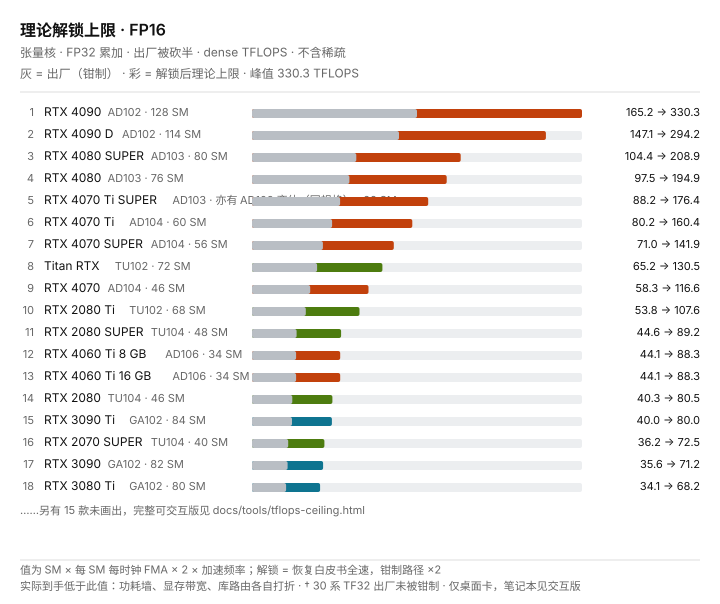
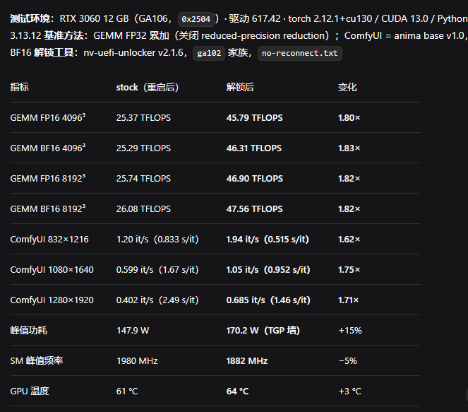
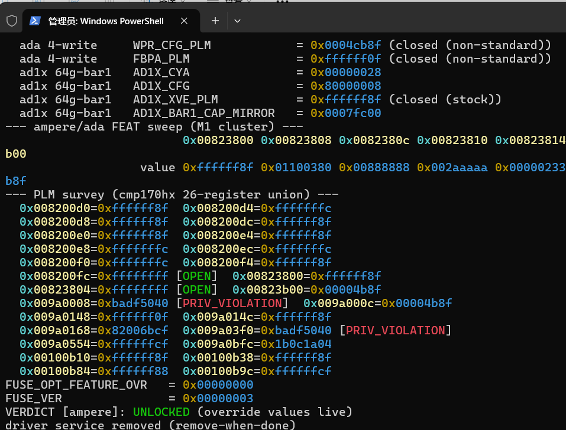
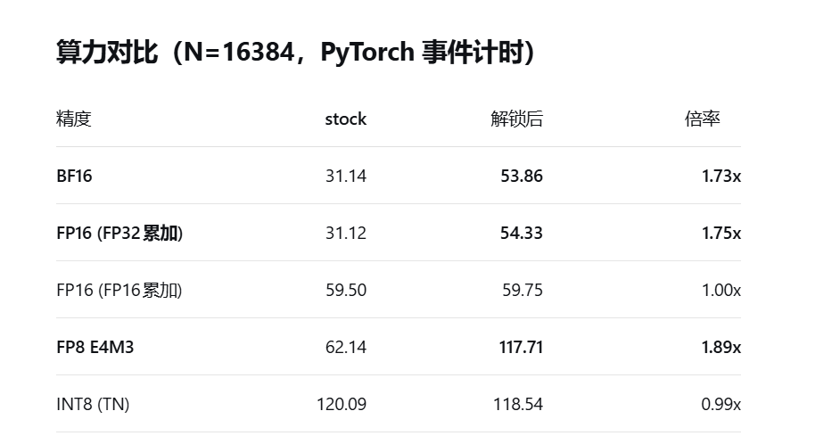
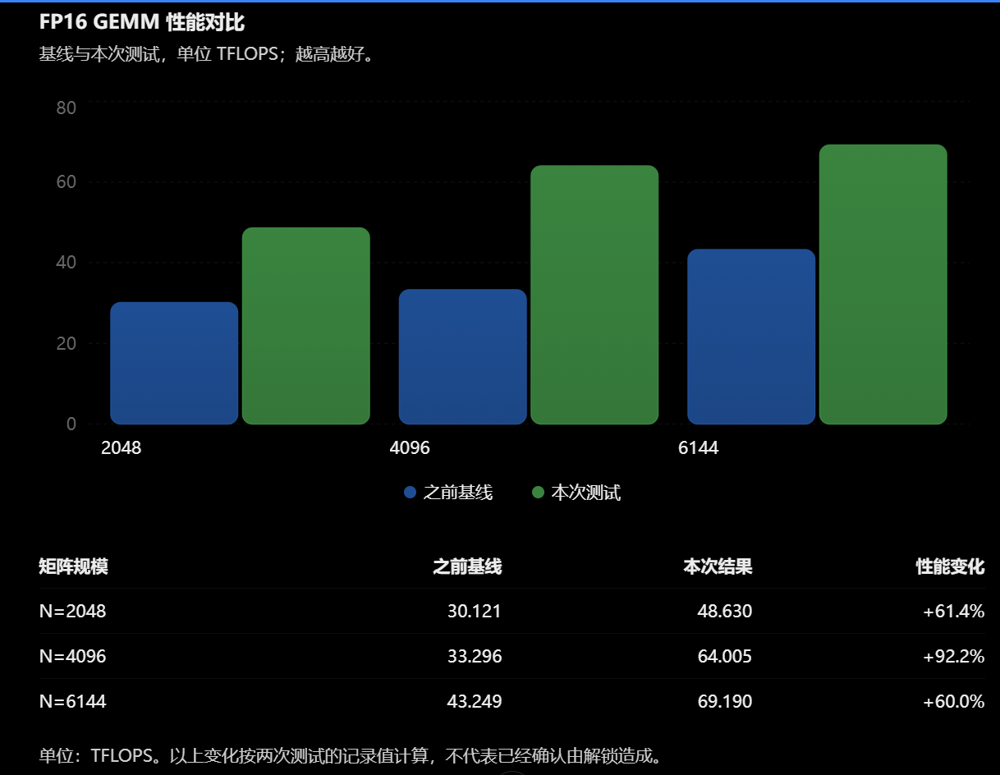

# nv-uefi-unlocker

[中文](README.md) | [English](README.en.md)

**你的 GeForce 正以半速跑 AI——这个工具在驱动加载前把它修复。**

[](https://github.com/physicsdolphin/nv-uefi-unlocker/releases/latest)
[](docs/compatibility.md)
[](docs/faq.md)
[](LICENSE)
[](https://github.com/physicsdolphin/nv-uefi-unlocker/stargazers)

**实测 FP16 / BF16 / TF32 张量吞吐最高约 2.6× · FP8 最高约 1.9× · 图像 / 视频生成 +14–75% · DirectML 推理算子最高 +94% · LLM 推理 prefill 最高 +19%（decode +5%）· 无 VBIOS 刷写，断电即复原**（逐卡数据见[兼容性矩阵](docs/compatibility.md)；增益受功耗墙与精度路径制约——LLM 行为双卡 MoE 实测，非微基准外推）

[](https://physicsdolphin.github.io/nv-uefi-unlocker/tools/tflops-ceiling.html)

*理论解锁上限天梯图（FP16 · 桌面卡）——[打开可交互版](https://physicsdolphin.github.io/nv-uefi-unlocker/tools/tflops-ceiling.html)：FP32/TF32/FP16/BF16/FP8 五个精度页签、含 20/30/40 系桌面+笔记本全量、可切换显示出厂现值；[`?k=fp8`](https://physicsdolphin.github.io/nv-uefi-unlocker/tools/tflops-ceiling.html?k=fp8) 直达指定精度。理论标尺与上方实测数字口径不同，见[理论提升分析](docs/theoretical-uplift.md)。*

## GTX 16 + RTX 20 + RTX 30 + RTX 40 系列通用的 UEFI 预驱动 NVIDIA GPU 解锁工具 ##

解开 NVIDIA 显卡的 Tensor 计算性能限制。从 U 盘启动，解锁后自动进入 Windows 或 Linux 或任意操作系统，无需刷写 VBIOS；断电后恢复原状。

[观看项目宣传片 ↗](https://www.bilibili.com/video/BV1d6xN66ECM/)
[官方视频：工具概览 ↗](https://www.youtube.com/watch?v=y11Pluqoqhg) · [完整实操走录 ↗](https://www.youtube.com/watch?v=hrw1KBTM1EQ)

## 兼容性速览

| 系列 | 支持情况 |
| --- | --- |
| GTX 16 · Turing | 理论兼容，欢迎实机验证 |
| RTX 20 · Turing | 全系兼容；部分型号有已知问题，见完整矩阵 |
| RTX 30 · Ampere GA10x | 全系兼容，支持笔记本与台式 |
| RTX 40 · Ada | 全系兼容，支持笔记本与台式 |
| Pascal 及更早 / GA100 / RTX 50 | 不支持 |

## 社区成功反馈与复现

以下 **硬件型号 / 形态分组** 用于大家直观查找自己的卡名字有没有成功先例（因为你第一时间可能不知道里面的pci id或者芯片代号!!!）
来源自[视频评论区](https://www.bilibili.com/video/BV1d6xN66ECM/)，部分选自[社区验证汇总](docs/community-reports.md)；评论区部分是观众报告，因为他们可能受相关限制无法访问github，我们帮助收集了他们的结果分享。同一型号多条报告时取信息量最大的一条。现行支持与已知限制仍以全量[兼容性矩阵](docs/compatibility.md)为准。

表中分别注明前后实测、只有解锁后截图和文字自述。基准算力增幅不等于实际应用增幅；同时超频或改变功耗条件的报告单独标注。

| 硬件型号 / 形态 | 社区报告的结果与条件 | 来源 |
| --- | --- | --- |
| RTX 2050 Laptop 4GB | EFI 全链通过且 Windows ssdiag 判 UNLOCKED（PLM 全开、SS 覆盖值在效）；初步 PyTorch 峰值 FP16 25.13 / BF16 25.33 TFLOPS，尚无严格锁定态 A/B | [#142](https://github.com/physicsdolphin/nv-uefi-unlocker/issues/142) |
| RTX 2060 12GB | 修复后通过；六轮单变量与 PROM 离线分析把 staging 钉在 4 GiB 边界（未给性能数值） | [#89](https://github.com/physicsdolphin/nv-uefi-unlocker/issues/89) |
| RTX 2060 Super 8GB | 全链通过：FWSEC → WPR2 → BOOT_DIRECT → PLM 开启 → SS0/SS1 读回；签名还原、Windows 交棒正常 | [#12](https://github.com/physicsdolphin/nv-uefi-unlocker/issues/12) |
| RTX 2070 Laptop 8GB | v2.1.3 通过；首个 Turing 笔记本成功记录，跨芯片同签名推动 >4G 分配修复（未给性能数值） | [#16](https://github.com/physicsdolphin/nv-uefi-unlocker/issues/16) |
| RTX 2070 8GB（开发者自测） | 全链通过（FWSEC → BOOT_DIRECT booter → PLM 全开 → SS0/SS1 读回）；FP32 累加 GEMM 36 → 60–63 TFLOPS（+67~75%），需 GSP 模式前置 | [最终结果](docs/evidence/m3-tu106/host-and-final-result.md) |
| RTX 2080 8GB | v2.1.8 修复后通过；报告者以 8 轮单变量和与成功机逐位 diff 定位 0x91（未给性能数值） | [#62](https://github.com/physicsdolphin/nv-uefi-unlocker/issues/62) |
| RTX 2080 Super 8GB | 0x91 修复后复测通过：46 → 68 TFLOPS（+47.8%）；该修复链的首个成功验证 | [#14](https://github.com/physicsdolphin/nv-uefi-unlocker/issues/14) |
| RTX 2080 Ti | 同卡精确 A/B：FP16（FP32 累加）持续 58.70 → 94.97 TFLOPS（+62%），每时钟 ×1.80，60 s 浸泡 0 停顿、无 TDR/WHEA；FP32/INT8/带宽不变（300 W 墙、GSP 开启）。另有原厂 11GB 在 Linux 专有驱动下 60.31 → 89.57 TFLOPS 的跨平台全链记录；H3 收益不明显 | [#125](https://github.com/physicsdolphin/nv-uefi-unlocker/issues/125) · [#103](https://github.com/physicsdolphin/nv-uefi-unlocker/issues/103) · [S41](https://www.bilibili.com/video/BV1d6xN66ECM/?comment_on=1&comment_root_id=318838634673&comment_secondary_id=318838634673) |
| RTX 2080 Ti 22GB 改卡 | 自述最后一次尝试成功；未给性能对比 | [S33](https://www.bilibili.com/video/BV1d6xN66ECM/?comment_on=1&comment_root_id=322063070336&comment_secondary_id=322417003552) |
| RTX 3060 12GB | FP16 25.37 → 45.79 TFLOPS；Anima 生图 1.20 → 1.94 it/s | [S30](https://www.bilibili.com/video/BV1d6xN66ECM/?comment_on=1&comment_root_id=318661261937&comment_secondary_id=318661261937) · [截图](docs/community-success.md#s30) |
| RTX 3060 Ti LHR | v2.1.0 全链通过：PLM `0xffffff8f` → `0xffffffff` 翻转读回（约 149 ms）、SS0/SS1 读回、Windows 交棒正常；跨厂刷映众冰龙 VBIOS（未给性能数值） | [#11](https://github.com/physicsdolphin/nv-uefi-unlocker/issues/11) |
| RTX 3070 8GB（台式机） | USB 引导解锁成功、diag 确认且生成时间 −50%；机器休眠（S4）后 diag 显示 not_unlocked、生成时间回落。同型号另一份 v0.2.0 记录为 EFI 全链 + FLR 后选择器保留、但进 Windows 不保留 | [Discussion #129](https://github.com/physicsdolphin/nv-uefi-unlocker/discussions/129) · [#54](https://github.com/physicsdolphin/nv-uefi-unlocker/issues/54) |
| RTX 3070 Laptop 8GB | FP16 42.05 → 82.06 TFLOPS；150W VBIOS + 超频环境 | [S12](https://www.bilibili.com/video/BV1d6xN66ECM/?comment_on=1&comment_root_id=318487921761&comment_secondary_id=318487921761) · [截图](docs/community-success.md#s12) |
| RTX 3070 Ti Laptop | WMMA FP16 45.51 → 88.84 TFLOPS；cuBLAS FP16 基本不变 | [S36](https://www.bilibili.com/video/BV1d6xN66ECM/?comment_on=1&comment_root_id=322484248128&comment_secondary_id=322484248128) |
| RTX 3080 10GB | 系统侧 UNLOCKED；FP16 53.91 → 84.60 TFLOPS | [S28](https://www.bilibili.com/video/BV1d6xN66ECM/?comment_on=1&comment_root_id=322392362704&comment_secondary_id=322392362704) · [截图](docs/community-success.md#s28) |
| RTX 3080 12G LHR | ComfyUI 视频生成 800 秒 → 不足 500 秒（ID 未注明） | [社区汇编](docs/community-reports.md) |
| RTX 3080 20G | BF16 GEMM 65 → 110–113（三次跑 110.11/113.01/113.19，功耗锁 275 W）；模型常驻显存场景 qwen2.1 BF16 193.7 → 92.9 秒、krea2pornV4 42 → 31.5 秒 | [社区汇编](docs/community-reports.md) |
| RTX 3080 Laptop | 自述成功，BF16 约 +33%；无前后绝对值 | [S18](https://www.bilibili.com/video/BV1d6xN66ECM/?comment_on=1&comment_root_id=318503929089&comment_secondary_id=318523189905) |
| RTX 3080 Ti Laptop | v2.1.0 成功自述；另一报告 BF16 45 → 72 TFLOPS，另有超频 | [S04](https://www.bilibili.com/video/BV1d6xN66ECM/?comment_on=1&comment_root_id=322101380288&comment_secondary_id=322138152256) · [S09](https://www.bilibili.com/video/BV1d6xN66ECM/?comment_on=1&comment_root_id=322187811968&comment_secondary_id=322187811968) |
| RTX 3080 Ti 20G（同德原生） | 解锁成功；设备 ID/VBIOS 待回传（同德原生不等于 ES，可能为修卡或 ES 散片，未给性能数值） | [社区汇编](docs/community-reports.md) |
| RTX 3080 Ti（形态未说明） | 截图 FP16 73.9 → 123.2，单位未标；FP32 对照基本不变 | [S48](https://www.bilibili.com/video/BV1d6xN66ECM/?comment_on=1&comment_root_id=318960839137&comment_secondary_id=318960839137) · [截图](docs/community-success.md#s48) |
| RTX 3090 | Qwen-Image2.1 Turbo BF16 每图接近 60 秒 → 22 秒（前值为约数） | [S49](https://www.bilibili.com/video/BV1d6xN66ECM/?comment_on=1&comment_root_id=322473751376&comment_secondary_id=322473751376) |
| RTX 3090 20GB OEM（本人标注） | FP16 77.36 → 115.20 TFLOPS；本人另报睡眠唤醒后失效 | [S46](https://www.bilibili.com/video/BV1d6xN66ECM/?comment_on=1&comment_root_id=322654906480&comment_secondary_id=322654906480) · [截图](docs/community-success.md#s46) |
| RTX 3090 Ti | H3 INT8 工作流同 418.5W，单条总耗时 123.47 → 108.08 秒 | [S25](https://www.bilibili.com/video/BV1d6xN66ECM/?comment_on=1&comment_root_id=322309028240&comment_secondary_id=322309028240) · [截图](docs/community-success.md#s25) |
| RTX 4050 Laptop 6GB | 成功自述；仅解锁后 FP16 39.15 TFLOPS，另有超频设置 | [S34](https://www.bilibili.com/video/BV1d6xN66ECM/?comment_on=1&comment_root_id=322434523792&comment_secondary_id=322434523792) · [截图](docs/community-success.md#s34) |
| RTX 4060 Laptop | 截图 FP16/FP32 累加 31.12 → 54.33（单位未标）；另有生图反馈 | [S01](https://www.bilibili.com/video/BV1d6xN66ECM/?comment_on=1&comment_root_id=318379087793&comment_secondary_id=318379087793) · [S16](https://www.bilibili.com/video/BV1d6xN66ECM/?comment_on=1&comment_root_id=318513166865&comment_secondary_id=318513166865) · [S42](https://www.bilibili.com/video/BV1d6xN66ECM/?comment_on=1&comment_root_id=322579294896&comment_secondary_id=322579294896) · [截图](docs/community-success.md#s16) |
| RTX 4060 Ti 8GB | 首个 8GB `2803` 数据点：读回通过（PLM 开、SS0/SS1、READOUT_1=0）；cuBLAS 4096³ 中位 FP16 45.59 → 77.36（+69.7%）、BF16 45.64 → 77.74（+70.3%）、TF32 20.06 → 41.91（+108.9%），FP32 对照为噪声 | [PR #87](https://github.com/physicsdolphin/nv-uefi-unlocker/pull/87) |
| RTX 4060 Ti 16GB | 两位观众报告成功及生图变快；含华硕 B550M 平台 | [S05](https://www.bilibili.com/video/BV1d6xN66ECM/?comment_on=1&comment_root_id=318384860033&comment_secondary_id=318425336033) · [S50](https://www.bilibili.com/video/BV1d6xN66ECM/?comment_on=1&comment_root_id=318780355665&comment_secondary_id=318780355665) |
| RTX 4060 8GB（形态未说明） | MOSS Image 1024×1536、30 步，约 240 → 200 秒 | [S31](https://www.bilibili.com/video/BV1d6xN66ECM/?comment_on=1&comment_root_id=318678373665&comment_secondary_id=318678373665) |
| RTX 4070 Laptop | FP16 N=4096：33.296 → 64.005 TFLOPS；另有成功自述 | [S21](https://www.bilibili.com/video/BV1d6xN66ECM/?comment_on=1&comment_root_id=322273213728&comment_secondary_id=322273213728) · [S39](https://www.bilibili.com/video/BV1d6xN66ECM/?comment_on=1&comment_root_id=322525434896&comment_secondary_id=322525434896) · [截图](docs/community-success.md#s21) |
| RTX 4070 台式机 | FP16 61.99 → 76.32–87.82 TFLOPS（150W/200W 条件）；生图 35 → 27 秒 | [S13](https://www.bilibili.com/video/BV1d6xN66ECM/?comment_on=1&comment_root_id=322202417520&comment_secondary_id=322202417520) · [截图](docs/community-success.md#s13) |
| RTX 4070（形态未说明） | Pony 1024²：11.1 → 9.0 秒；Wan2.2 5B / 49 帧：96 → 78.2 秒 | [S44](https://www.bilibili.com/video/BV1d6xN66ECM/?comment_on=1&comment_root_id=318864603793&comment_secondary_id=318864603793) |
| RTX 4070M 魔改卡 | AD106 / 10de:2820；自述更新后成功，FP16 40 → 70（单位未标） | [S02](https://www.bilibili.com/video/BV1d6xN66ECM/?comment_on=1&comment_root_id=322092618224&comment_secondary_id=322120397328) |
| RTX 4070 SUPER | 桥 BME 修复后 replay/unlock 通过，marker、SS0/SS1、FLR 后出口读回正确；cuBLAS 8192 七次中位 FP16→FP32 累加 70.5 → 100.1、BF16 71.0 → 107.0、TF32 35.5 → 48.4，FP16 累加与 FP32 SIMT 对照基本不变（220 W） | [#3](https://github.com/physicsdolphin/nv-uefi-unlocker/issues/3#issuecomment-6434240012) |
| RTX 4070 Ti（华硕 TUF OC） | 本地修改版 v2.1.9 全链读回通过（POST-FLR verified、HANDOFF-OUT 全对）；cuBLAS 8192³：FP16 80.35 → 137.97（1.72×）、BF16 80.44 → 144.13（1.79×），FP32 对照 1.01× | [Discussion #140](https://github.com/physicsdolphin/nv-uefi-unlocker/discussions/140) |
| RTX 4070 Ti SUPER | 含系统侧 UNLOCKED 截图；57.00 → 150.93 TFLOPS 的报告同时超频 | [S07](https://www.bilibili.com/video/BV1d6xN66ECM/?comment_on=1&comment_root_id=318434036593&comment_secondary_id=318434036593) · [S10](https://www.bilibili.com/video/BV1d6xN66ECM/?comment_on=1&comment_root_id=322192703296&comment_secondary_id=322192703296) · [S23](https://www.bilibili.com/video/BV1d6xN66ECM/?comment_on=1&comment_root_id=318588984337&comment_secondary_id=318588984337) · [S51](https://www.bilibili.com/video/BV1d6xN66ECM/?comment_on=1&comment_root_id=318800216993&comment_secondary_id=318800216993) · [截图](docs/community-success.md#s23) |
| RTX 4080 Laptop | 自述 FP16 约 57 → 80 TFLOPS | [S08](https://www.bilibili.com/video/BV1d6xN66ECM/?comment_on=1&comment_root_id=318467714081&comment_secondary_id=318467714081) |
| RTX 4080 16GB | 冷启动一次通过：WPR2 → marker → PLM 翻转 → 四写 → 选择器读回 → FLR 后 AON 存活 → bootmgfw 交棒；两次独立 A/B FP16 4096³ 100.53 → 185.50/185.24（1.85×）、BF16 4096³ 100.37 → 192.18/189.44（1.91×），FP32 对照不变（340 W 上限） | [#53](https://github.com/physicsdolphin/nv-uefi-unlocker/issues/53) · [Discussion #72](https://github.com/physicsdolphin/nv-uefi-unlocker/discussions/72) |
| RTX 4080 SUPER | 成功自述、约 1.85×；未提供应用耗时 | [S24](https://www.bilibili.com/video/BV1d6xN66ECM/?comment_on=1&comment_root_id=318597571313&comment_secondary_id=318597571313) |
| RTX 4080 SUPER 32GB 改卡 | 含 TRX40 双卡；BF16 107.1 → 191.1，prefill +16.4%/+19.1%、decode +5.5% | [S11](https://www.bilibili.com/video/BV1d6xN66ECM/?comment_on=1&comment_root_id=318394280177&comment_secondary_id=318482856705) · [S32](https://www.bilibili.com/video/BV1d6xN66ECM/?comment_on=1&comment_root_id=318683830785&comment_secondary_id=318683830785) · [S43](https://www.bilibili.com/video/BV1d6xN66ECM/?comment_on=1&comment_root_id=322585313104&comment_secondary_id=322585313104) · [待补测上下文](docs/community-success.md#s32) |
| RTX 4090 | 截图 TF32 79.4 → 148.5（单位未标）；本人另报 MOSS BF16 约 +15%–20% | [S40](https://www.bilibili.com/video/BV1d6xN66ECM/?comment_on=1&comment_root_id=322535665616&comment_secondary_id=322535665616) · [S45](https://www.bilibili.com/video/BV1d6xN66ECM/?comment_on=1&comment_root_id=322634742704&comment_secondary_id=322634742704) · [截图](docs/community-success.md#s45) |
| RTX 4090 Laptop（配置截图标注） | 后续自述可用；型号来自本人附的 AI 配置识别图，无性能对比 | [S38](https://www.bilibili.com/video/BV1d6xN66ECM/?comment_on=1&comment_root_id=318796399937&comment_secondary_id=318815524849) |
| RTX 5060 Ti 16GB（作为显示主卡） | Blackwell `2d04` 无资产家族映射，双卡机中被安全跳过、系统正常（副卡 4060 Ti 全链通过）；**不能算 5060 Ti 自身的解锁** | [#56](https://github.com/physicsdolphin/nv-uefi-unlocker/issues/56) |
| GTX 1080 Ti（负控） | 同机三张均被正确跳过；Pascal 不属于解锁对象 | [#69](https://github.com/physicsdolphin/nv-uefi-unlocker/issues/69) |
| Tesla V100-SXM2-16GB（负控） | 双卡机经 `tx-select-bdf.txt` 排除，目标卡正常解锁 | [Discussion #140](https://github.com/physicsdolphin/nv-uefi-unlocker/discussions/140) |
| Quadro P600（显示副卡） | X99 无核显双卡形态中作显示副卡，被正确跳过零写入（负控）；目标 3060 12GB 正常解锁 | [Discussion #131](https://github.com/physicsdolphin/nv-uefi-unlocker/discussions/131) |
| Quadro RTX 5000 | 报告者列为后续计划，尚无实测结果 | [S01](https://www.bilibili.com/video/BV1d6xN66ECM/?comment_on=1&comment_root_id=318379087793&comment_secondary_id=318379087793) |

### 复现截图示例

点击图片查看来源与测试条件。[完整图集：15 位观众的 22 张图片及说明](docs/community-success.md) · [来源与 SHA-256 索引](docs/evidence/bilibili-2026-11-02/sources.json)。

<table>
<tr>
<td align="center" valign="top" width="50%">
<b>RTX 3060 12GB</b><br>
<a href="docs/community-success.md#s30"></a><br>
<a href="docs/community-success.md#s30">原图、来源与条件</a>
</td>
<td align="center" valign="top" width="50%">
<b>RTX 3080 10GB / UNLOCKED</b><br>
<a href="docs/community-success.md#s28"></a><br>
<a href="docs/community-success.md#s28">原图、来源与条件</a>
</td>
</tr>
<tr>
<td align="center" valign="top" width="50%">
<b>RTX 4060 Laptop</b><br>
<a href="docs/community-success.md#s16"></a><br>
<a href="docs/community-success.md#s16">原图、来源与条件</a>
</td>
<td align="center" valign="top" width="50%">
<b>RTX 4070 Laptop</b><br>
<a href="docs/community-success.md#s21"></a><br>
<a href="docs/community-success.md#s21">原图、来源与条件</a>
</td>
</tr>
</table>

## 实战案例

兼容矩阵之外，这几个已闭环的案例展示了本工具背后的工程深度——每个都附完整日志与证据链：

- **魔改 VBIOS 的计算负载 P8 锁（[#90](https://github.com/physicsdolphin/nv-uefi-unlocker/issues/90)）**：2080 Ti 的 EFI 事务被 booter 明文反汇编证明**源码级成功**，Windows 里黑屏低频的真凶却是卡上刷过的 kingpin 类极限测试 BIOS（NV 发给 OEM 超频工作室的跑分特供，带 compute 负载独立 P-state 策略）。识别指纹：`nvidia-smi` 功耗读数远超零售墙。四层误导（判读假阴性/WHEA 硬件疑云/烤机正常/功率电路疑云）逐层剥开，最后一击来自多年改卡经验认出那个数字。→ [五层诊断链](docs/community-reports.md) · [机理开放问题](docs/open-questions.md)
- **X99 + CSM 交棒定律（[#35](https://github.com/physicsdolphin/nv-uefi-unlocker/issues/35)/[#61](https://github.com/physicsdolphin/nv-uefi-unlocker/issues/61)）**："事务全绿但 Windows 落 Code 12"历经四轮结论反转，最终定为交棒 console 归属链定律——与解锁/芯片族/拓扑无关，CSM off 即愈；后被 Zagitta 上游用户在 X99 上独立复现引证。→ [定律全文](docs/faq.md#recovery)
- **雷电解锁 = staging 低位化（[#74](https://github.com/physicsdolphin/nv-uefi-unlocker/issues/74)）**：TB 平台 ≥4 GiB DMA 全链不可达的三死形定位 + 两机两实现单变量实锤，催生 v2.1.8 默认低位 staging（现零反例）。→ [取证矩阵](docs/tu10x-booter-0x91-matrix.md)

逐精度理论提升（简单分类口径；机理推导、三代 SM 架构图与 stressor 工具对账见[理论提升依据](docs/theoretical-uplift.md)）：

| 精度档 | 执行单元 | 出货钳制（RTX 20–40） | 理论上限 |
| --- | --- | --- | --- |
| FP16 · BF16 · TF32（FP32 累加张量路径） | 二~四代张量核 | 半速出货 | **2×** |
| FP8（E4M3/E5M2） | 四代张量核（SM89+） | 半速出货 | **2×** |
| FP16（FP16acc）/ INT8 / INT16 / INT32 / FP32 / FP64 | 张量核 / CUDA 核 / FP64 核 | 无（出厂全速） | 1× |

实际倍数受功耗墙、显存带宽与逐 die 分箱制约（典型 1.5–2×，同频归一化贴近 2×）；CMP 矿卡例外（÷32 全路钳制，上限 32×）。

[完整兼容性矩阵与逐卡实测](docs/compatibility.md)（含 4090M 2757 / Alienware m18 R1 约 2 倍） · [常见问题](docs/faq.md)

## 开始使用

### 1. 获取工具并检查前置条件

从 [Releases](https://github.com/physicsdolphin/nv-uefi-unlocker/releases) 下载并解压发布包。发布包不附带 NVIDIA 固件，制盘脚本会自动下载指定版本并校验、生成所需文件。

准备一个 FAT32 U 盘，先备份其中的文件。目标机器须使用 UEFI 启动，关闭 Secure Boot，或为 EFI 自签并信任证书。笔记本优先使用独显直连，从系统选择“重启”后进入一次性启动菜单。

**Turing 用户先在目标 Windows 的管理员 PowerShell 运行一次，再重启：**

```powershell
.\enable-turing-unlock.ps1
```

重启后确认 GSP 固件已运行，再制作 U 盘。Linux Turing 目标同样需要 GSP-RM；详见 [GSP 前置说明](docs/faq.md#turing)。Linux 用户还应检查 [RTD3](docs/faq.md#linux)，避免进入系统后掉电丢失解锁。

### 2. 制作启动 U 盘

在**目标机**（要解锁的机器）的解压目录直接运行：脚本自动识别本机显卡代际，只生成并下载对应固件。

Windows PowerShell：

```powershell
.\make-usbroot.ps1
```

Linux / WSL / Git Bash：

```bash
bash make-usbroot.sh
```

在另一台机器上制作时显式指定代际：40 系 `-Family 40`，30 系 `30`，20 / 16 系 `20`。`-Family all` 把三代固件全部打进同一张 U 盘（一条命令即可服务多种卡）。

Windows 需要 PowerShell 5+；Linux 版需要 glibc ≥ 2.34（如 Ubuntu 22.04+ / Debian 12+）。首次生成需要联网，下载或校验失败时先处理错误，不要换固件版本。

生成的文件位于本地 `usbroot/`，其中已含 `EFI/BOOT/BOOTX64.EFI`。把 `usbroot/` 的**内容**复制到 U 盘根目录即可（不要连目录一起拷成 `U:\usbroot\`）。其余抽取中间文件不需要复制。

```text
U 盘（FAT32）
├── EFI/BOOT/BOOTX64.EFI
└── 固件文件（脚本末尾列出的 .bin 文件）
```

保留脚本生成的 `v67-*.bin` 解锁文件。[完整文件清单与用途](docs/faq.md#usb)。

替换已有 `EFI/BOOT/BOOTX64.EFI` 前先备份。不要复制到系统 ESP，也不需要调整永久启动顺序。完整文件用途、异机制盘、多卡选择和其他选项见 [USB 文件与选项](docs/faq.md#usb)。

### 3. 启动并验证

1. 从固件的一次性启动菜单选择 U 盘。
2. 版本屏按 **空格或回车**运行；其他键或 30 秒不操作会中止事务并交回系统引导器。目标 GPU 暂时黑屏或冻结末帧属正常现象。
3. 等待工具完成并自动链回系统，日志在 U 盘根目录 `loader.log`。
4. Windows 下用发布包的 `ssdiag-x86_64-windows.exe` 检查系统内状态，并用相同负载比较解锁前后的性能。Linux 可在源码仓库运行 `sudo python3 tools/diag-unlock.py`。详见 [验证与修复](docs/faq.md#ssdiag)。每次冷启动需要重放。

选了 U 盘一闪回到启动菜单（或直接进系统）、盘上没有 `loader.log`，说明 EFI 根本没被执行——此时也没有任何写入；多数是缺 `EFI/BOOT/BOOTX64.EFI` 或 Secure Boot 还开着，按 [无法启动排查](docs/faq.md#no-boot)逐条核对。

遇到 STOP、异常或黑屏卡死，**同会话不要重试**；完全断电后拔 U 盘，走原系统引导，再按 [恢复说明](docs/faq.md#recovery)检查。

让 Agent 帮忙部署：[部署指南](AGENTS.deploy.md)。可以直接把下面这句话交给它：

> 请根据 https://github.com/physicsdolphin/nv-uefi-unlocker/blob/main/AGENTS.deploy.md ，帮我安装 nv-uefi-unlocker，为我的显卡解锁。

## 自行构建（可选）

使用发布包可跳过本节。需要 Rust 工具链；Windows 选择 MSVC 版本。在仓库根目录运行：

```text
rustup target add x86_64-unknown-uefi
cargo build --release
cargo efi-tx
```

EFI 程序生成在 `target/x86_64-unknown-uefi/release/loader.efi`。用以下命令制作启动文件（40 系示例；30 系改 `-Family 30`，20 / 16 系改 `-Family 20`）：

```powershell
.\release\make-usbroot.ps1 -Family 40 -AssetsExe .\target\release\assets.exe -BootEfi .\target\x86_64-unknown-uefi\release\loader.efi
```

```bash
bash release/make-usbroot.sh --family 40 \
  --assets ./target/release/assets \
  --boot-efi ./target/x86_64-unknown-uefi/release/loader.efi
```

之后按上面的布局复制到 U 盘。[只读诊断、测试与开发说明](docs/faq.md#layout)。

## 与 nvoc 配合

本工具解除 Tensor 计算性能限制；[nvoc](https://github.com/Skyworks-Neo/nvoc) 在系统内提供功耗、电压和超频控制，两者可以叠加。

1. 先完成本工具的解锁，在系统内确认状态并记录基准。
2. 按 [nvoc 文档](https://github.com/Skyworks-Neo/nvoc#readme)选择适用于显卡的控制方式。kmd 功耗墙解锁在移动端可用，10/20 系桌面卡的效果尚待验证；`set-volt-rail-limit` 的电压墙控制适用于 10 系及之后 GPU。
3. 用 [cli-stressor-cuda-rs](https://github.com/Skyworks-Neo/nvoc/tree/main/cli-stressor-cuda-rs) 在相同负载下对比，监控功耗、Hot Spot 和限频原因。

组合后功耗和温度可能大幅超过原厂包络，需自行确认散热与供电余量。[组合测试结果与风险说明](docs/faq.md#nvoc-results)。

## 关于作者与团队

作者是一名长期硬件超频与显卡改装爱好者，经手超频魔改维修运维的 NVIDIA 显卡累计超过
数百 块（含大量矿卡与魔改卡），多年从事笔记本、桌面计算机、服务器运维、硬件维修、UEFI BIOS魔改逆向、硬件安全调试；

本项目是与同学一起进行的学生兴趣研究。正因如此，工具的每个写路径
都按"读回验证 + 证据归档"纪律设计，失败场景的恢复手段见
[安全约束与实现边界](docs/faq.md#safety)。

本项目的开发过程使用了 AI 编程助手。与所有代码相同，AI 产出不享受任何
默认信任：事务代码是上游 GPL-2.0 实现的行为级移植，须先通过行为级模拟器
全绿、再经实机读回验证才进入发布——这条规则对人类与 AI 写的每一行代码
一视同仁。

## 参考资料与仓库

本项目是社区工作的直接受益者与衍生者，完整致谢见
[docs/credits.md](docs/credits.md)（按仓库历史中的实际作用核对归类）。
开发期实际研读与引用的仓库已 clone 至本地 `reference/`（不入库），按作用分组：

**事务链母本与一手权威**

- [gpu-unlock](https://github.com/Zagitta/gpu-unlock)（GPL-2.0）——事务链移植母本；
  `unlock_610.c` 逐段对照与 mock 测试蓝本
- [gpu-unlock-ada](https://github.com/JustAResearcher/gpu-unlock-ada)（GPL-2.0）——
  AD10x 四写链源头；28e1 报告（Windroid234）是本项目直接依据，并驱动本项目
  三处判据修正（FBPA `0xffffff0f` 接受、scrubber 非致命、EALREADY 不 FLR）
- [gpu-unlock-bar1](https://github.com/84634E1A607A/gpu-unlock-4090-48g-64g-bar1)——
  AD10x 大 BAR1 参考线（未并入主线）
- [cmp90hx-unlock](https://github.com/WildFlash1st/cmp90hx-unlock)——V67 载荷链源头
- [open-gpu-kernel-modules](https://github.com/NVIDIA/open-gpu-kernel-modules)（MIT）——
  引导路径一手权威：Turing 引导路径四处代际差异（BOOT_DIRECT、portal 直写、
  RM_RISCV_UCODE_DESC v4、FWSEC generic-BL）全部据此考据落进代码
- [AD103_win_unlocker](https://huggingface.co/TOTORONG/AD103_win_unlocker)（TOTORONG）——
  Windows EFI 载具工艺先例（GOP 断连/链式交接/事务日志范式）

**Turing 谱系与定址（0x4096xx FEAT 块）**

- [cmp170hx](https://github.com/Consensus-Protocol/cmp170hx)——PLM 语义、booter
  0x89/0x91 状态码字典与验证方法论
- [cmp50hx-unlock](https://github.com/xrip/cmp50hx-unlock)——Turing 谱系实机闭环
  源头：50HX（TU102）31.7× 实测，40HX/50HX 共用 TU102 booter 归档，是 TU106
  全链可行性的实机依据；FEAT 块 `0x409650/64/6c` 定址亦出自此
- [turing-unlock](https://github.com/nlzy/turing-unlock)（nlzy）——Zagitta kmod
  的 Turing 官方改编（Dell 2080 Ti 22GB，FP16 约 1.6×）；TU102 gadget/栈几何
  表与 GSP IDA 库来源；`TU_FEAT_READOUT 0x409668` 引用源（ssdiag 与 loader
  的 Turing readout 同源）
- [travis-mcdevitt/nv-uefi-unlocker](https://github.com/travis-mcdevitt/nv-uefi-unlocker)——
  本项目下游 fork，其 Turing 成功链记录进入 0x91 取证对照
- [tu102-22g-uefi-unlock](https://github.com/chenxluo/tu102-22g-uefi-unlock)——
  TU102 22G 改装卡 UEFI 方案（22G 支持线的同类对照）

**同类 Windows/UEFI 先行工作**

- [rtx30-unlock](https://github.com/craftingmod/rtx30-unlock)——Zagitta kmod 的
  Windows/UEFI 移植（GA10x 同类先行）
- [rtx30-unlock-windows-toolkit](https://github.com/Siselea/rtx30-unlock-windows-toolkit)——
  上者的单卡单显伴侣工具
- [rtx3080-unlock-public](https://github.com/rough2515-hub/rtx3080-unlock-public)——
  RTX 3080 10GB UEFI 实验先行（韩文）
- [KohakUnlock](https://github.com/KohakuBlueleaf/KohakUnlock)——Turing 谱系
  （boot-hook 形态）与 4090 Windows/UEFI 的源码优先研究
- [Turing-unlock](https://github.com/haohervchb/Turing-unlock)（haohervchb）——
  2080 Ti（TU102）易失解锁，2026-10-22 单跑成功记录
- [nv_unlock_win](https://github.com/mirabarukaso/nv_unlock_win)——Titan RTX
  Windows 内核例试验（同目标的另一条路）
- [gpuunlock](https://github.com/miounet11/gpuunlock)——4090/4070 Ti SUPER
  合并发行版

**寄存器/熔丝侧线**

- [ReBarUEFI](https://github.com/xCuri0/ReBarUEFI)（xCuri0，MIT）——30 系+
  ReBAR 平台侧机制权威（枚举期 hook + PCIe ReBAR 扩展能力）与平台大 BAR
  限制补丁目录；[NvStrapsReBar](https://github.com/terminatorul/NvStrapsReBar)
  是其 Turing fork——推翻本项目此前"Turing BAR1 不可扩"的判断；M1 采样
  PSTRAPS 解码直接依据
- [ga100-fuse-re](https://github.com/ahnguyen17/ga100-fuse-re) ·
  [gpcprobe](https://github.com/matstatman/gpcprobe) ·
  [170hx-rir-tool](https://github.com/lixiangwuxian/170hx-rir-tool)——GA100
  熔丝/RIR 架构（熔丝语义参考线）
- [p104-gen2-unlock](https://github.com/skbskhud/p104-gen2-unlock)——P104 PCIe
  Gen2 链路工具（PCI 配置空间操作参考，与算力解锁正交）
- **CMP 钳制机制史前史**——[FluidX3D #8](https://github.com/ProjectPhysX/FluidX3D/issues/8)
  （2023-10-27，`FP_CONTRACT OFF` 禁 FMA 收缩：按指令类型降发射率的最早
  公开行为学证据）→ [NVIDIA-patcher #73](https://github.com/dartraiden/NVIDIA-patcher/issues/73)
  （2023-12-06，jetcat8848：170HX FP32 0.395→6.285 TFLOPS 15.9× + efuse
  1/2^n 分频假设——九路速率选择器模型雏形，通向 2026 寄存器级破解的源头
  线程）；详见 [docs/credits.md](docs/credits.md) 与
  [theoretical-uplift](docs/theoretical-uplift.md) §2 史前史注脚

**逆向工具链**

- [envytools](https://github.com/envytools/envytools)——envydis（fuc5 Falcon
  反汇编，量产 booter 安全段为密文、需密钥在场才可解）+ nvbios
- [faucon](https://github.com/vbe0201/faucon)——fuc5 反汇编备选（实测解不了
  量产 booter）

许可：**GPL-2.0-only**（`LICENSE`）。NVIDIA 固件与 VBIOS 版权归 NVIDIA，按其
原许可条款从钉版公开包本地再生，不在本仓库分发。

- 原理科普：[专业用户版](https://www.bilibili.com/opus/1264436370549506065) · [入门用户版](https://www.bilibili.com/opus/1264493051219279872)
- 社区讨论与报导（语言随条目标注）：
  [Reddit](https://www.reddit.com/r/overclocking/comments/1xj5jp3/new_uefi_gpu_unlocking_tool_revealed_for_windows/)（EN） ·
  [TechPowerUp](https://www.techpowerup.com/354316/new-uefi-tool-lifts-nvidias-tensor-cap-on-rtx-20-to-40-series-cards-in-windows?type=Tools)（EN） ·
  [Wccftech](https://wccftech.com/new-nvidia-uefi-gpu-unlocker-brings-up-to-75-higher-ai-compute-performance-to-rtx-20-30-40-series-gpus-on-windows/)（EN） ·
  [NotebookCheck](https://www.notebookcheck.net/UEFI-level-pre-driver-Nvidia-GPU-unlocker-now-available-for-RTX-2xxx-3xxx-and-4xxx-GPUs-on-Windows-and-Linux.1438153.0.html)（EN） ·
  [HKEPC](https://www.hkepc.com/27140/)（ZH-HK） ·
  [PCGH Extreme 论坛](https://extreme.pcgameshardware.de/threads/nv-uefi-unlocker-modder-schalten-zusaetzliche-ki-leistung-bei-aelteren-geforce-gpus-frei.679185/)（DE） ·
  [Tom's Hardware](https://www.tomshardware.com/pc-components/gpus/open-source-usb-tool-unlocks-nvidias-half-speed-gpu-ai-limiter-on-windows-lifts-gpus-fp16-math-performance-up-to-65-percent-uefi-unlocker-covers-rtx-20-30-and-40-series-desktops-and-laptops)（EN） ·
  [VideoCardz](https://videocardz.com/newz/modders-create-automated-tool-to-unlock-ai-performance-on-nvidia-geforce-rtx-20-30-and-40-series-gpus)（EN） ·
  [游民星空 GamerSky](https://www.gamersky.com/news/202611/2238729.shtml)（ZH） ·
  [Guru3D](https://www.guru3d.com/story/modders-report-up-to-higher-ai-compute-on-geforce-rtx-20-30-and-40-cards/)（EN） ·
  [Frandroid](https://www.frandroid.com/marques/3306125_ce-logiciel-debride-les-nvidia-geforce-rtx-20-30-et-40)（FR） ·
  [Mezha Media](https://mezha.net/eng/news/mezha-2ffa1478104cdc175bc0e096_uefi_pre-driver_nvidia/)（EN；[中文版](https://mezha.net/ch/news/mezha-2ffa1478104cdc175bc0e096_uefi-pre-driver-nvidia-gpu-unlocker/)） ·
  [Digg](https://digg.com/tech/vfyuouiy)（EN） ·
  [HotRepo](https://hotrepo.ai/physicsdolphin/nv-uefi-unlocker)（EN） ·
  [HardwareCooking](https://www.hardwarecooking.fr/nv-uefi-unlocker-tensor-cores-rtx-20-30-40-windows/)（FR） ·
  [Playground.ru](https://www.playground.ru/misc/news/novaya_utilita_pozvolyaet_uvelichit_proizvoditelnost_videokart_nvidia_rtx_do_75_v_zadachah_ii-1886614)（RU） ·
  [FanaticosDelHardware](https://fanaticosdelhardware.com/nv-uefi-unlocker-multiplica-hasta-265-veces-el-rendimiento-tensor-de-las-geforce-rtx-en-windows/)（ES） ·
  [OMGPU](https://www.omgpu.com/nvidia-luefi-gpu-unlocker-dope-de-75-lia-des-rtx-20-a-40-sur-windows/)（FR） ·
  [PauseHardware](https://pausehardware.com/nvidia-tensor-rtx-debridees-sous-windows/)（FR） ·
  [Gaming-ST](https://gaming-st.com/gpu/nv-uefi-unlocker-windows-rtx20-30-40-tensor-unlock/)（JA） ·
  [GECID](https://ua.gecid.com/news/novij_nstrument_podvoyu_produktivn_st_tenzornih_yader_dlya_v_deokart_rtx_20_40_u_windows/)（UK） ·
  [GPU-Unlock.net](https://gpu-unlock.net/windows)（EN） ·
  [IT-SVR](https://it-svr.com/svrforum-news-3234984/)（KO） ·
  [ShiftDelete](https://shiftdelete.net/en/nv-uefi-unlocker)（EN） ·
  [GizNewsDaily](https://giznewsdaily.com/nvidia-gpu-unlocker-at-uefi-pre-driver-level-released-for-rtx-2xxx-4xxx/)（EN） ·
  [PixLib](https://pixlib.ru/article/nv-uefi-unlocker-kak-uskorit-tenzornye-yadra-rtx-do-75-v-zadachakh-ii)（RU） ·
  [ShiftDelete 论坛](https://shiftdelete.net/forum/konular/eski-rtx-kartlara-yapay-zeka-takviyesi-nv-uefi-unlocker.5000006)（TR） ·
  [eTeknix](https://www.eteknix.com/nv-uefi-unlocker-boosts-ai-performance-by-up-to-75-on-rtx-20-30-and-40-gpus/)（EN） ·
  [滄者極限 Coolaler](https://www.coolaler.com/nv-uefi-unlocker-%E8%AE%93-rtx-20-30-40-%E9%A1%AF%E5%8D%A1-ai-%E6%95%88%E8%83%BD75%EF%BC%8C%E5%85%8D%E5%88%B7-vbios/)（ZH-HK） ·
  [XFastest](https://news.xfastest.com/169478/nvidia-rtx-20%ef%bc%8f30%ef%bc%8f40-%e9%a1%af%e5%8d%a1%e9%96%8b%e6%ba%90-uefi-%e5%b7%a5%e5%85%b7%e8%a7%a3%e9%8e%96-ai-%e7%ae%97%e5%8a%9b%ef%bc%9artx-4060-%e7%ad%86%e9%9b%bb-fp16-%e6%b8%ac%e8%a9%a6/)（ZH-HK） ·
  [GameApps.hk](https://www.gameapps.hk/news/71358/nvidia-rtx-gpu-uefi-unlocker-ai-performance-boost/)（ZH-HK） ·
  [HyperAI 超神经](https://hyper.ai/cn/stories/e969128a0f35dc33e44aeee493d8a16a)（ZH） ·
  [电玩帮](https://www.vgover.com/news/243692)（ZH） ·
  [夢想數位工坊](https://dreamdigi.tw/35957-2/)（ZH-HK） ·
  [WORLDTECH](https://worldtech.news/story/cluster:99a2191612e071705d677715e85a108e87a0c329b66b40e4d2b79d07284014b8?lang=zh)（ZH） ·
  [Telset.id](https://telset.id/laptop-pc/tool-usb-unlock-tensor-nvidia-rtx-20-30-40-tanpa-flash-vbios/)（ID） ·
  [Silicon Report](https://www.siliconreport.com/open-source-uefi-tool-unlocks-nvidia-gpu-tensor-performance)（EN） ·
  [Kantan.News](https://kantan.news/news/new-uefi-tool-removes-ai-speed-limitation-on-nvidia-graphics-cards)（EN） ·
  [digitalcitizen.life](https://www.digitalcitizen.life/new-nvidia-gpu-unlocker-boosts-rtx-20-30-and-40-series-ai-performance-by-up-to-75-on-windows/)（EN） ·
  [PC Test Bench](https://www.pctestbench.com/nv-uefi-unlocker-rtx-tensor-windows/)（EN） ·
  [Hooshware](https://hooshware.net/news/7b49fb54-b7ab-4779-b799-01958b7601c9)（EN） ·
  [X/RoundtableSpace](https://x.com/RoundtableSpace/status/2115749232980140458)（EN） ·
  [X/Pirat_Nation](https://x.com/Pirat_Nation/status/2116303886604739008)（EN） ·
  [XenoSpectrum](https://xenospectrum.com/en/nvidia-uefi-windows-tensor-unlock/)（EN） ·
  [DNS Club](https://club.dns-shop.ru/amp/digest/187732-instrument-nv-uefi-unlocker-povyishaet-ii-proizvoditelnost-kart/)（RU） ·
  [HardwarePremium](https://www.hardwarepremium.com/noticias/78275/uefi-nvidia-desbloqueador-rtx-2000-3000-4000/)（ES） ·
  [Shahrsakhtafzar](https://www.shahrsakhtafzar.com/fa/news/graphic-card/62809-nvidia-geforce-rtx-tensor-unlock-windows-tool)（FA） ·
  [DicasPC](https://dicaspc.com.br/noticias/nv-uefi-unlocker-libere-ate-75-mais-ia-na-sua-rtx/)（PT-BR） ·
  [Diario da Midia](https://diariodamidia.com.br/autor/thiago-nogueira)（PT-BR） ·
  [Facebook/PCMR HUB](https://www.facebook.com/PCMRHUB/posts/nv-uefi-unlocker-is-an-open-source-uefi-level-pre-driver-tool-that-removes-nvidi/1546978424130406/)（EN） ·
  [YouTube/Max Herrera](https://www.youtube.com/shorts/AMhmWjjpgFk)（EN） ·
  [ProfesionalReview](https://www.profesionalreview.com/2026/11/01/nv-uefi-unlocker-75-mas-rendimiento-ia-rtx-20-30-40/)（ES） ·
  [Facebook/ComfyUI 群组](https://www.facebook.com/groups/comfyui/posts/1122947967144569/)（EN） ·
  [搜狐](https://m.sohu.com/a/1095783758_163726)（ZH） ·
  [网易](https://www.163.com/dy/article/LAM8N7DS05527PMU.html)（ZH） ·
  [X/NFT_Chen](https://x.com/NFT_Chen/status/2116389085682241717)（ZH） ·
  [Instagram](https://www.instagram.com/p/DfKvpmvgUoO/)（ZH-HK） ·
  [网易](https://www.163.com/dy/article/LALVCN6L0556OH4N.html)（ZH） ·
  [X/xiax0603](https://x.com/xiax0603/status/2116550883018494257)（ZH） ·
  [WindowsForum](https://windowsforum.com/news/nv-uefi-unlocker-lifts-rtx-20-30-and-40-tensor-core-limits-ai-gains-and-secure-boot-risks.450453/)（EN） ·
  [Hacker News](https://news.ycombinator.com/item?id=50272846)（EN） ·
  [YouTube/究極完全体ガジェモン](https://www.youtube.com/watch?v=Lc9cadT9Qk0)（JA） ·
  [Facebook/老N顯示卡](https://www.facebook.com/61579313407097/posts/122190692660977113/)（ZH-HK） ·
  [TechNews 科技新報](https://technews.tw/2026/11/02/open-source-usb-tool-unlocks-nvidias-half-speed-gpu-ai-limiter-on-windows/)（ZH-HK） ·
  [電腦王阿達](https://www.kocpc.com.tw/archives/701745)（ZH-HK） ·
  [腾讯新闻](https://view.inews.qq.com/a/20261101A0AMKJ00)（ZH） ·
  [AHAN 格點全球](https://news.ahan.net/article/55430)（ZH） ·
  [Facebook/Coolaler 粉絲團](https://www.facebook.com/coolalerfans/posts/1706720778130729/)（ZH-HK） ·
  [FreeLLM](https://freellm.vip/sites/nv-uefi-unlocker)（EN） ·
  [the9.pro](https://news.the9.pro/pt/models/nv-uefi-unlocker/)（PT-BR） ·
  [TrashExpert](https://trashexpert.ru/news/hardware-news/rtx-uefi-usb-tensor-unlocker-windows)（RU） ·
  [Facebook/Fier De Mon PC](https://www.facebook.com/FierDeMonPC/posts/1457447876541008/)（FR） ·
  [PBX Science](https://pbxscience.com/open-source-nv-uefi-unlocker-lifts-tensor-core-limits-on-rtx-20-30-and-40-gpus-with-gains-of-up-to-75-in-tests/)（EN） ·
  [Fosswire](https://fosswire.org/news/open-source-nv-uefi-unlocker-tool-removes-nvidia-tensor-limi)（EN） ·
  [YouTube/Kempinator Gaming](https://www.youtube.com/watch?v=TulzjBvbdjo)（EN） ·
  [YouTube/duffytechnology – overview](https://www.youtube.com/watch?v=y11Pluqoqhg)（EN） ·
  [YouTube/duffytechnology – full walkthrough](https://www.youtube.com/watch?v=hrw1KBTM1EQ)（EN）
  [SECNews](https://www.secnews.gr/en/745864/geforce-rtx-tensor-unlock/)（EN） ·
  [Quasar Zone](https://quasarzone.com/bbs/qn_hardware/views/2085634)（KO） ·
  [GiggleHD](https://gigglehd.com/gg/hard/19358883)（KO） ·
  [Global Computer Community](https://globalcomputercommunity.com/index.php?/forums/topic/75-nv-uefi-unlocker-tensor-caps-lifted-in-windows-but-watch-the-board-power/)（EN） ·
  [zod.kr](https://zod.kr/news/8983775)（KO） ·
  [Inven](https://www.inven.co.kr/board/party/6292/2046)（KO）

## Star History

<a href="https://www.star-history.com/?repos=physicsdolphin%2Fnv-uefi-unlocker&type=date&legend=top-left">
 <picture>
   <source media="(prefers-color-scheme: dark)" srcset="https://api.star-history.com/chart?repos=physicsdolphin/nv-uefi-unlocker&type=date&theme=dark&legend=top-left" />
   <source media="(prefers-color-scheme: light)" srcset="https://api.star-history.com/chart?repos=physicsdolphin/nv-uefi-unlocker&type=date&legend=top-left" />
   
 </picture>
</a>
