# 社区复现截图 / Community screenshots

[中文介绍](../README.md#社区成功反馈与复现截图) · [English overview](../README.en.md#community-success-reports-and-screenshots) · [兼容性矩阵](compatibility.md)

这里收录 16 位观众的 23 张原图，来自[项目视频 BV1d6xN66ECM 的公开评论区](https://www.bilibili.com/video/BV1d6xN66ECM/)。资料采集于 **2026-11-02 18:51:09–19:07:33（北京时间）**。

这是观众反馈的存档，未独立实机复测。终端读回、前后基准、只有解锁后数值和 AI 汇总报告分别注明；AI 汇总图本身不能替代原始日志。相同型号的不同平台、VBIOS、功耗和驱动条件不可直接合并。记录中的版本与部署方式仅描述当时实验，当前操作请看 [README](../README.md#开始使用)。

图片保持导出原始字节，包括横竖方向；点击图片可查看完整尺寸。每张图都保留评论者署名、原评论、原图链接与 SHA-256（见[来源索引](evidence/bilibili-2026-11-02/sources.json)）。索引还包含 README 硬件表中其余文字报告及必要上下文的链接，不包含完整评论导出或账号资料。

## 有前后对比的报告

### S30 · RTX 3060 · 哲学香蕉菌

来源：[哲学香蕉菌，2026-10-30](https://www.bilibili.com/video/BV1d6xN66ECM/?comment_on=1&comment_root_id=318661261937&comment_secondary_id=318661261937)（评论 `318661261937`）。

**报告结果：** FP16 25.37 → 45.79、BF16 25.29 → 46.31 TFLOPS（4096）；Anima BF16生图1.20 → 1.94、0.599 → 1.05、0.402 → 0.685 it/s。

**条件与边界：** 3060 12GB GA106；v2.1.6、驱动617.42。图中不同分辨率生图吞吐提高约62%–75%；功耗147.9→170.2W。

型号或后续更正的上下文：[318652838881](https://www.bilibili.com/video/BV1d6xN66ECM/?comment_on=1&comment_root_id=318652838881&comment_secondary_id=318652838881)。

查看原图（1 张）

**基准与 Anima 生图对比（观众汇总）** · [评论原图](http://i0.hdslb.com/bfs/new_dyn/ed342d333f7b788e39ce73a86b5e2357571852961.png)

<a href="evidence/bilibili-2026-11-02/318661261937-1.png">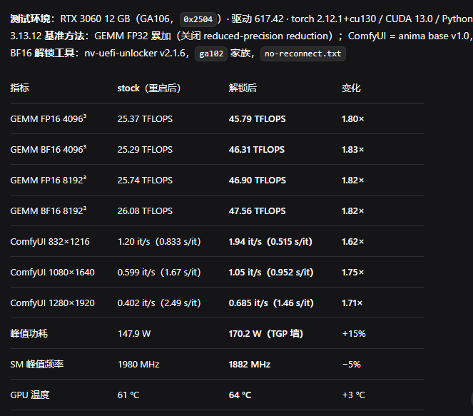</a>

### S28 · RTX 3080 · laxy2333

来源：[laxy2333，2026-10-30](https://www.bilibili.com/video/BV1d6xN66ECM/?comment_on=1&comment_root_id=322392362704&comment_secondary_id=322392362704)（评论 `322392362704`）。

**报告结果：** FP16 53.91 → 84.60 TFLOPS，+56.9%；BF16 54.97 → 81.74，+48.7%；附UNLOCKED状态。

**条件与边界：** 10GB；此前构建Family选错，指定ga102后成功。混合负载测试截图，不外推为所有应用增幅。

型号或后续更正的上下文：[322352868720](https://www.bilibili.com/video/BV1d6xN66ECM/?comment_on=1&comment_root_id=322352868720&comment_secondary_id=322352868720)。

查看原图（3 张）

**解锁前混合负载测试** · [评论原图](http://i0.hdslb.com/bfs/new_dyn/b839cdf0263aa0f4ba4a8f5a27fe0f55219938505.png)

<a href="evidence/bilibili-2026-11-02/322392362704-1.png">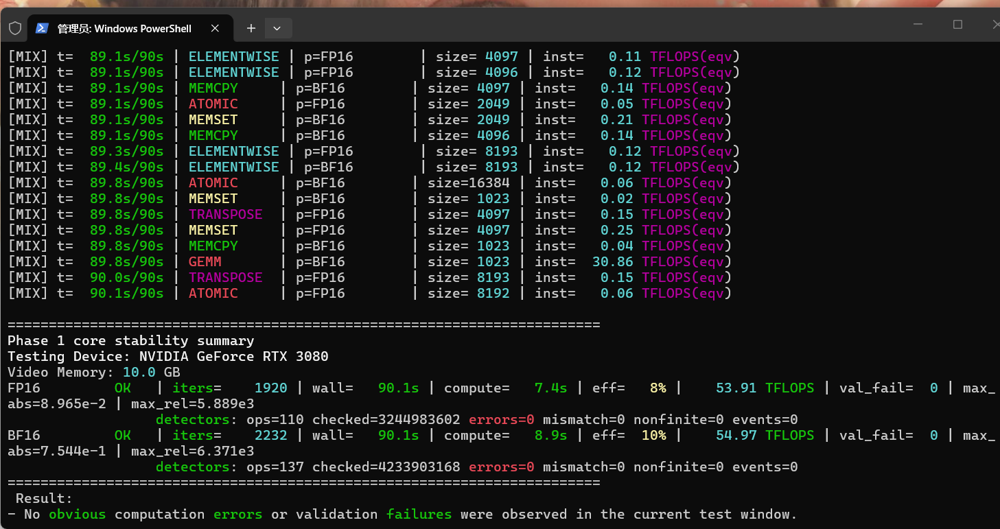</a>

**系统侧寄存器与 UNLOCKED 状态** · [评论原图](http://i0.hdslb.com/bfs/new_dyn/e0c3437116e95c583ce7a710b6f8f133219938505.png)

<a href="evidence/bilibili-2026-11-02/322392362704-2.png">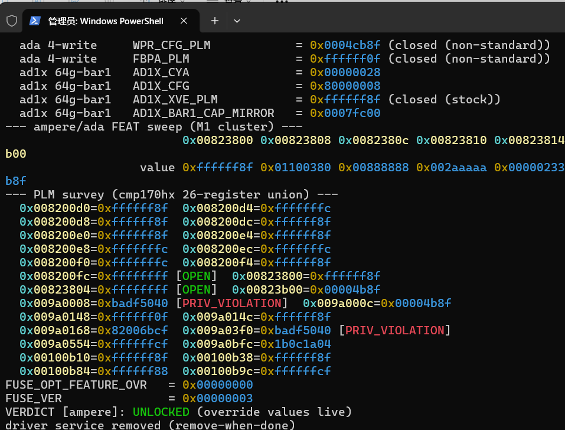</a>

**解锁后混合负载测试** · [评论原图](http://i0.hdslb.com/bfs/new_dyn/b662ff17923e795151329772fb5fd428219938505.png)

<a href="evidence/bilibili-2026-11-02/322392362704-3.png">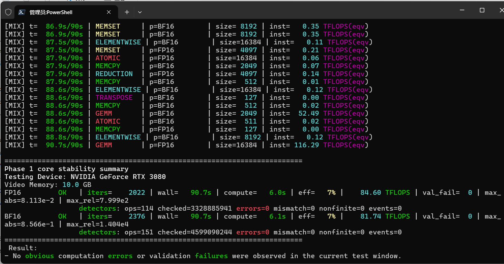</a>

### S12 · RTX 3070 Laptop · Ndxopcgvx

来源：[Ndxopcgvx，2026-10-29](https://www.bilibili.com/video/BV1d6xN66ECM/?comment_on=1&comment_root_id=318487921761&comment_secondary_id=318487921761)（评论 `318487921761`）。

**报告结果：** FP16 42.05 → 82.06 TFLOPS，+95.1%；BF16 42.04 → 82.04，+95.1%。

**条件与边界：** 原文说应该成功，附图给出前后对比；R9000P 2021，150W VBIOS、核心/显存超频 115/545；测试脚本由 AI 提供，未独立验证；两张终端图的 FP16、BF16 均为 FP32 累加路径。未收录仅显示 U 盘目录的第三张附件。

查看原图（2 张）

**解锁前测试** · [评论原图](http://i0.hdslb.com/bfs/new_dyn/9cb9e7d16c254ba50f0ceda5a71defcd352059262.png)

<a href="evidence/bilibili-2026-11-02/318487921761-1.png">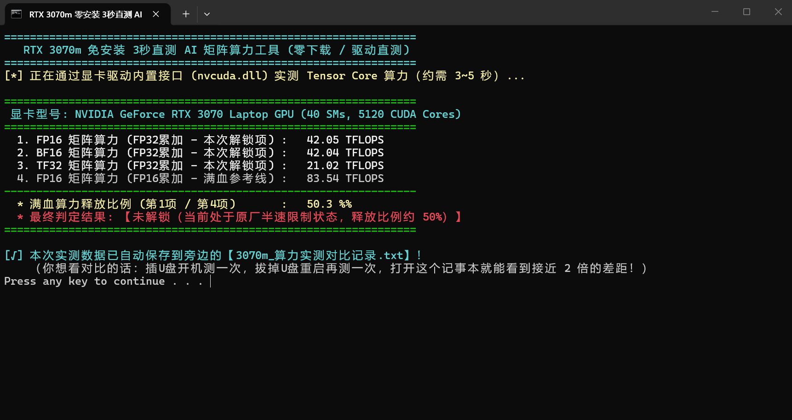</a>

**解锁后测试** · [评论原图](http://i0.hdslb.com/bfs/new_dyn/235b4e32699b20ff10b5e0b4df561ce9352059262.png)

<a href="evidence/bilibili-2026-11-02/318487921761-2.png">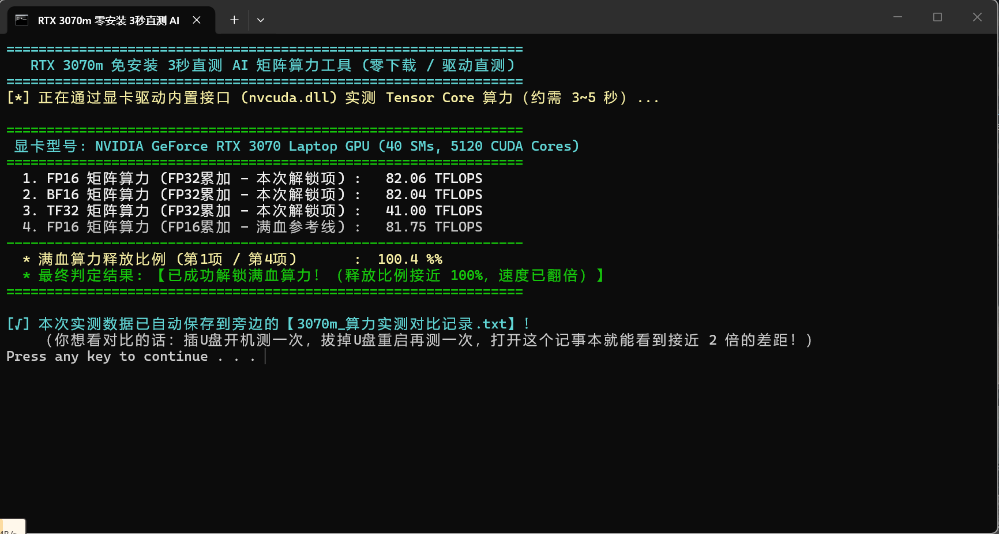</a>

### S16 · RTX 4060 Laptop · 我想变成light

来源：[我想变成light，2026-10-29](https://www.bilibili.com/video/BV1d6xN66ECM/?comment_on=1&comment_root_id=318513166865&comment_secondary_id=318513166865)（评论 `318513166865`）。

**报告结果：** BF16 31.14 → 53.86（1.73倍）；FP16/FP32累加 31.12 → 54.33（1.75倍）；FP8 62.14 → 117.71（1.89倍）。

**条件与边界：** 截图未写单位；N=16384，PyTorch事件计时；INT8 120.09→118.54，未提升。只据该图记录，不外推全型号。

查看原图（1 张）

**不同精度的前后对比（观众汇总）** · [评论原图](http://i0.hdslb.com/bfs/new_dyn/26b7b00a4b14debdbd087154f334ca7b66820689.png)

<a href="evidence/bilibili-2026-11-02/318513166865-1.png">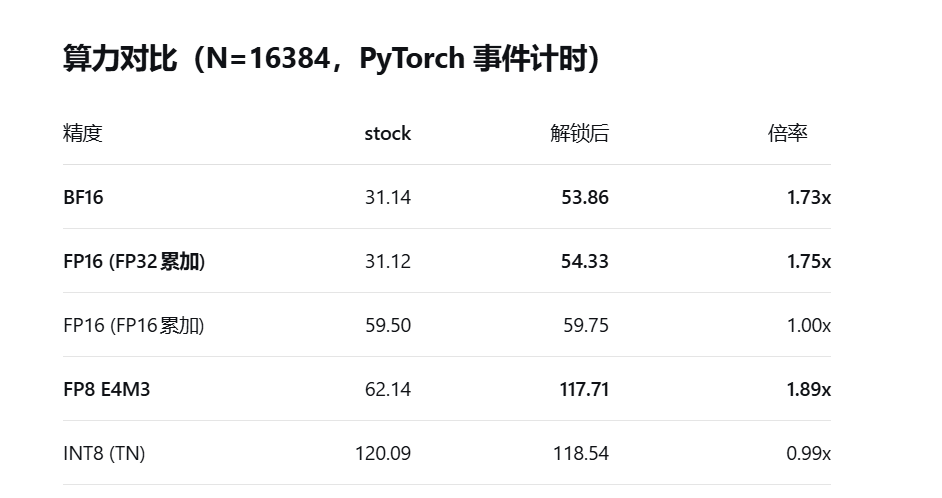</a>

### S21 · RTX 4070 Laptop · 天蓝色的烟雨

来源：[天蓝色的烟雨，2026-10-29](https://www.bilibili.com/video/BV1d6xN66ECM/?comment_on=1&comment_root_id=322273213728&comment_secondary_id=322273213728)（评论 `322273213728`）。

**报告结果：** FP16 N=2048：30.121 → 48.630；4096：33.296 → 64.005；6144：43.249 → 69.190 TFLOPS。

**条件与边界：** 早先失败，后以FAT32硬盘分区解决；按后续量化结果更新。截图注明尚不能独立确认所有差异都由解锁造成。

型号或后续更正的上下文：[322211869408](https://www.bilibili.com/video/BV1d6xN66ECM/?comment_on=1&comment_root_id=322211869408&comment_secondary_id=322211869408) · [322270354624](https://www.bilibili.com/video/BV1d6xN66ECM/?comment_on=1&comment_root_id=322211869408&comment_secondary_id=322270354624)。

查看原图（1 张）

**FP16 GEMM 前后对比（观众汇总）** · [评论原图](http://i0.hdslb.com/bfs/new_dyn/bac394d7bcbf0837a688cdbd6814acda73701409.png)

<a href="evidence/bilibili-2026-11-02/322273213728-1.png">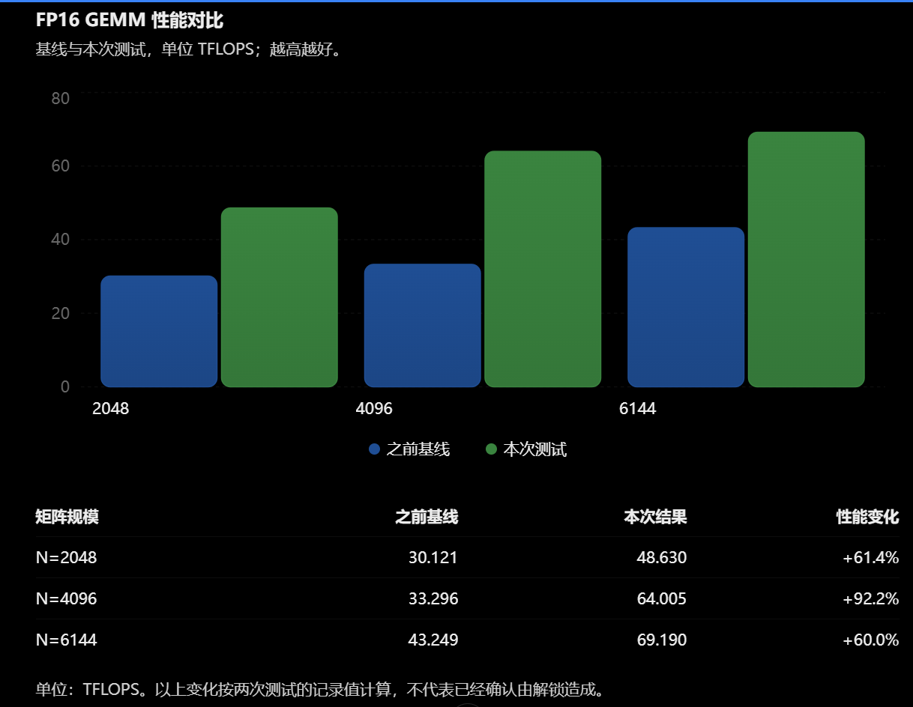</a>

### S23 · RTX 4070 Ti SUPER · 这一管叫做深情

来源：[这一管叫做深情，2026-10-30](https://www.bilibili.com/video/BV1d6xN66ECM/?comment_on=1&comment_root_id=318588984337&comment_secondary_id=318588984337)（评论 `318588984337`）。

**报告结果：** 4096 FP16 57.00 → 150.93；BF16 57.51 → 127.32；8192 FP16 55.50 → 127.28；BF16 54.97 → 128.39 TFLOPS。3参考图生视频自述快至少1分钟。

**条件与边界：** 本人明确同时超频和解锁，不能把约2.65倍跑分全归因解锁。功耗227→291.58W；应用未提供前后总耗时；必须结合本人后续“超频加解锁”的说明阅读截图中的倍数。

型号或后续更正的上下文：[318606154961](https://www.bilibili.com/video/BV1d6xN66ECM/?comment_on=1&comment_root_id=318588984337&comment_secondary_id=318606154961) · [318606748657](https://www.bilibili.com/video/BV1d6xN66ECM/?comment_on=1&comment_root_id=318588984337&comment_secondary_id=318606748657)。

查看原图（1 张）

**系统侧状态与基准汇总；同时进行了超频** · [评论原图](http://i0.hdslb.com/bfs/new_dyn/17a4d625a968d83de126f8f610d0f88287903194.png)

<a href="evidence/bilibili-2026-11-02/318588984337-1.png">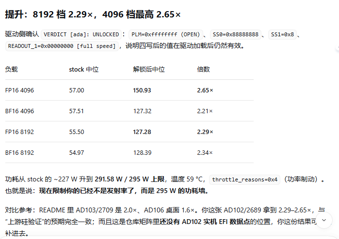</a>

### S13 · RTX 4070 台式机 · 重生之我是虾头

来源：[重生之我是虾头，2026-10-29](https://www.bilibili.com/video/BV1d6xN66ECM/?comment_on=1&comment_root_id=322202417520&comment_secondary_id=322202417520)（评论 `322202417520`）。

**报告结果：** FP16 61.99 → 76.32–87.82 TFLOPS，+23%–42%；BF16 62.40 → 77.89–90.71，+25%–45%；出图 35 → 27 秒。

**条件与边界：** 同一人两条成功评论只计一次。图中 150W/200W 条件影响范围；35→27 秒是耗时减少22.9%、吞吐提升29.6%；图中视频耗时是推算，未当实测。

型号或后续更正的上下文：[322202428288](https://www.bilibili.com/video/BV1d6xN66ECM/?comment_on=1&comment_root_id=322202326304&comment_secondary_id=322202428288)。

查看原图（1 张）

**测试汇总照片；底部视频耗时为推算，不作实测引用** · [评论原图](http://i0.hdslb.com/bfs/new_dyn/8083040d148114726690cbc8249d12de636075104.jpg)

<a href="evidence/bilibili-2026-11-02/322202417520-1.jpg">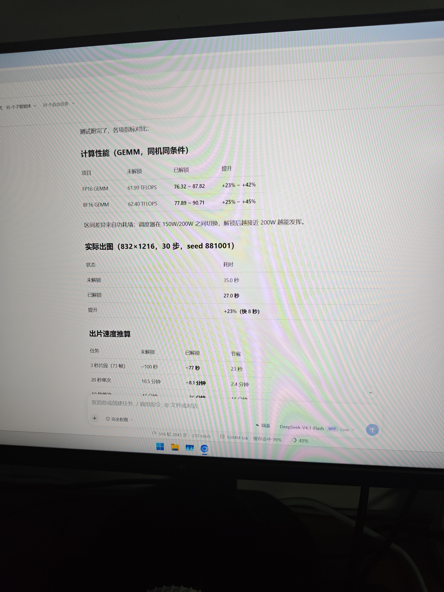</a>

### S25 · RTX 3090 Ti · 吼吼吼lo

来源：[吼吼吼lo，2026-10-30](https://www.bilibili.com/video/BV1d6xN66ECM/?comment_on=1&comment_root_id=322309028240&comment_secondary_id=322309028240)（评论 `322309028240`）。

**报告结果：** H3 INT8工作流同418.5W：单条123.47 → 108.08秒；采样75.13 → 65.50秒；再提至445.5W单条110.74秒。

**条件与边界：** 截图记录6条批次对比；同功耗总耗时减少12.5%、吞吐提高14.2%。额外提高功耗没有进一步收益；不能只取transition局部约50%作整段加速；仅收录包含原始分阶段数值的表格，未重复收录结论图。

查看原图（1 张）

**H3 工作流分阶段及单条总耗时对比** · [评论原图](http://i0.hdslb.com/bfs/new_dyn/bd2588d7f6276996ed5f29628acc7e40540051932.jpg)

<a href="evidence/bilibili-2026-11-02/322309028240-1.jpg">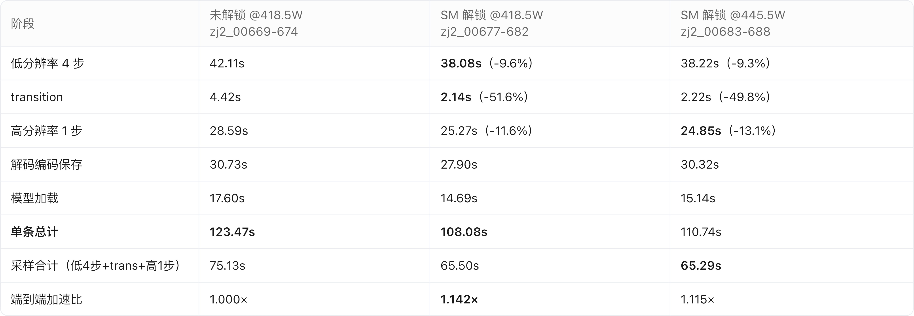</a>

### S32 · RTX 4080 SUPER 32GB 改卡 · Wulai0-0

来源：[Wulai0-0，2026-10-30](https://www.bilibili.com/video/BV1d6xN66ECM/?comment_on=1&comment_root_id=318683830785&comment_secondary_id=318683830785)（评论 `318683830785`）。

**报告结果：** 基准93.4 → 181.9 TFLOPS；H3 INT8同工作流0.9MP/15秒视频，原730–760秒，解锁后冷699.82秒、热674.01秒。

**条件与边界：** 注意：699.82与674.01均为解锁后两次，不能当解锁前后。后续本人明确原约750秒；保持功耗墙，提升有限。

型号或后续更正的上下文：[318436712481](https://www.bilibili.com/video/BV1d6xN66ECM/?comment_on=1&comment_root_id=318436712481&comment_secondary_id=318436712481) · [318772456913](https://www.bilibili.com/video/BV1d6xN66ECM/?comment_on=1&comment_root_id=318683830785&comment_secondary_id=318772456913)。

查看原图（4 张）

**解锁前基准终端输出** · [评论原图](http://i0.hdslb.com/bfs/new_dyn/e4e272ebe04bb6b331c0f376ccf0b254285348395.png)

<a href="evidence/bilibili-2026-11-02/318683830785-1.png">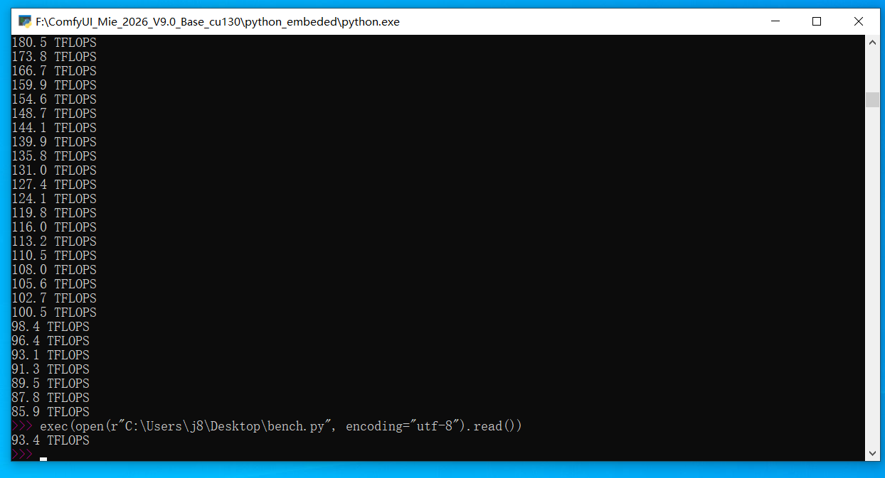</a>

**解锁后基准终端输出** · [评论原图](http://i0.hdslb.com/bfs/new_dyn/351d3f4af50686669e8026a4563eb17a285348395.png)

<a href="evidence/bilibili-2026-11-02/318683830785-2.png">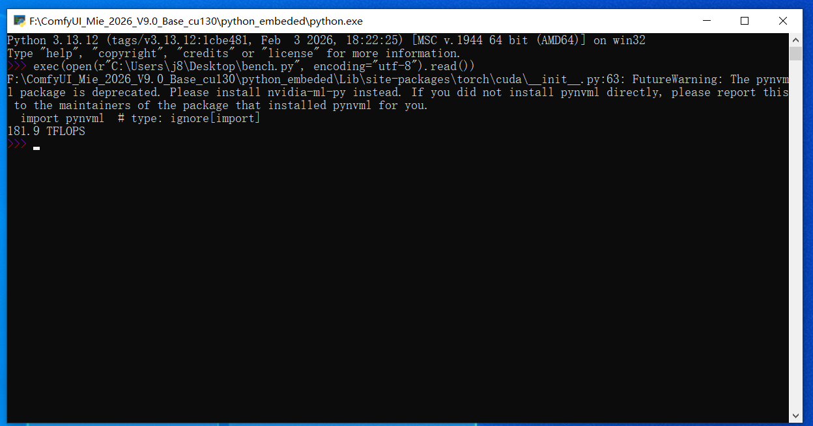</a>

**32GB 配置与运行监控** · [评论原图](http://i0.hdslb.com/bfs/new_dyn/dcdc97c73aabd2e16b45555230c54c66285348395.png)

<a href="evidence/bilibili-2026-11-02/318683830785-3.png">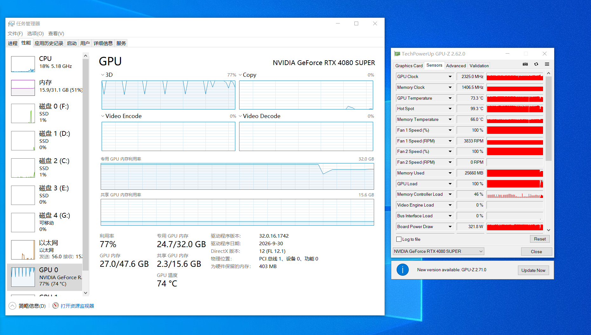</a>

**H3 工作流与运行记录** · [评论原图](http://i0.hdslb.com/bfs/new_dyn/943d1edf3f7fa2d9ed5d46d431d60033285348395.png)

<a href="evidence/bilibili-2026-11-02/318683830785-4.png">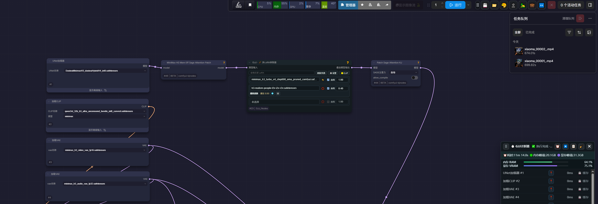</a>

### S46 · RTX 3090 20GB OEM（本人标注） · FIcCAT

来源：[FIcCAT，2026-11-02](https://www.bilibili.com/video/BV1d6xN66ECM/?comment_on=1&comment_root_id=322654906480&comment_secondary_id=322654906480)（评论 `322654906480`）。

**报告结果：** FP16 77.36→115.20、BF16 78.11→116.75、TF32 40.46→72.78 TFLOPS。

**条件与边界：** 本人称OEM超龙20GB、核心GA102-250-KD-A1，需修改驱动；型号按原文保留，不改写成其他零售型号。后续睡眠唤醒解除解锁状态。

型号或后续更正的上下文：[322657710656](https://www.bilibili.com/video/BV1d6xN66ECM/?comment_on=1&comment_root_id=322654906480&comment_secondary_id=322657710656) · [322668036848](https://www.bilibili.com/video/BV1d6xN66ECM/?comment_on=1&comment_root_id=322654906480&comment_secondary_id=322668036848)。

查看原图（1 张）

**前后基准对比（观众汇总）** · [评论原图](http://i0.hdslb.com/bfs/new_dyn/9219fa7fbfb0db7b4210a334bf622ec02833817.png)

<a href="evidence/bilibili-2026-11-02/322654906480-1.png">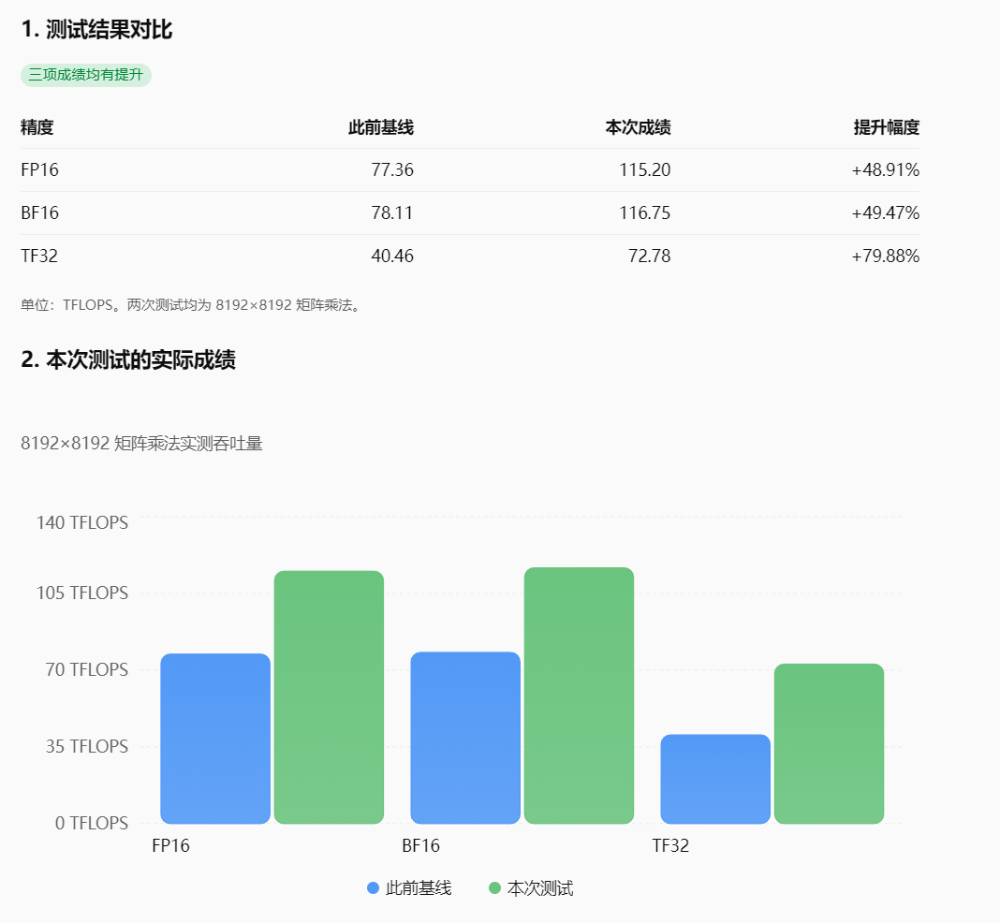</a>

### S45 · RTX 4090 · ふわとろ

来源：[ふわとろ，2026-11-01](https://www.bilibili.com/video/BV1d6xN66ECM/?comment_on=1&comment_root_id=322634742704&comment_secondary_id=322634742704)（评论 `322634742704`）。

**报告结果：** TF32 79.4→148.5、81.2→155.4；BF16 156.7→188.9；MOSS BF16自述+15%–20%，H3+10%。

**条件与边界：** 保留功耗墙。文字称名人堂，附AI截图称ROG，品牌不一致；可确认均写4090，不细分品牌。截图算力单位未写明。

查看原图（1 张）

**基准对比（AI 汇总；显卡品牌与文字反馈不一致）** · [评论原图](http://i0.hdslb.com/bfs/new_dyn/8467017d9214a1c3af3722078446eee71525736.png)

<a href="evidence/bilibili-2026-11-02/322634742704-1.png">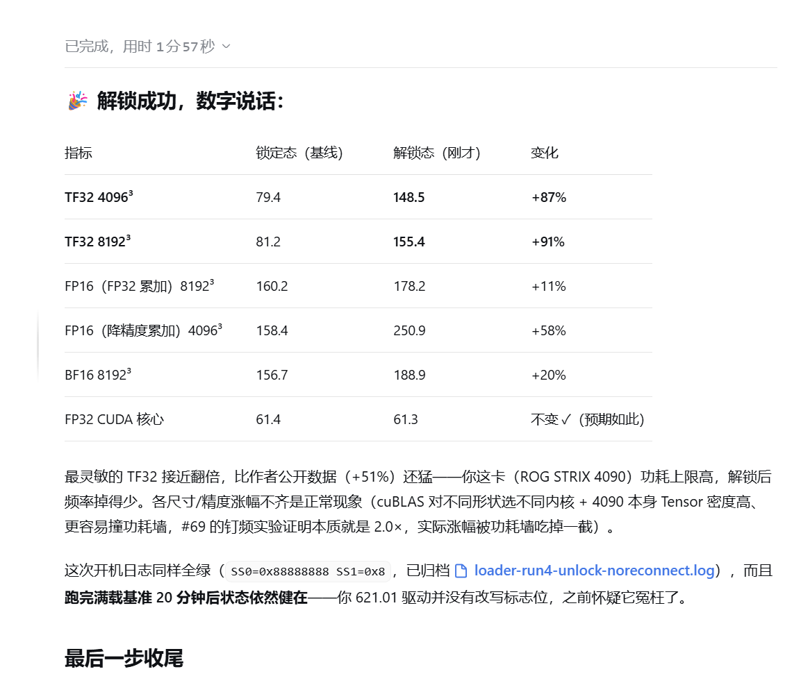</a>

### S48 · RTX 3080 Ti（形态未说明） · 十二悠

来源：[十二悠，2026-11-02](https://www.bilibili.com/video/BV1d6xN66ECM/?comment_on=1&comment_root_id=318960839137&comment_secondary_id=318960839137)（评论 `318960839137`）。

**报告结果：** TF32 38.5→66.7，FP16 73.9→123.2，BF16 74.8→125.8；FP32 26.5→26.4基本不变。

**条件与边界：** 图片为AI汇总测试报告；1950MHz+且注明无降频，单位未明确。保留原图的方向及原始像素。

查看原图（1 张）

**基准对比照片（AI 汇总；保留原图方向）** · [评论原图](http://i0.hdslb.com/bfs/new_dyn/0dbb11a6ec1a9389f103941290aadd1949804397.jpg)

<a href="evidence/bilibili-2026-11-02/318960839137-1.jpg">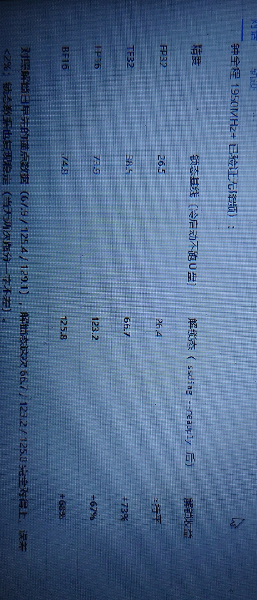</a>

## 只有解锁后数值或图片的报告

### S01 · RTX 4060 Laptop · TualatinPentium

来源：[TualatinPentium，2026-10-27](https://www.bilibili.com/video/BV1d6xN66ECM/?comment_on=1&comment_root_id=318379087793&comment_secondary_id=318379087793)（评论 `318379087793`）。

**报告结果：** 解锁成功；截图显示 FP16 47.32 TFLOPS。

**条件与边界：** 截图只有解锁后值，没有前后增幅；另有 Quadro RTX 5000 的计划，不能算已完成。

查看原图（1 张）

**仅解锁后测试；没有解锁前对照** · [评论原图](http://i0.hdslb.com/bfs/new_dyn/05bc00da1c33e312790c25f761c2c55d481086477.png)

<a href="evidence/bilibili-2026-11-02/318379087793-1.png">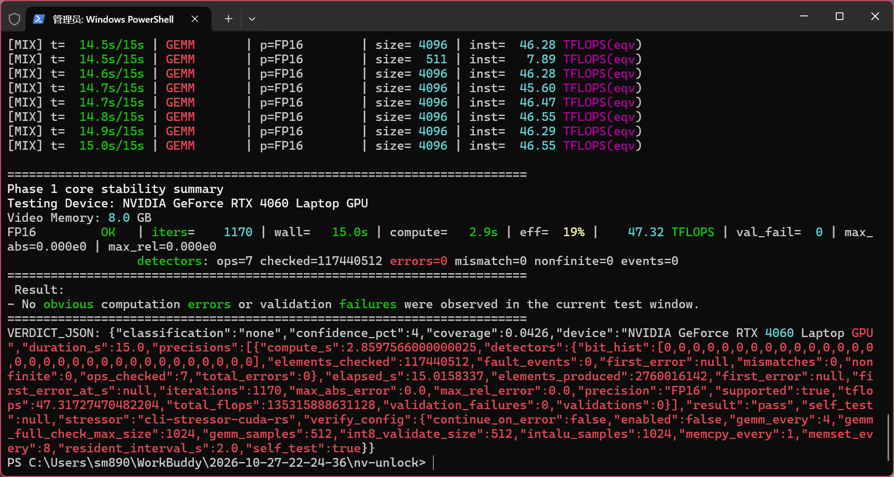</a>

### S07 · RTX 4070 Ti SUPER · 未然极光

来源：[未然极光，2026-10-28](https://www.bilibili.com/video/BV1d6xN66ECM/?comment_on=1&comment_root_id=318434036593&comment_secondary_id=318434036593)（评论 `318434036593`）。

**报告结果：** 仅解锁，热点温度 80°C → 100°C；截图 FP16 103.12 TFLOPS。

**条件与边界：** 原文型号带 v1；未给解锁前算力，温升不能用作性能增幅。

查看原图（1 张）

**仅解锁后测试；没有解锁前对照** · [评论原图](http://i0.hdslb.com/bfs/new_dyn/d46fdea662dbf1b23b7bfef38b11e840216963966.png)

<a href="evidence/bilibili-2026-11-02/318434036593-1.png">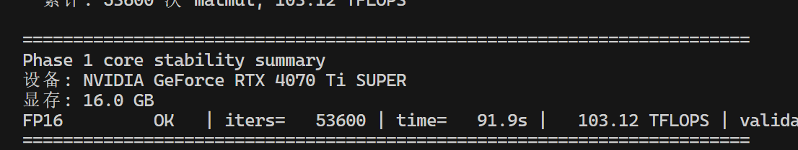</a>

### S34 · RTX 4050 Laptop · snpdz

来源：[snpdz，2026-10-31](https://www.bilibili.com/video/BV1d6xN66ECM/?comment_on=1&comment_root_id=322434523792&comment_secondary_id=322434523792)（评论 `322434523792`）。

**报告结果：** 自述成功，截图FP16 39.15 TFLOPS（仅解锁后）。

**条件与边界：** 6GB；截图另有125W、核心+65、显存+105设置。无解锁前算力，不能计算增幅。

查看原图（2 张）

**仅解锁后 FP16 测试** · [评论原图](http://i0.hdslb.com/bfs/new_dyn/8a0fb9ed2844a41bab800d5b7b531cc8306417542.jpg)

<a href="evidence/bilibili-2026-11-02/322434523792-1.jpg">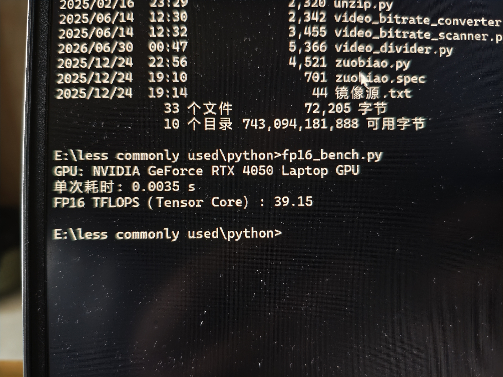</a>

**6GB 配置及超频、功耗设置** · [评论原图](http://i0.hdslb.com/bfs/new_dyn/6c6e4b6723d055d7eeef6cc840022f08306417542.jpg)

<a href="evidence/bilibili-2026-11-02/322434523792-2.jpg">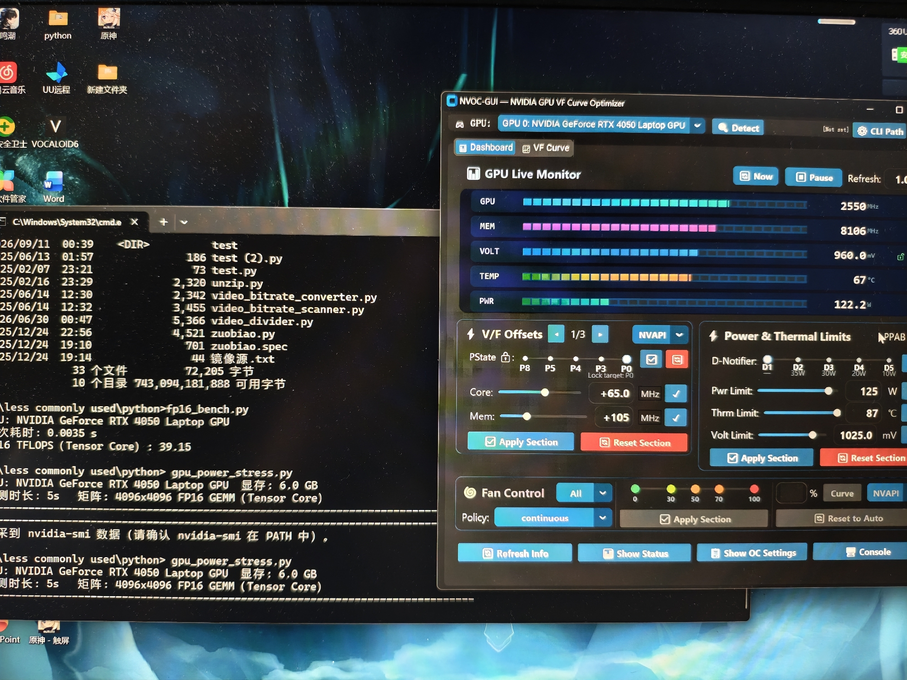</a>

### S42 · RTX 4060 Laptop · 网友陈胤平

来源：[网友陈胤平，2026-11-01](https://www.bilibili.com/video/BV1d6xN66ECM/?comment_on=1&comment_root_id=322579294896&comment_secondary_id=322579294896)（评论 `322579294896`）。

**报告结果：** 两个生图工作流：200多秒→103.31秒；140多秒→54.79秒，自述快50%–60%。

**条件与边界：** 未超频，未开性能模式；D盘小分区启动。前值为约数；作者口中的50%–60%更接近耗时减少，不等同吞吐提升。

查看原图（1 张）

**解锁后两个工作流的耗时；解锁前约数见评论** · [评论原图](http://i0.hdslb.com/bfs/new_dyn/96a6875d161c430117a6e2c8bb99e00640862625.png)

## 收录口径与后续补充

README 按原文型号和形态分组，共引用 37 位观众的报告；同一人后续更正与补图回到同一条来源。未明确型号的反馈、失败或尚未完成的尝试、他人的型号提问，以及其他超频工具的成功，均不据此增加硬件条目。不从评论数量推算成功率，也不把不同测试的增幅平均。

本次没有采用 Linux 方案来源尚不明确的 RTX 3070 Laptop 图作为本项目复现图，也没有把 RTX 4090 Laptop 的 AI 配置识别图当成解锁结果截图；后者的成功自述在 README 单独标明。RTX 3080 Ti 的条目使用明确成功自述和前后对比照片，不以缺少场景与误差范围的游戏帧率增幅充当验证。

补充记录请使用[硬件实测反馈模板](https://github.com/physicsdolphin/nv-uefi-unlocker/issues/new?template=02-hardware-report.yml)，提供 GPU / 显存 / 平台、工具与驱动版本、系统侧读回、同负载前后数据以及功耗和超频条件。图片请保留可追溯来源，并在上传前去除与测试无关的私人信息。
