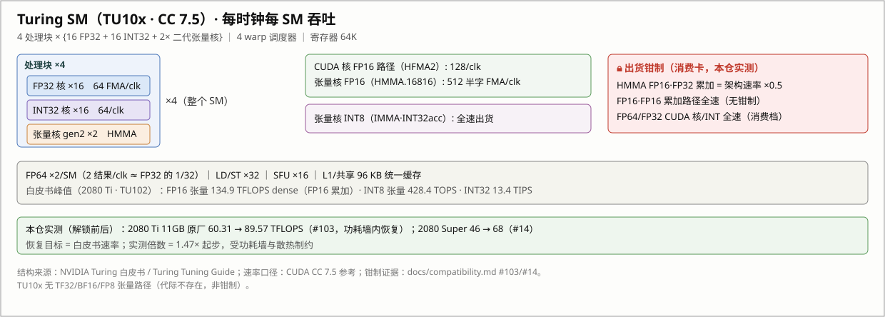
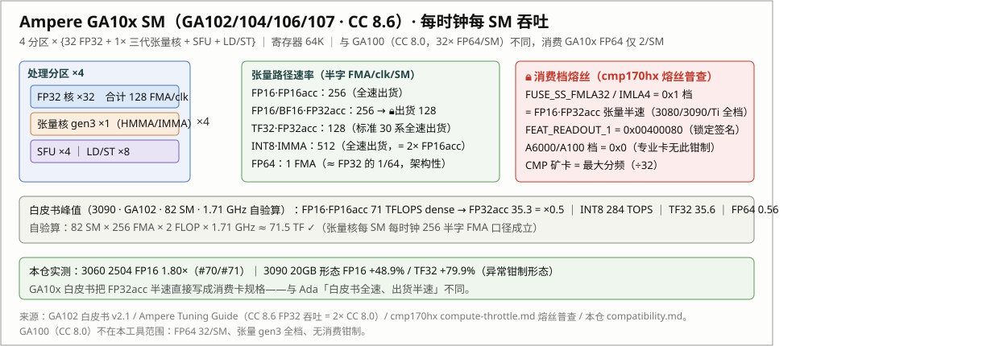
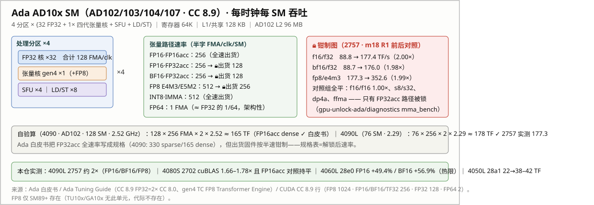

# Theoretical Uplift: SM Unit Routing, Per-Generation Architecture, and Per-Precision Ceilings

> 中文版：[theoretical-uplift.md](theoretical-uplift.md)
>
> This document answers three questions: **which execution units the lock actually throttles** (mechanism), **what the theoretical ceiling per precision is** (architectural derivation), and **what each precision mode in cli-stressor-cuda-rs actually measures** (tool mapping). Every number carries a source; the derivations are reproducible.

## 1. Conventions

- **FLOP counting**: one multiply-accumulate (FMA/MAC) = 2 FLOP; dense numbers never include sparsity speedups. This is the convention used by whitepapers and [TechPowerUp].
- **Rate units**: half-word FMAs/clk/SM and results/clk/SM (the CUDA Programming Guide convention) are both used; each occurrence is labeled.
- **Definition of the theoretical ceiling**: unlocking = restoring the **whitepaper rate** (the factory architectural rate); it is not overclocking. The theoretical ceiling for each precision = factory rate ÷ shipped clamped rate — 2× on clamped paths, 1× on unclamped ones.
- **Measured intervals** come from the [compatibility matrix](compatibility.en.md) and the evidence directory; controlled before/after experiments (same machine, driver, and power plan) take precedence.

## 2. The lock's unit-level mechanism: nine rate selectors

NVIDIA reserves one rate divider per arithmetic-unit class in the `OPT_SM_SPEED_SELECT` fuse block (fuse census across 15 Ampere cards + 5 CMP 170HX probes by the cmp170hx project, [compute-throttle.md](https://github.com/Consensus-Protocol/cmp170hx/blob/main/docs/unlock/compute-throttle.md)):

| Fuse | Governs | RTX 3080–3090 Ti (consumer) | A100/A6000 (pro) | CMP 170HX (mining) |
|---|---|---|---|---|
| `FUSE_SS_DP` | FP64 | 0 (full) | 0 | 1 (÷2) |
| `FUSE_SS_FFMA` | FP32 FMA | 0 (full) | 0 | 5 (÷32) |
| `FUSE_SS_FMLA16` | FP16 MLA | 0 (full) | 0 | 5 (÷32) |
| `FUSE_SS_FMLA32` | FP32 MLA / FP16·FP32acc tensor | **1 (half)** | 0 | 5 (÷32) |
| `FUSE_SS_IMLA0–3` | Integer MLA 0–3 (incl. DP4A) | 0 (full) | 0 | 5 (÷32) |
| `FUSE_SS_IMLA4` | Integer MLA 4 | **1 (half)** | 0 | 5 (÷32) |

Three key points:

1. **Consumer gaming cards ship with only the `FMLA32`/`IMLA4` pair at tier 0x1** — the well-known "consumer FP16-with-FP32-accumulate tensor halving". FP32 CUDA cores, FP64, DP4A, and the FP16·FP16acc path are **factory-full-rate** on gaming cards; the ÷32 clamps exist only on CMP mining cards.
2. The unlock surface is the `FEAT_OVR_PLM (0x00823804)` gate plus the `SS0/SS1 (0x0082381c/0x823820)` override registers: opening the PLM from `0xffffff8f` (L3-only writes) to `0xffffffff` lets a host write `SS0=0x88888888, SS1=0x8` (nibble = [override-enable | 3-bit speed, 0 = full]) and restore all nine units to full rate. The writes live in the always-on island: they survive FLR and vanish on power-off — this transaction is exactly what this tool performs.
3. **SS0/SS1 are per-die binning values**: the cmp170hx cohort shows 13 cards with 13 different values, but the **locked-state read-only signature is stable** — `FEAT_READOUT_1 = 0x00400080` on RTX 30 series, zero after unlock. Per-die variance means shipped clamp depth can differ per SKU (see §7).

**Prehistory footnote (the public record before the fuse census)**: the "per-instruction-type issue-rate throttle" had behavioral evidence two and a half years before cmp170hx's fuse survey (2026-05) — on 2023-10-27, [FluidX3D issue #8](https://github.com/ProjectPhysX/FluidX3D/issues/8) found that `FP_CONTRACT OFF` (disabling FMA contraction) restores ~16× of the 170HX's FP32 (2,276 → 7,681 MLUPs/s on the memory-bound workload, 3.4×); on 2023-12-06 jetcat8848 brought the same technique to [dartraiden/NVIDIA-patcher issue #73](https://github.com/dartraiden/NVIDIA-patcher/issues/73) (170HX FP32 **0.395 → 6.285 TFLOPS, 15.9×**) and hypothesized "an efuse tags the FMA speed at 1/2^n (n=1..5), and the NV driver knows how to run it" — the embryo of today's nine-selector model. 15.9× ≈ ½ of the 32× full FFMA restore: FMA is throttled ÷32 while non-FMA mul/add issue at full rate but need two instructions per 2 FLOP — the earliest public evidence that **the clamp selects an issue rate per instruction type rather than damaging the ALU itself** (cmp170hx's history records #73 as the thread that ultimately led to the register-level crack; its assessment of #73: "reliable as a record, unreliable as analysis"; the technique was later cited academically in [arXiv 2505.03782](https://arxiv.org/pdf/2505.03782)).

Turing (RTX 20) uses the same FEAT family at different addresses (`0x4096xx` rather than `0x823xxx`, see [cold-values](cold-values.md)); the semantics match, and this repo's TU102/TU104 field results show 20-series cards also ship with the FP16·FP32acc halving (§4).

## 3. SM architecture and unit routing per generation

### 3.1 Turing (TU10x · CC 7.5 · GTX 16/RTX 20)

- Per SM: 4 processing blocks × {16 FP32 + 16 INT32 + 2× gen-2 Tensor Cores}, 2 FP64 units, 4 warp schedulers ([Turing whitepaper](https://images.nvidia.com/aem-dam/en-zz/Solutions/design-visualization/technologies/turing-architecture/NVIDIA-Turing-Architecture-Whitepaper.pdf), [Turing Tuning Guide](https://docs.nvidia.com/cuda/turing-tuning-guide/index.html)).
- Per clock per SM: FP32 64 FMA; CUDA-core FP16 (HFMA2) 128; tensor FP16 (HMMA.16816) 512 half-word FMAs; INT32 64; FP64 2.
- Whitepaper peaks (2080 Ti · TU102): FP16 tensor **134.9 TFLOPS dense** (FP16 accumulate; 269.8 sparse) · INT8 tensor 428.4 TOPS · INT32 13.4 TIPS.
- TF32/BF16/FP8 tensor paths do not exist in this generation (absence, not a clamp).
- **Shipped clamp (this repo's field evidence)**: HMMA FP16·FP32acc at half rate. A stock 11 GB 2080 Ti measures 60.31 TFLOPS before the unlock (≈ half the whitepaper figure, further cut by power limits) and 89.57 after ([#103](https://github.com/physicsdolphin/nv-uefi-unlocker/issues/103), still power-limited); 2080 Super 46 → 68 ([#14](https://github.com/physicsdolphin/nv-uefi-unlocker/issues/14)).

### 3.2 Ampere consumer (GA10x · CC 8.6 · RTX 30)

- Per SM: 4 partitions × {32 FP32 + 1× gen-3 Tensor Core}, 2 FP64 units ([GA102 whitepaper](https://www.nvidia.com/content/PDF/nvidia-ampere-ga-102-gpu-architecture-whitepaper-v2.1.pdf), [Ampere Tuning Guide](https://docs.nvidia.com/cuda/ampere-tuning-guide/index.html): CC 8.6 delivers 2× the FP32 ops/clk/SM of CC 8.0).
- Per clock per SM: FP32 128 FMA; tensor FP16acc 256 half-word FMAs; TF32 128; INT8 IMMA 512; FP64 1 FMA (≈ FP32/64, **architectural** on both consumer and pro).
- Self-check (3090 · 82 SM · 1.71 GHz): 82 × 256 × 2 × 1.71 ≈ 71.5 TF ✓ matches the whitepaper 71 dense (FP16acc); FP32acc 35.3 dense = ×0.5, **written into the consumer whitepaper as the spec**; INT8 284 TOPS = 2× FP16acc (full rate); TF32 35.6 = half the architectural 2×FP32, i.e. shipped clamped as on every standard 30-series card (#194 measured 3070 Ti 17.0→37.5, a clean 2.20×); FP64 0.56.
- Fuse signature: `FEAT_READOUT_1 = 0x00400080`.

### 3.3 Ada (AD10x · CC 8.9 · RTX 40)

- SM structure mirrors GA10x (128 FP32 + 4× gen-4 Tensor Cores + 2 FP64) and adds the FP8 (E4M3/E5M2) tensor path ([Ada whitepaper](https://images.nvidia.com/aem-dam/Solutions/geforce/ada/nvidia-ada-gpu-architecture.pdf), [Ada Tuning Guide](https://docs.nvidia.com/cuda/ada-tuning-guide/index.html)).
- CUDA guide CC 8.9 row (results/clk/SM): FP8 1024 · FP16/BF16/TF32 256 · FP32 128 · FP64 2.
- Self-check (4090 · AD102 · 128 SM · 2.52 GHz): 128 × 256 × 2 × 2.52 ≈ 165 TF ✓ = whitepaper FP16acc dense; **the whitepaper lists the full FP32acc rate as the spec (330 sparse / 165 dense)** — but shipped firmware clamps it to half. 4090 Laptop (AD103M · 76 SM · 2.29 GHz) self-check: 76 × 256 × 2 × 2.29 ≈ 178 TF ✓, matching this repo's post-unlock 177.4 TF/s bit-for-bit ([evidence/uefi-2757-m18r1](evidence/uefi-2757-m18r1/report.md)).
- **Shipped clamp map (2757 before/after, same machine, driver, and power plan; mma_bench 20000 iters × 5 reps)**:

| Path | Stock | Unlocked | Ratio | Verdict |
|---|---:|---:|---:|---|
| FP16·FP32acc | 88.8 TF/s | 177.4 | **2.00×** | clamped ×0.5 → restored |
| BF16·FP32acc | 88.7 | 176.0 | **1.98×** | same |
| FP8 E4M3 | 177.3 | 352.6 | **1.99×** | clamped ×0.5 → restored |
| FP16·FP16acc (control) | 177.3 | 177.7 | 1.00× | **never locked** |
| INT8 IMMA (control) | — | — | 1.00× | never locked |
| DP4A / FFMA (control) | — | — | 1.00× | never locked |

This table anchors the whole document: **the clamp is precise to "tensor path × accumulator mode", and completely unrelated to CUDA-core and integer-tensor paths.**

On the desktop side (2684 · three independent cuBLAS datasets: two reporters in [#69](https://github.com/physicsdolphin/nv-uefi-unlocker/issues/69) plus [#80](https://github.com/physicsdolphin/nv-uefi-unlocker/issues/80)), the per-path Ada desktop spectrum is now filled in: **TF32 per-clock 243–247 → 477–493 FLOP/clk/SM (= 93–96% of the 512 full rate, +96–100%, stable across three sizes)** — TF32·FP32acc ships clamped ×0.5 on standard 40-series desktop cards (30-series carries the same lock: #194 plus a local 3080 12 GB run of 35→69 on 2026-11-06 refute the old full-rate reading, so there is no per-generation difference). This corrects the whitepaper semantics: the Ada whitepaper's TF32 82.6 is the **shipped clamped value**, not the architectural rate (CUDA guide CC 8.9 TF32 = 256 results/clk/SM = architectural); the famous GeForce "TF32 = FP32 rate" quirk is this lock made visible. The FP16/BF16·FP32acc cuBLAS rows are governed by framework routing (see §5 and §7); the raw pipe has not been directly measured on 2684.

### 3.4 Laptops share the desktop model

2757 (4090 Laptop), 28e0 (4060 Laptop: FP16 +49.4% / BF16 +56.9%, thermal-limited, [#119](https://github.com/physicsdolphin/nv-uefi-unlocker/issues/119)), 28a1 (4050 Laptop: 22 → 38–42 TF), 2702 (4080 SUPER: cuBLAS 1.66–1.78× with the **FP16acc control flat**) — mobile and desktop share one clamp model; gain differences are explained by power and cooling.

### 3.5 Maxwell / Pascal (9/10 series) and mobile workstations: unclamped reference

9-series (Maxwell, GM10x/GM20x) and 10-series (Pascal, GP10x) carry 128 FP32 lanes per SM and no tensor units: TF32/BF16/FP8 do not exist, FP16 runs on the FP32 CUDA cores at a native 1/64 rate (CUDA guide cc 5.x/6.1, 2 ops/clk/SM against 128 for FP32), so frameworks convert it to FP32 — the chart lists FP16 equal to FP32 to mark that emulated path (the P100's GP100 at cc 6.0 with native 2× is the one exception). The tool supports neither generation, so all of them are as-shipped reference rows; mobile workstations (the Mobile parts of Quadro M/P/T/RTX, RTX A, RTX Ada-MW and Blackwell-MW) are unclamped architectural full rate like desktop pro cards and are reference rows too.

## 4. Simple × precise classification master table

Simple classification follows the community convention (TechPowerUp / whitepapers / mainstream benchmarks); the precise classification goes to instruction level.

| Simple | Precise (instruction/path) | Execution unit | Shipped lock (20–40 gaming) | Ceiling | Measured here |
|---|---|---|---|---|---|
| **FP8** (E4M3/E5M2) | gen-4 TC FP8 MMA (FP32acc) | gen-4 Tensor Cores (SM89+ only) | **×0.5** | **2×** | 1.99× (2757); 1.9× (banner) |
| **INT8** | IMMA.S8.S32 (tensor); DP4A.S8.S32 (CUDA core) | gen-2–4 Tensor Cores; INT path | none | 1× | 1.00× (s8/s32, dp4a controls flat) |
| **FP16** | HMMA.16816.F32 (FP32acc — cuBLAS default hgemm); HMMA.16816.F16 (FP16acc); HFMA2 (CUDA core) | gen-2–4 Tensor Cores | **FP32acc ×0.5**; FP16acc none | 2× (FP32acc path only) | 1.47–2.0× (#14/#103/2504/2702/2757) |
| **BF16** | HMMA BF16·FP32acc | gen-3/4 Tensor Cores (SM80+) | **×0.5** (measured on mobile; desktop 2684 ships full-rate, #80 — see §8 open items) | 2× | 1.98× (2757); 1.57× (28e0, thermal); **1.00× (2684, identical in both states)** |
| **INT16** | scalar INT MAD (no tensor path) | INT32 CUDA cores | none | 1× | — |
| **TF32** | HMMA TF32 (19-bit, FP32acc) | gen-3/4 Tensor Cores (SM80+) | **×0.5 on standard 30/40-series (40-series Nov 2026, #69/#80; 30-series 2026-11-06, #194 + local 3080 12G)**; present on some abnormal forms | 2× | +79.9% (3090 20GB abnormal form); **1.96× (2684 fixed-clock, #80) + per-clock doubling (#69)**; 2.20× (3070 Ti, #194); ~2× (3080 12G, 35→69) |
| **FP32** | FFMA / FMLA32 | FP32 CUDA cores | none (**only CMP mining cards carry ÷32**) | 1× (CMP: 32×) | — |
| **INT32** | scalar INT32 MAD (TIPS) | INT32 CUDA cores | none | 1× | — |
| **FP64** | DGEMM | dedicated FP64 units (2/SM) | none | 1× (throughput is architectural: FP32/32 on TU10x, FP32/64 on GA10x/AD10x) | — |

## 5. cli-stressor-cuda-rs precision mapping (the nvoc-side tool, reconciled)

| Stressor precision | Kernel path | cuBLAS/compute config | Unit actually exercised | Simple category | Precise category | Unlock sensitivity |
|---|---|---|---|---|---|---|
| `FP64` | Gemm | `CUBLAS_COMPUTE_64F` | FP64 units | FP64 | DGEMM | none |
| `FP32` | Gemm | `COMPUTE_32F` (TF32 math mode explicitly off) | FP32 CUDA cores | FP32 | FFMA (FMA = 2 FLOP) | none (CMP only) |
| `TF32` | Gemm | `COMPUTE_32F` + `CUBLAS_TF32_TENSOR_OP_MATH` | gen-3/4 Tensor Cores | TF32 | HMMA TF32·FP32acc | card-dependent (per die) |
| `FP16` | Gemm | A/B/C = `CUDA_R_16F` + `COMPUTE_32F` (hard-coded in cudarc) | gen-2–4 Tensor Cores | FP16 | **HMMA·FP16in/FP32acc — exactly the locked path** | **~2×; the primary gain mode** |
| `BF16` | Gemm | `CUDA_R_16BF` + `COMPUTE_32F`; gated to SM80+ | gen-3/4 Tensor Cores | BF16 | HMMA BF16·FP32acc | **~2×** |
| `FP8E4M3FN` | **Gemm unsupported** (explicit error); Memcpy/Memset treat it as 1 B/element | — | memory subsystem (not tensor cores) | FP8 (nominally) | the stressor **does not measure** FP8 tensor throughput | use an mma_bench-class tensor benchmark for FP8 |
| `INT8` | Gemm | `CUDA_R_8I × CUDA_R_8I → CUDA_R_32I`, `COMPUTE_32I` + `DEFAULT_TENSOR_OP` (dims rounded to ×16; auto-IMMA on SM75+) | INT8 tensor path | INT8 | IMMA·INT32acc | none (ships full-rate) |
| `INT16` / `INT32` | **IntAlu only** (no cuBLAS path) | NVRTC kernel: ×32 int32 MAD chain + narrowing; `__dp4a` on SM61+ | INT32 CUDA cores | INT16/INT32 | INT MAD / DP4A | none |

Three reconciliation traps:

- **The stressor's `FP16` mode = FP16·FP32acc** (COMPUTE_32F accumulation) — precisely the locked path. The community's "FP16acc control group" is the other path (COMPUTE_32F_FAST_16F-style configs), which was never locked; the 2702 report's "cuBLAS 1.75× with FP16acc control flat" is exactly this fork.
- **The stressor's `FP8E4M3FN` mode is not a tensor benchmark** (the GEMM path explicitly rejects FP8 and falls to the memory path); the banner's "FP8 ~1.9×" comes from mma_bench-class tensor measurements (1.9887× in the 2757 report). Do not mix the two.
- **PyTorch/cuBLAS is a different class of instrument and may not measure the locked path at all**: the cuBLAS 13 (torch 2.10+/cu130) COMPUTE_32F FP16/BF16 GEMM rows on 2684 track ≈ **the FP8 row ÷ 2** across three independent datasets (two #69 reporters + #80), in both stock and unlocked states (#80: 94.5/118.6 vs 95.5/119; #69: 448–490/560 vs 481/586) — i.e. the row is routed onto FP8 throughput rather than the locked native HMMA·F32 path, so a framework-side FP16/BF16 before/after is not a clamp A/B. This routing is not documented in cuBLAS (the documented emulation schemes are BF16x9-FP32 on CC 10.x and FP64 fixed-point only); the mechanism needs a cuBLASLt log to confirm the dispatched kernel names. To measure the pipe directly, use an mma_bench-class raw-instruction benchmark.

## 6. Ceiling derivation and self-checks

Formula: `peak = SM count × FMAs/clk/SM × 2 (FLOP/FMA) × boost clock` (dense).

| Card | Precision · path | Derivation | Result | Cross-check |
|---|---|---|---|---|
| 3090 (GA102 · 82 SM · 1.71 GHz) | FP16·FP16acc tensor | 82×256×2×1.71 GHz | ≈71.5 TF | whitepaper 71 ✓ |
| 3090 | FP16·FP32acc | same ÷2 (shipped half-rate) | ≈35.7 TF | whitepaper 35.3 ✓ |
| 3090 | INT8 IMMA | 82×512 ops×2×1.71 | ≈287 TOPS | whitepaper 284 ✓ |
| 4090 (AD102 · 128 SM · 2.52 GHz) | FP16acc tensor | 128×256×2×2.52 | ≈165 TF | whitepaper 165 ✓ |
| 4090 | TF32·FP32acc | architectural 128×256×2×2.52; shipped ÷2 | 165 / 82.6 | whitepaper 82.6 = shipped clamped value, CUDA guide 256 results/clk/SM = architectural; #80 fixed-clock A/B 47.9→93.8 TF @1.5 GHz (97%→95%) ✓ |
| 4090L 2757 (AD103M · 76 SM · 2.29 GHz) | FP16acc | 76×256×2×2.29 | ≈178 TF | post-unlock 177.4 measured ✓ (exact) |
| 2080 Ti (TU102 · 68 SM) | FP16acc | whitepaper | 134.9 TF | stock 60.31 ≈ half-rate further cut by power; 89.57 unlocked (power-limited) ✓ model |

**Ceiling per mode**: clamped paths (FP16/BF16/TF32·acc, FP8) = **2×** (half → full); unclamped paths (FP16acc, INT8, INT16/32, FP32, FP64, DP4A) = **1×**. CMP mining cards carry ÷32 on FFMA/FMLA16/FMLA32/IMLA0–4 across the board — a 32× ceiling (170HX measured FP32 0.395 → 12.7–12.9 TFLOPS).

## 7. Why real-world gains are usually below 2×: four walls

1. **Power limits**: removing the halving doubles the toggle rate; hitting the power wall pulls clocks back. Typical: 3090 20GB form FP16 +48.9% ([#29](https://github.com/physicsdolphin/nv-uefi-unlocker/issues/29)), 4060L thermal-limited +49.4% (#119), 2080 Ti restored to 89.57 rather than 134.9 (#103). Clock-normalized gains approach 2× (2702: two independent points, 1.75×/1.78×/1.66×, with frequency analysis).
2. **Memory-bandwidth binding**: LLM decode reads every weight per token, so doubled compute does not help — decode +5.5% vs prefill +16–19% (132K context, two runs with zero interval overlap; dual-GPU MoE measurement on 2702). Image/video +14–75% and DirectML +94% are mixed spectra (operator sets with different compute intensities) sitting between the walls.
3. **Per-die binning**: SS0/SS1 factory values differ per die; some forms (shield-repaired cards, OEM variants) clamp deeper or clamp more paths (the 3090 20GB TF32 +79.9% is one such). Judge per card via `FEAT_READOUT_1` and measurement.
4. **Framework/library routing and realization rate**: end-to-end frameworks may not measure the locked path itself — the cuBLAS 13 COMPUTE_32F FP16/BF16 rows track ≈ the FP8 row ÷ 2 (third bullet of §5), so the stock baseline is already in the full-rate class, and what PyTorch users perceive for FP16/BF16 is only 1.0–1.3× (2684: the whole table sits at 1.00–1.33× except TF32's 1.96×), while the raw-pipe convention gives 2.00× (2757 mma_bench). The banner's ~2×/FP8 ~1.9× figures use the mma_bench/stressor convention; framework users can see substantially less — the 2702 cuBLAS 1.66–1.78× vs 2684 1.1–1.45× spread belongs to this wall too (stack version vs die, to be determined). Also: post-unlock, the F32acc half-precision rows realize 60–76% and rise with N (not a hard cap: 115–134% of their own class ceiling, and TF32 — same accumulator mode — reaches its full rate as a counterexample); the cause of the 1.39× gap to fp16acc parity at fixed clock (#69) is one of three candidates (kernel realization rate / pipe property / routing), discrimination in §8.
5. **The end-to-end / microbenchmark ratio is bidirectional** (added 2026-11-03, two closed cases): Amdahl share decides the direction. Lower-bound shape — 3060 `2504`/X99 ran 1.43× end-to-end against 1.79× tensor, with the reporter's Amdahl inversion putting ~68% of sampling time in matmul/attention ([D#131](https://github.com/physicsdolphin/nv-uefi-unlocker/discussions/131)); upper-bound shape — the 4070 Ti SUPER real 3D-generation pipeline ran **2.0–2.2× end-to-end**, above its 1.69× BF16 microbenchmark, because unlock shortens dependency chains of many small operators and shrinks GPU idle share ([D#143](https://github.com/physicsdolphin/nv-uefi-unlocker/discussions/143)). When reporting end-to-end numbers, state the share direction — it prevents both "the microbenchmark didn't double" and "end-to-end exceeded 2×" misreadings.

## 8. Open items (recorded honestly)

- The Turing FP16·FP16acc control experiment has not been run (the model predicts full-rate, no gain); Turing INT8 tensor controls are likewise untested.
- ~~"TF32 ships full-rate on GA10x/Ada … a standard-card TF32 before/after is still missing"~~ → **answered (2026-11-02, #69/#80): standard 40-series desktop cards ship TF32 clamped ×0.5** (2684: 1.96× at fixed clock, per-clock 243→489 stable across three sizes); **the "GA10x is full-rate" half was refuted on 2026-11-06** — #194 (3070 Ti 17.0→37.5, 2.20×) and a local 3080 12 GB run (~35→69) show the same lock on 30-series, so §4/§6 now record it as clamped.
- **Desktop 2684 BF16·FP32acc ships full-rate and does not move under the unlock** (#80: 506–507 FLOP/clk/SM = 99% of the 512-class architectural value, identical in both states), conflicting with the 2757/28e0 clamps (1.98×/+56.9%) — per-die/SKU binning vs instrument; discriminate by running mma_bench on 2684.
- **The cuBLAS COMPUTE_32F FP16/BF16 row routing onto FP8 is undocumented** (third bullet of §5) — discriminate with a cuBLASLt log of dispatched kernel names; if confirmed, README/FAQ need a "framework convention vs raw-pipe convention" note.
- **Post-unlock, F32acc half-precision rows realize 60–76% without reaching fp16acc parity** (rises with N, no hard cap) — cause among kernel realization rate / pipe property / routing; discriminate with an mma_bench N-sweep on 2684 (the raw pipe already reached parity on 2757).
- A Turing fuse census at cmp170hx granularity has not been done; Turing-side conclusions anchor on FEAT_READOUT and field measurements.

## 9. Sources

- Fuse/unit mapping and the 0x1 tier: [cmp170hx compute-throttle.md](https://github.com/Consensus-Protocol/cmp170hx/blob/main/docs/unlock/compute-throttle.md) (15-card fuse census)
- Behavioral record chain before the fuse census: [FluidX3D issue #8](https://github.com/ProjectPhysX/FluidX3D/issues/8) (2023-10-27, the original FMA-disable discovery), [dartraiden/NVIDIA-patcher issue #73](https://github.com/dartraiden/NVIDIA-patcher/issues/73) (2023-12-06, jetcat8848's 15.9× and the efuse 1/2^n hypothesis; recorded by cmp170hx as the thread that led to the register-level crack), [arXiv 2505.03782](https://arxiv.org/pdf/2505.03782) (academic citation)
- Turing: [Turing whitepaper](https://images.nvidia.com/aem-dam/en-zz/Solutions/design-visualization/technologies/turing-architecture/NVIDIA-Turing-Architecture-Whitepaper.pdf), [Turing Tuning Guide](https://docs.nvidia.com/cuda/turing-tuning-guide/index.html)
- GA10x: [GA102 whitepaper v2.1](https://www.nvidia.com/content/PDF/nvidia-ampere-ga-102-gpu-architecture-whitepaper-v2.1.pdf), [Ampere Tuning Guide](https://docs.nvidia.com/cuda/ampere-tuning-guide/index.html)
- Ada: [Ada whitepaper](https://images.nvidia.com/aem-dam/Solutions/geforce/ada/nvidia-ada-gpu-architecture.pdf), [Ada Tuning Guide](https://docs.nvidia.com/cuda/ada-tuning-guide/index.html), CUDA C++ Programming Guide CC 8.9 throughput row ([FP8 1024 / FP16 256 / TF32 256 / FP32 128 / FP64 2](https://docs.nvidia.com/cuda/cuda-c-programming-guide/index.html))
- The decisive per-path control: this repo's [evidence/uefi-2757-m18r1](evidence/uefi-2757-m18r1/report.md) (mma_bench, gpu-unlock-ada/diagnostics)
- Per-card measurements: [compatibility matrix](compatibility.en.md) (#14/#29/#70/#71/#103/#119, 2702/2757 reports)
- 40-series desktop per-precision A/B and the cuBLAS routing discovery: [#69](https://github.com/physicsdolphin/nv-uefi-unlocker/issues/69) (fixed-clock A/B + per-clock spectrum, two reporters), [#80](https://github.com/physicsdolphin/nv-uefi-unlocker/issues/80) (fixed-clock per-precision cuBLAS spectrum)
- Stressor tool facts: nvoc `cli-stressor-cuda-rs` sources (`PrecisionKind`, `gemm.rs`, `int_alu.rs`, `mem_ops.rs`) and cudarc 0.19 `cublas::safe::gemm` (compute-type mapping)
