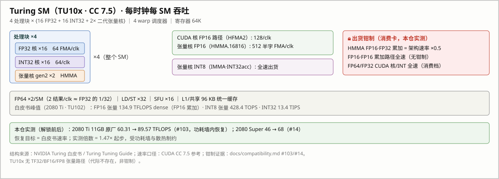
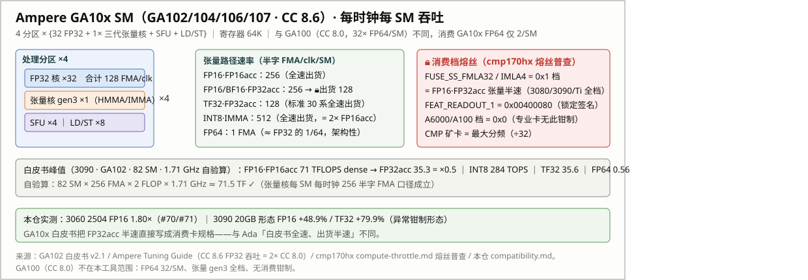
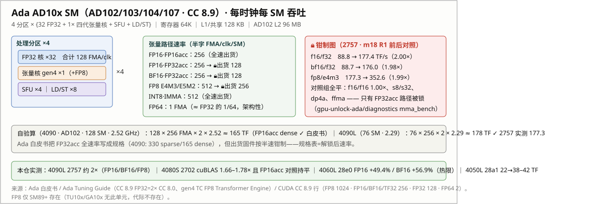

# 理论提升依据：SM 单元路由、代际架构与逐精度上限

> English version: [theoretical-uplift.en.md](theoretical-uplift.en.md)
>
> 本文回答三个问题：**锁到底锁了哪些执行单元**（机理）、**每个精度理论上限是多少**（架构推导）、**cli-stressor-cuda-rs 的每个精度档实际测的是什么**（工具映射）。所有数字给来源；推导可复算。

## 1. 口径声明

- **FLOP 计数**：一次乘加（FMA/MAC）计 2 FLOP；dense 一律不含稀疏（sparsity）加速比。这是社区通行的 [TechPowerUp]/白皮书口径。
- **速率单位**：半字 FMA/clk/SM（每时钟每 SM 的半精度乘加数）与 results/clk/SM（CUDA 编程指南口径）混用时逐处标注。
- **理论上限的定义**：解锁 = 恢复**白皮书速率**（出厂架构速率），不是超频。因此每档精度的理论上限 = 出厂速率 ÷ 出货钳制速率，钳制路径为 2×，未钳制路径为 1×。
- **实测区间来源**：[兼容性矩阵](compatibility.md)与本仓 evidence 目录；对照实验（解锁前后同机同驱动同功耗档）优先。
- **累加精度口径（2026-11-28，#306 勘误）**：白皮书的张量表把同一物理路径按累加精度分成两列，引用时必须同时写明输入精度**与累加精度**。按本仓实测，`with FP32 Accumulate` 列对应出货钳制后的半速值，`with FP16 Accumulate` 列是该路径的满速值：2757 的 FP16·FP32acc 88.8 → 177.4 TF/s（2.00×），而同机 FP16·FP16acc 177.3 → 177.7（1.00×）；桌面 4090 的外部复现同形（165.6 → 331.6 TF/s，见 §3.3）。

## 2. 锁的单元级机理：九路速率选择器

NVIDIA 在 `OPT_SM_SPEED_SELECT` 熔丝块为**每类算术单元**各留一路速率分频（cmp170hx 项目对 15 张 Ampere 卡 + 5 张 170HX 探针的熔丝普查，[compute-throttle.md](https://github.com/Consensus-Protocol/cmp170hx/blob/main/docs/unlock/compute-throttle.md)）：

| 熔丝 | 治理单元 | RTX 3080–3090 Ti（消费档） | A100/A6000（专业档） | CMP 170HX（矿卡） |
|---|---|---|---|---|
| `FUSE_SS_DP` | FP64 | 0（全速） | 0 | 1（÷2） |
| `FUSE_SS_FFMA` | FP32 FMA | 0（全速） | 0 | 5（÷32） |
| `FUSE_SS_FMLA16` | FP16 MLA | 0（全速） | 0 | 5（÷32） |
| `FUSE_SS_FMLA32` | FP32 MLA / FP16·FP32acc 张量 | **1（半速）** | 0 | 5（÷32） |
| `FUSE_SS_IMLA0–3` | 整数 MLA 0–3（含 DP4A） | 0（全速） | 0 | 5（÷32） |
| `FUSE_SS_IMLA4` | 整数 MLA 4 | **1（半速）** | 0 | 5（÷32） |

三个要点：

1. **消费游戏卡只有 `FMLA32`/`IMLA4` 两路在 0x1 档**——这就是社区熟知的「消费卡 FP16·FP32 累加张量半速」。FP32 CUDA 核、FP64、DP4A、FP16·FP16acc 路径在游戏卡上**出厂全速**；÷32 级钳制只存在于 CMP 矿卡。
2. 锁的解锁面是 `FEAT_OVR_PLM (0x00823804)` 门 + `SS0/SS1 (0x0082381c/0x823820)` 覆盖寄存器：PLM 从 `0xffffff8f`（仅 L3 可写）开到 `0xffffffff` 后，宿主写 `SS0=0x88888888, SS1=0x8`（ nibble = [覆盖使能 | 3 位速率 0=全速]）即可把九路全部拉回全速。写入落在 always-on 岛，FLR 后存活、断电即失——这就是本工具的事务本体。
3. **SS0/SS1 是逐 die 分箱值**，不同卡出厂覆盖值不同（cmp170hx 阵列里 13 张卡 13 个值），但**锁定状态的只读签名稳定**：RTX 30 系 `FEAT_READOUT_1 = 0x00400080`，解锁后归零。逐 die 差异意味着不同 SKU 的出厂钳制深度可以不同（见 §7 异常形态）。

**史前史注脚（熔丝普查之前的公开记录链）**：「按指令类型降发射率」在 cmp170hx 熔丝普查（2026-05）之前两年半就有行为学证据——2023-10-27 [FluidX3D issue #8](https://github.com/ProjectPhysX/FluidX3D/issues/8) 发现 `FP_CONTRACT OFF`（禁 FMA 收缩）让 170HX 恢复 ~16× FP32（内存受限负载 2,276 → 7,681 MLUPs/s，3.4×）；2023-12-06 jetcat8848 把同一技术带到 [dartraiden/NVIDIA-patcher issue #73](https://github.com/dartraiden/NVIDIA-patcher/issues/73)（170HX FP32 **0.395 → 6.285 TFLOPS，15.9×**），并提出「efuse 标记 FMA 速率 1/2^n（n=1..5）、驱动知道如何执行」的假设——即今日九路速率选择器模型的雏形。15.9× ≈ FFMA 全速恢复值（32×）的 ½：FMA 被钳 ÷32，非 FMA 的 mul/add 全速发射但每 2 FLOP 需两条指令——**钳制按指令类型选发射率、而非损伤 ALU 本体**的最早公开证据（cmp170hx history 把 #73 记为「最终通向寄存器级破解」的源头线程；注意其考据对 #73 的定性是「记录可靠、分析不可靠」；该技术后被 [arXiv 2505.03782](https://arxiv.org/pdf/2505.03782) 学术引用）。

Turing（20 系）走同族 FEAT 块（地址 `0x4096xx` 而非 `0x823xxx`，见本仓 [cold-values](cold-values.md)），语义相同：本仓 TU102/TU104 实测证明 20 系同样存在 FP16·FP32acc 半速出货（§4）。

## 3. 三代 SM 架构与单元路由

### 3.1 Turing（TU10x · CC 7.5 · GTX 16/RTX 20）

- 每 SM：4 处理块 × {16 FP32 + 16 INT32 + 2× 二代张量核}，FP64 ×2，4 warp 调度器（[Turing 白皮书](https://images.nvidia.com/aem-dam/en-zz/Solutions/design-visualization/technologies/turing-architecture/NVIDIA-Turing-Architecture-Whitepaper.pdf)、[Turing Tuning Guide](https://docs.nvidia.com/cuda/turing-tuning-guide/index.html)）。
- 每时钟每 SM：FP32 64 FMA；CUDA 核 FP16（HFMA2）128；张量 FP16（HMMA.16816）512 半字 FMA；INT32 64；FP64 2。
- 白皮书峰值（2080 Ti · TU102；参考版/Founders Edition）：FP16 张量 **107.6/113.8 TFLOPS dense（FP16 累加；215.2/227.7 sparse）** · FP16·FP32acc 53.8/56.9 · INT8 张量 215.2/227.7 TOPS · INT32 13.4/14.2 TIPS。
- 代际不存在 TF32/BF16/FP8 张量路径（非钳制，是硬件没有）。
- **出货钳制（本仓实测）**：HMMA FP16·FP32acc 半速。2080 Ti 11GB 原厂 60.31 TFLOPS（≈ 白皮书 FP32acc 56.9，频率差 +6%），解锁后 89.57（= 白皮书 FP16acc 113.8 的 79%，功耗墙内，[#103](https://github.com/physicsdolphin/nv-uefi-unlocker/issues/103)）；2080 Super 46 → 68（[#14](https://github.com/physicsdolphin/nv-uefi-unlocker/issues/14)）——两例的出厂值都贴白皮书 FP32acc 列，解锁后向 FP16acc 列靠拢，差额由功耗墙解释。

### 3.2 Ampere 消费（GA10x · CC 8.6 · RTX 30）

- 每 SM：4 分区 × {32 FP32 + 1× 三代张量核}，FP64 ×2（[GA102 白皮书](https://www.nvidia.com/content/PDF/nvidia-ampere-ga-102-gpu-architecture-whitepaper-v2.1.pdf)、[Ampere Tuning Guide](https://docs.nvidia.com/cuda/ampere-tuning-guide/index.html)：CC 8.6 的 FP32 吞吐是 CC 8.0 的 2×/SM）。
- 每时钟每 SM（results/clk/SM，result=FMA）：FP32 128；张量 FP16·FP16acc 512 · FP16/BF16·FP32acc 256（出货值；解锁后 512）· TF32 128（出货值；解锁后 256）· INT8 IMMA 1024；FP64 2 FMA（≈FP32 的 1/64，**架构性**，消费/专业同）。
- 自验算（3090 · 82 SM · 1.695 GHz）：82 × 512 × 2 × 1.695 ≈ 142 TF ✓ = 白皮书 FP16acc 142 dense（同一张表的 FP32acc 列 71 = ×0.5，**白皮书直接写明消费减半**）；INT8 284 TOPS = 2× FP16acc（全速）；TF32 35.6 = 架构 256/clk（2×FP32）的出货半速（30 系标准卡同样出厂钳制，#194 实测 3070 Ti 17.0→37.5 解锁翻倍）；FP64 0.56。
- 熔丝签名：`FEAT_READOUT_1 = 0x00400080`。

### 3.3 Ada（AD10x · CC 8.9 · RTX 40）

- SM 结构与 GA10x 同构（128 FP32 + 4× 四代张量核 + FP64 ×2），新增 FP8（E4M3/E5M2）张量路径（[Ada 白皮书](https://images.nvidia.com/aem-dam/Solutions/geforce/ada/nvidia-ada-gpu-architecture.pdf)、[Ada Tuning Guide](https://docs.nvidia.com/cuda/ada-tuning-guide/index.html)）。
- CUDA 指南 CC 8.9 原生行（CUDA 核，results/clk/SM）：FP16 256 · FP32 128 · FP64 2；张量侧按 [Ada 白皮书 V2.02](https://images.nvidia.com/aem-dam/Solutions/Data-Center/l4/nvidia-ada-gpu-architecture-whitepaper-V2.02.pdf) Appendix A Table 2（pp. 29–31，4090 · 128 SM · 2.52 GHz）折算：FP16·FP16acc 512 · FP16/BF16·FP32acc 256（出货值；解锁后 512）· TF32 128（出货值；解锁后 256）· FP8 1024/512（FP16acc/FP32acc）· INT8 1024。
- 自验算（4090 · AD102 · 128 SM · 2.52 GHz）：128 × 256 × 2 × 2.52 ≈ 165 TF = 白皮书 **FP16·FP32acc** dense（165.2/330.4 sparse；出货钳制值），同一张表的 **FP16·FP16acc** 为 330.3 dense（512/clk）——后者出厂即满速，也是解锁后 FP32acc 路径实测回到的速率（外部 8×4090 复现 165.6 → 331.6 TF/s，Harry Chen 2026-11-17）。4090 Laptop（AD103M · 76 SM · 2.29 GHz）自验算 76 × 256 × 2 × 2.29 ≈ 178 TF = 解锁后 FP16·FP32acc 实测 177.4 TF/s（逐位）；同机 FP16·FP16acc 对照 177.3 → 177.7（1.00×，出厂即满速）——**锁只打在 FP32acc 路径，本仓默认的 `mma_bench f16/f32` 走的正是这条路**（[evidence/uefi-2757-m18r1](evidence/uefi-2757-m18r1/report.md)）。
- **出货钳制图（2757 前后对照，同机同驱动同功耗档，mma_bench 20000 iters × 5 reps）**：

| 路径 | 出厂 | 解锁后 | 倍数 | 结论 |
|---|---:|---:|---:|---|
| FP16·FP32acc | 88.8 TF/s | 177.4 | **2.00×** | 钳制 ×0.5 → 恢复 |
| BF16·FP32acc | 88.7 | 176.0 | **1.98×** | 同上 |
| FP8 E4M3 | 177.3 | 352.6 | **1.99×** | 钳制 ×0.5 → 恢复 |
| FP16·FP16acc（对照） | 177.3 | 177.7 | 1.00× | **从未被锁** |
| INT8 IMMA（对照） | — | — | 1.00× | 从未被锁 |
| DP4A / FFMA（对照） | — | — | 1.00× | 从未被锁 |

这张表是全文的锚：**钳制精确到「张量路径 × 累加模式」，CUDA 核与整数张量路径完全无关。**

桌面侧（2684 · 三份独立 cuBLAS 数据：[#69](https://github.com/physicsdolphin/nv-uefi-unlocker/issues/69) 两位报告者 + [#80](https://github.com/physicsdolphin/nv-uefi-unlocker/issues/80)）补齐了 Ada 桌面的逐路径谱：**TF32 per-clock 243–247 → 477–493 FLOP/clk/SM（= 512 满速的 93–96%，+96~100%，三尺寸稳定）**——TF32·FP32acc 在 40 系标准桌面卡出厂即钳制 ×0.5（30 系同锁：2026-11-06 由 #194 与本机 3080 12 GB 35→69 实测推翻旧「30 系全速」判断，「逐代差异」不成立）。据此修正白皮书语义：Ada 白皮书 TF32 82.6 是**出货钳制值**而非架构速率（#80 定频实测 243–247 results/clk/SM ≈ 256/clk 的架构值，见 §6），GeForce「TF32 = FP32 速率」的著名怪象即这把锁的可见形态。FP16/BF16·FP32acc 的 cuBLAS 行为受框架路由支配（见 §5、§7），裸管线在 2684 上尚未被直接测过。

### 3.4 同代笔记本与台式同构

2757（4090 Laptop）、28e0（4060 Laptop：FP16 +49.4% / BF16 +56.9%，热限，[#119](https://github.com/physicsdolphin/nv-uefi-unlocker/issues/119)）、28a1（4050 Laptop：22 → 38–42 TF）、2702（4080 SUPER：cuBLAS 1.66–1.78× 且 **FP16acc 对照组持平**）——移动端与台式同一套钳制模型，增益差异由功耗墙与散热解释。

### 3.5 Maxwell / Pascal（9/10 系）与移动工作站：无锁参考

9 系（Maxwell，GM10x/GM20x）与 10 系（Pascal，GP10x）每 SM 128 FP32 通道，均无张量核：TF32/BF16/FP8 不存在，FP16 走 FP32 CUDA 核，原生速率 1/64（CUDA guide cc 5.x/6.1 的 2 ops/clk/SM 对 FP32 的 128），框架实际转 FP32 执行——图里 FP16 直接取 FP32 值标示模拟路径（P100 的 GP100 cc 6.0 原生 2× 是唯一例外）。本工具不支持这两代，故全部按出厂参考行列出；移动工作站（Quadro M/P/T/RTX、RTX A、RTX Ada-MW、Blackwell-MW 的 Mobile 部件）与桌面专业卡同为不钳制的架构全速，作参考行。

## 4. 简单分类 × 精确分类总表

简单分类按社区通行口径（TechPowerUp/白皮书/主流基准）；精确分类到指令级。

| 简单分类 | 精确分类（指令/路径） | 执行单元 | 出货锁（20–40 系游戏卡） | 理论上限 | 本仓实测 |
|---|---|---|---|---|---|
| **FP8**（E4M3/E5M2） | gen4 TC FP8 MMA（HMMA/QGMM 类，FP32acc） | 四代张量核（仅 SM89+） | **×0.5** | **2×** | 1.99×（2757）；1.9×（banner 口径） |
| **INT8** | IMMA.S8.S32（张量）；DP4A.S8.S32（CUDA 核） | 二至四代张量核；INT 路径 | 无 | 1× | 1.00×（s8/s32、dp4a 对照全平） |
| **FP16** | HMMA.16816.F32（FP32acc，cuBLAS 默认 hgemm）；HMMA.16816.F16（FP16acc）；HFMA2（CUDA 核半字） | 二至四代张量核 | **FP32acc ×0.5**；FP16acc 无 | 2×（仅 FP32acc 路径） | 1.47–2.0×（#14/#103/2504/2702/2757） |
| **BF16** | HMMA BF16·FP32acc | 三/四代张量核（SM80+） | **×0.5**（移动端与桌面裸管线实测；2684 的 cuBLAS 行停在出货半速且解锁无感，属路由/逐 die 未判——见 §8） | 2× | 1.98×（2757）；1.57×（28e0 热限）；**1.00×（2684 cuBLAS 双态一致）** |
| **INT16** | 标量 INT MAD（无张量路径） | INT32 CUDA 核 | 无 | 1× | — |
| **TF32** | HMMA TF32（19-bit，FP32acc） | 三/四代张量核（SM80+） | **30/40 系标准卡 ×0.5（40 系 2026-11 #69/#80；30 系 2026-11-06 #194 + 本机 3080 12G）**；异常形态有 | 2× | +79.9%（3090 20GB 异常形态）；**1.96×（2684 定频，#80）+ per-clock 翻倍（#69）**；2.20×（3070 Ti #194）；约 2×（3080 12G 35→69） |
| **FP32** | FFMA / FMLA32 | FP32 CUDA 核 | 无（**CMP 矿卡 ÷32 才有**） | 1×（CMP 32×） | — |
| **INT32** | 标量 INT32 MAD（TIPS 口径） | INT32 CUDA 核 | 无 | 1× | — |
| **FP64** | DGEMM | FP64 专用核（2/SM） | 无 | 1×（吞吐架构性 = FP32 的 1/32（TU10x）或 1/64（GA10x/AD10x）） | — |

## 5. cli-stressor-cuda-rs 精度映射（nvoc 侧工具对账）

| stressor 精度档 | kernel 路径 | cuBLAS/compute 配置 | 实际执行的单元 | 归入简单分类 | 归入精确分类 | 解锁敏感度 |
|---|---|---|---|---|---|---|
| `FP64` | Gemm | `CUBLAS_COMPUTE_64F` | FP64 专用核 | FP64 | DGEMM | 无感 |
| `FP32` | Gemm | `COMPUTE_32F`（TF32 math mode 显式关闭） | FP32 CUDA 核 | FP32 | FFMA（FMA=2 FLOP） | 无感（仅 CMP 敏感） |
| `TF32` | Gemm | `COMPUTE_32F` + `CUBLAS_TF32_TENSOR_OP_MATH` | 三/四代张量核 | TF32 | HMMA TF32·FP32acc | 卡型相关（逐 die） |
| `FP16` | Gemm | A/B/C = `CUDA_R_16F` + `COMPUTE_32F`（cudarc 硬编码） | 二至四代张量核 | FP16 | **HMMA·FP16in/FP32acc——正是被锁路径** | **~2×，主力增益档** |
| `BF16` | Gemm | `CUDA_R_16BF` + `COMPUTE_32F`；设备门 SM80+ | 三/四代张量核 | BF16 | HMMA BF16·FP32acc | **~2×** |
| `FP8E4M3FN` | **Gemm 不支持**（显式报错）；Memcpy/Memset 等按 1 B/元素走内存路径 | — | 内存子系统（非张量核） | FP8（仅名义） | stressor 里**不测** FP8 张量核 | 张量 FP8 请用 mma_bench 类张量基准 |
| `INT8` | Gemm | `CUDA_R_8I × CUDA_R_8I → CUDA_R_32I`、`COMPUTE_32I` + `DEFAULT_TENSOR_OP`（尺寸对齐 16；SM75+ 自动 IMMA） | 张量核 INT8 | INT8 | IMMA·INT32acc | 无感（全速出货） |
| `INT16` / `INT32` | **仅 IntAlu**（无 cuBLAS 路径） | NVRTC 内核：int32 MAD ×32 链 + narrowing；SM61+ 加 `__dp4a` | INT32 CUDA 核 | INT16/INT32 | INT MAD / DP4A | 无感 |

三个容易踩的对账点：

- **stressor 的 `FP16` 档 = FP16·FP32acc**（COMPUTE_32F 累加），所以它测到的就是被锁的那条路；社区对照实验里的「FP16acc 组」是另一条路（COMPUTE_32F_FAST_16F 类配置），从未被锁——2702 报告的「cuBLAS 1.75× 且 FP16acc 对照持平」正是这两条路的分野。
- **stressor 的 `FP8E4M3FN` 档不是张量基准**（GEMM 路径显式不支持 FP8，落内存路径）；banner 的「FP8 ~1.9×」来自 mma_bench 类张量测量（2757 报告 1.9887×），两者不可混用。
- **PyTorch/cuBLAS 是另一类 instrument，测的可能不是被锁路径本身**：cuBLAS 13（torch 2.10+/cu130）的 COMPUTE_32F FP16/BF16 GEMM 行在 2684 上三份独立数据（#69 两位报告者 + #80）都 ≈ **FP8 行 ÷ 2**，stock 与 unlocked 双态成立（#80：94.5/118.6 vs 95.5/119；#69：448–490/560 vs 481/586）——即该行被路由到 FP8 吞吐结构而非被锁的 HMMA·F32 原生路径，框架侧 FP16/BF16 前后对照不是钳制对照。此路由未见于 cuBLAS 文档（文档化仿真仅 BF16x9-FP32 限 CC 10.x、FP64 固定点仿真另测），机制待 cuBLASLt log 取 dispatch kernel 名确认；直测管线用 mma_bench 类裸指令基准。

## 6. 理论上限推导与自验算

公式：`峰值 = SM 数 × 每 SM 每 clock FMA 数 × 2（FLOP/FMA） × boost clock`（dense）。

| 卡 | 精度·路径 | 推导 | 结果 | 白皮书/实测对账 |
|---|---|---|---|---|
| 3090（GA102 · 82 SM · 1.695 GHz） | FP16·FP16acc 张量 | 82×512×2×1.695 GHz | ≈142 TF | 白皮书 142 ✓（出厂满速） |
| 3090 | FP16·FP32acc | 同式，256/clk（出货半速） | ≈71 TF | 白皮书 71 ✓ |
| 3090 | INT8 IMMA | 82×1024 ops×2×1.695 | ≈284 TOPS | 白皮书 284 ✓ |
| 4090（AD102 · 128 SM · 2.52 GHz） | FP16·FP16acc 张量 | 128×512×2×2.52 | ≈330 TF | 白皮书 330.3 ✓（出厂满速；对照） |
| 4090 | FP16·FP32acc 张量 | 128×256×2×2.52 | ≈165 TF | 白皮书 165.2 ✓（出货钳制值；解锁后 → ≈330） |
| 4090 | TF32·FP32acc | 架构 256/clk（128×256×2×2.52 = 165）；出货 128/clk | 165 / 82.6 | 白皮书 82.6 = 出货钳制值；#80 定频 A/B 47.9→93.8 TF @1.5 GHz（243→489 FLOP/clk/SM，97%→95%）✓ |
| 4090L 2757（AD103M · 76 SM · 2.29 GHz） | FP16·FP32acc（解锁后） | 76×256×2×2.29 | ≈178 TF | 实测 177.4 ✓（逐位）；同机 FP16·FP16acc 对照 177.3→177.7（1.00×） |
| 4080 SUPER 2702（AD103 桌面，seti9585 mma_bench，#80） | FP16·FP32acc 两模式 | 256/clk 出货；f16/f16 对照 203 TF | ≈101 TF | 锁定 101.0 / 解锁 202.7 ✓（**2.01×**，f16/f16 1.00× 对照平） |
| 2080 Ti（TU102 · 68 SM） | FP16·FP16acc 张量 | 白皮书（FE） | 113.8 TF | 出厂 60.31 ≈ 白皮书 FP32acc 56.9（+6% 频率差）；解锁 89.57 = 113.8 的 79%（功耗墙内）✓ 模型 |

**每档理论上限**：被钳制路径（FP16/BF16/TF32·acc、FP8）= **2×**（半速→全速）；未钳制路径（FP16acc、INT8、INT16/32、FP32、FP64、DP4A）= **1×**。CMP 矿卡的 FFMA/FMLA16/FMLA32/IMLA0–4 全路 ÷32，理论上限 32×（170HX 实测 FP32 0.395 → 12.7–12.9 TFLOPS）。

## 7. 为什么实际增益经常小于 2×：四堵墙

1. **功耗墙**：半速钳制解除后 SM 翻倍翻转，撞功耗墙时频率回落。典型：3090 20GB 形态 FP16 +48.9%（[#29](https://github.com/physicsdolphin/nv-uefi-unlocker/issues/29)）、4060L 热限 +49.4%（#119）、2080 Ti 恢复到 89.57 而非 113.8（#103）。同频归一化后增益普遍贴近 2×（2702 双独立点 1.75×/1.78×/1.66× + 频率分析）。**这堵墙最干净的一次现场量化**（#54，AD102 4090 + 850 W 直供，`nvidia-smi -lgc` 定频）：锁定态 → 解锁态的增益随时钟单调收窄——1005 MHz +55%（60 W→160 W）、1800 MHz +23%、2100 MHz +18%、自由加速 +15%（撞 450 W）；低精度把墙推远，同一张卡同一解锁 FP8 `torch._scaled_mm` 532.1 TF/s ≈ 官方 FP8 的 160%、INT8 593.2 TOP/s ≈ 180%。即 2× 是"功率免费时"的上限，不是任何时钟都能兑现；日常推理若不受张量速率限（该机 2100 与 2595 MHz 端到端同秒数），解锁收益只在 compute-bound 负载上体现。
2. **显存带宽绑定**：LLM decode 每 token 读全量权重，算力翻倍换不来带宽 → decode +5.5% vs prefill +16~19%（132K 上下文两组区间零重叠，2702 双卡 MoE 实测）。图像/视频生成 +14–75%、DirectML +94% 属于混合谱（算力档占比不同的算子集合），处于两堵墙之间。
3. **逐 die 分箱**：SS0/SS1 出厂覆盖值逐 die 不同，个别形态（屏蔽修复卡、OEM 改动形态）钳制更深或路径更多（3090 20GB 的 TF32 +79.9% 即此类），逐卡以 `FEAT_READOUT_1` 与实测为准。
4. **栈/库路由与实现率**：框架端到端测的可能不是被锁路径本身——cuBLAS 13 的 COMPUTE_32F FP16/BF16 行 ≈ FP8 行 ÷2（§5 第三条），stock 基线已在全速类，PyTorch 用户感知的 FP16/BF16 增益仅 1.0–1.3×（2684：除 TF32 1.96× 外全表 1.00–1.33×），而裸管线口径是 2.00×（2757 mma_bench）。banner 的 ~2×/FP8 ~1.9× 是 mma_bench/stressor 口径，框架用户感知可以显著更低——2702 的 cuBLAS 1.66–1.78× 与 2684 的 1.1–1.45× 离散亦属此墙（栈版本/die 待判）。另：解锁后 F32acc 半精度行 realized 60–76% 且随 N 爬升（非硬 cap：破自身类天花板 115–134%、同累加模式的 TF32 到满反例），未达 fp16acc parity（#69 定频缺口 1.39×）的成因三选一（kernel 实现率 / 管线属性 / 路由），判别见 §8。**外部实证（2026-11-17，Harry Chen，8×RTX 4090）**：kernel 实现率分支已在他机坐实为主因——NCU 对照显示解锁后 cuBLASLt 默认仍按出厂半速模型选小 tile kernel（`128x64`，SM 利用率 56%、显存带宽已 87%），库内最优大 tile（`128x128`）达 287 TF/s ≈ 指令级峰值 331.6 的 87%；启发式为完全静态 LUT（锁频不变、LD_PRELOAD 伪装 6000 Ada 无效、`CUBLASLT_HEURISTICS_LUT_FILE` 死路径、kernel 集只按 CC 划分）。按形状遍历候选实测择优（autotune）可回收 FP8 1.17–1.93×、非对称大矩阵 FP16/BF16 1.3–1.64×，超大 K 需 CUTLASS swizzle（+24–128%）；方法与各精度推荐配置见 [unlocked-ada-gemm](https://github.com/Harry-Chen/unlocked-ada-gemm) 与[原始博客](https://harrychen.xyz/2026/11/17/unlocked-rtx-4090-gemm-perf/)。
5. **端到端/微基准比值双向**（2026-11-03 补，两例闭环）：Amdahl 占比决定方向。下界形态——3060 `2504`/X99 端到端 1.43× < 张量 1.79×，报告者 Amdahl 反解 ~68% 采样耗时在 matmul/attention（[D#131](https://github.com/physicsdolphin/nv-uefi-unlocker/discussions/131)）；上界形态——4070 Ti SUPER 真实 3D 生成管线端到端 **2.0–2.2×** > BF16 微基准 1.69×，解锁缩短小算子依赖链+GPU 空闲占比缩小（[D#143](https://github.com/physicsdolphin/nv-uefi-unlocker/discussions/143)）。报告端到端数字时标注占比方向，避免"微基准没翻倍"或"端到端超过 2×"的双向误读。

## 8. 开放项（如实记录）

- Turing 的 FP16·FP16acc 对照组实验尚未做（模型预测：全速、无感）；Turing INT8 张量对照同样未测。
- ~~Ada/GA10x 的 TF32 全速出货判断……标准卡 TF32 前后对照仍缺~~ → **已回答（2026-11-02，#69/#80）：40 系标准桌面卡 TF32 出厂钳制 ×0.5**（2684 定频 1.96×、per-clock 243→489 三尺寸稳定）；**“GA10x 全速”已于 2026-11-06 被推翻**：#194 的 3070 Ti 17.0→37.5（2.20×）与本机 3080 12 GB 约 35→69 证明 30 系同一把锁，逐代差异不成立，§4/§6 已改按钳制记。
- **2684 桌面 BF16·FP32acc 在 cuBLAS 口径下停在出货 FP32acc 速率且解锁无感**（#80：506–507 FLOP/clk/SM ≈ 256 FMA/clk/SM = 白皮书 FP32acc 列的 99%，双态一致；注意这是 cuBLAS 行，受 §5 第三条的框架路由支配，不能当作裸管线证据）与 2757/2702 裸管线的 2× 冲突——判别 = 2684 跑 mma_bench：若裸管线也停在半速则该 die 属于逐 die/SKU 形态，若翻倍则坐实 cuBLAS 路由。**补充（2026-11-06，#80 内 seti9585）：桌面 AD103 `2702` 的 mma_bench 已做**——`bf16/f32` 101.0→**202.7（2.01×）**、`f16/f32` 2.01×、`f16/f16` 对照 1.00×，双态 ssdiag 验证：**裸管线 2× 在桌面 Ada 成立**，与 2757 一致；2684 自身的 mma_bench 仍待跑。
- **cuBLAS COMPUTE_32F FP16/BF16 行的 FP8 路由机制未文档化**（§5 第三条）——判别 = cuBLASLt log 看 dispatch kernel 名；若证实，README/FAQ 需加「框架口径 vs 裸管线口径」注。
- **解锁后 F32acc 半精度行 realized 60–76% 未达 fp16acc parity**（N 正相关、无硬 cap）的成因（kernel 实现率/管线属性/路由）——判别 = 2684 mma_bench N-sweep（2757 裸管线已证 parity）。**外部旁证（2026-11-17，unlocked-ada-gemm）**：4090 上以 NCU 坐实 kernel 选择是主因之一（默认 56% vs 库内最优 85% SM 利用率）；本仓 2684 N-sweep 仍待跑，以完成本仓口径闭环。
- Turing 熔丝级普查（cmp170hx 同等粒度）未做，Turing 侧结论以 FEAT_READOUT 与实测为锚。

## 9. 来源

- 熔丝/单元映射与 0x1 档：[cmp170hx compute-throttle.md](https://github.com/Consensus-Protocol/cmp170hx/blob/main/docs/unlock/compute-throttle.md)（15 卡熔丝普查）
- 熔丝普查前的行为学记录链：[FluidX3D issue #8](https://github.com/ProjectPhysX/FluidX3D/issues/8)（2023-10-27，FMA 禁用原始发现）、[dartraiden/NVIDIA-patcher issue #73](https://github.com/dartraiden/NVIDIA-patcher/issues/73)（2023-12-06，jetcat8848 的 15.9× 与 efuse 1/2^n 假设；cmp170hx 记为通向寄存器级破解的源头线程）、[arXiv 2505.03782](https://arxiv.org/pdf/2505.03782)（学术引用）
- Turing：[Turing 白皮书](https://images.nvidia.com/aem-dam/en-zz/Solutions/design-visualization/technologies/turing-architecture/NVIDIA-Turing-Architecture-Whitepaper.pdf)（Appendix A 规格表：2080 Ti 参考版/Founders Edition 113.8/56.9/227.7 TFLOPS·TOPS，FP16acc/FP32acc/INT8）、[Turing Tuning Guide](https://docs.nvidia.com/cuda/turing-tuning-guide/index.html)
- GA10x：[GA102 白皮书 v2.1](https://www.nvidia.com/content/PDF/nvidia-ampere-ga-102-gpu-architecture-whitepaper-v2.1.pdf)（Appendix A 3090 表：142/71/35.6 TFLOPS 与 284 TOPS，FP16acc/FP32acc/TF32/INT8）、[Ampere Tuning Guide](https://docs.nvidia.com/cuda/ampere-tuning-guide/index.html)
- Ada：[Ada 白皮书 V2.02](https://images.nvidia.com/aem-dam/Solutions/Data-Center/l4/nvidia-ada-gpu-architecture-whitepaper-V2.02.pdf)（Appendix A Table 2，pp. 29–31：FP16·FP16acc 330.3 / FP16·FP32acc 165.2 / BF16·FP32acc 165.2 / TF32 82.6 / FP8 660.6/330.3 / INT8 660.6，dense）、[Ada Tuning Guide](https://docs.nvidia.com/cuda/ada-tuning-guide/index.html)、CUDA C++ Programming Guide CC 8.9 原生行（[FP16 256/FP32 128/FP64 2 results/clk/SM](https://docs.nvidia.com/cuda/cuda-c-programming-guide/index.html)）
- 解锁后软件栈适配（kernel 启发式按出厂半速校准与 autotune 方法）：[Harry-Chen/unlocked-ada-gemm](https://github.com/Harry-Chen/unlocked-ada-gemm) 与[配套博客](https://harrychen.xyz/2026/11/17/unlocked-rtx-4090-gemm-perf/)（2026-11-17，8×4090 实测）
- 逐路径钳制的决定性对照：本仓 [evidence/uefi-2757-m18r1](evidence/uefi-2757-m18r1/report.md)（mma_bench，gpu-unlock-ada/diagnostics）
- 逐卡实测：[兼容性矩阵](compatibility.md)（#14/#29/#70/#71/#103/#119、2702/2757 报告）
- 40 系桌面逐精度 A/B 与 cuBLAS 路由发现：[#69](https://github.com/physicsdolphin/nv-uefi-unlocker/issues/69)（钉频 A/B + per-clock 谱，两位报告者）、[#80](https://github.com/physicsdolphin/nv-uefi-unlocker/issues/80)（定频逐精度 cuBLAS 谱）
- stressor 工具事实：nvoc `cli-stressor-cuda-rs` 源码（`PrecisionKind`、`gemm.rs`、`int_alu.rs`、`mem_ops.rs`）与 cudarc 0.19 `cublas::safe::gemm`（compute type 映射）
